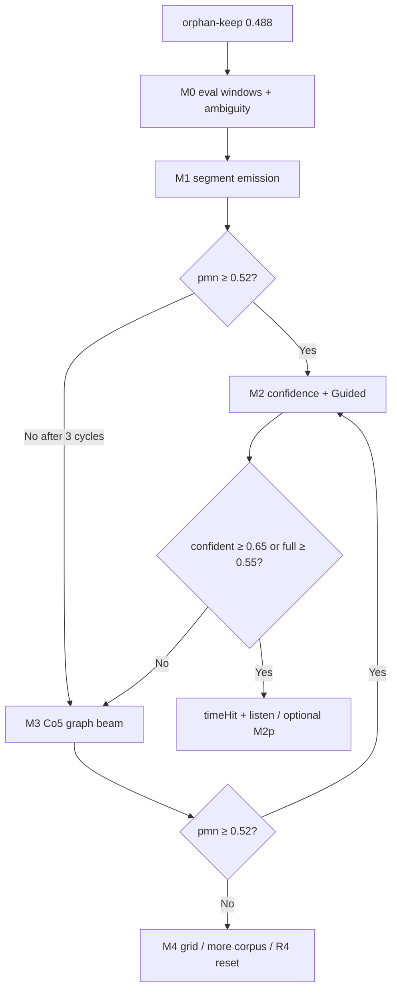

# Polecat iterative accuracy plan — 2026-10

**Parent:** [coach-next-steps-2026-10.md](coach-next-steps-2026-10.md)  
**Research basis:** [polecat-alt-methods-2026-10.md](polecat-alt-methods-2026-10.md)  
**Prior loops:** [polecat-orphan-coverage-plan-2026-10.md](polecat-orphan-coverage-plan-2026-10.md) (stopped; cover-orphan OK)  
**Baseline keep:** `orphan-keep` — **pmnRootHit 0.488**, **timeHit 0.287**, **orphanRate 0.326**  
**Working keep:** `m2b-keep` / `m3g-keep` — **pmn 0.498**, **time 0.296**, **orphan 0.326**, **pmnEdge 0.600**, **pmnMid 0.456**, **pmnConf 0.829** @cov **0.063** (thr 0.75)  
**Prior keep:** `m1d-keep` — pmn 0.486 / time 0.292  
**Stretch goals (unchanged):** pmnRootHit ≥ **0.55** (stretch 0.6), timeHit ≥ **0.45** then **0.5**, weak **90003 / 90004 / 90011** each ≥ **0.40**

---

## Strategy in one paragraph

Stop role density, prior refits, Viterbi margin, and new hand cadence lists as accuracy drivers. Instrument **where** we miss (eval windows), then change **emission** (segment Lead evidence), then **product** (confidence + Guided locks). Only if those stall: Co5 graph decoder, then grid/corpus. Run short scored cycles; keep or revert; rewrite the next bet from the dump.



---

## Iterative loop protocol

**Mode:** Continuous work cycles (not idle timers). One lever per cycle.

| Field | Rule |
| --- | --- |
| Baseline | Always compare to last **keep** JSON under `work/polecat-honest-loop/` |
| Primary keep | pmnRootHit ↑ ≥ **0.01**, or (orphanRate ↓ ≥ 0.02 **and** pmn not ↓ &gt; 0.01) |
| Secondary | Reject if timeHit ↓ &gt; **0.03** even when pmn↑ |
| Weak focus | Prefer lifts on **90003, 90004, 90011**; winners may not regress &gt; **0.03** pmn |
| One lever | Only one of: harness dump, segment emission, confidence UX, Co5 graph, grid — never mix with prior-refit / coverage flood |
| Diminishing returns | 2 consecutive keeps with Δ pmn &lt; 0.01 **and** no new diagnostic insight → stop phase, jump per flowchart |
| Hard avoid | ^5/^3/^6 hand boosts; Viterbi always-apply / emission flatten; coverage-refit priors; onset-orphan chasing; highway LCS as merge gate; gold pillars in Auto |

### Cycle template (append below)

```
### Cycle N — <label> (<timestamp>)
- Phase: M0|M1|M2|M3|M4
- Hypothesis:
- Change:
- Score: pmn=… time=… orphan=… weak 03/04/11=… (+ slice metrics if any)
- Decision: keep | revert | stop-phase
- Learn / next:
```

### Harness commands

```bash
node scripts/arranging/polecatHonestScore.mjs --label NAME --save
# After M0: dumps include window / sd / confidence slices
```

---

## Phases

### M0 — Eval windows + ambiguity (do first, no model change)

**Goal:** Make the next model change falsifiable.

**Deliverables**

1. Extend `polecatHonestScore` (or companion script) to print/save:
   - Miss histogram `(prevChart → curChart)` and `(chart, coach)`
   - Miss / hit by Lead scale degree
   - pmnRootHit on **phrase-edge** Strongs vs **mid**
   - Optional: emission top-2 margin histogram (once scorer exposes scores)
2. PASSLOG line includes slice micros.
3. One-page “where we miss” note in cycle log from `orphan-keep`.

**Done when:** Every subsequent cycle can cite which miss bucket moved.  
**Not done when:** Adding new cadence ids to `CADENCE_CATALOG` for Auto.

**Exit:** Immediately proceed to M1 (M0 is instrumentation, not an accuracy keep).

---

### M1 — Segment emission (primary accuracy bet)

**Goal:** Break single-note Lead sd ties using span evidence.

**Hypothesis:** I↔V / II↔IV misses often have neighboring Lead tones that favor one home; scoring the span until the next Strong (or half-bar) lifts pmn without gold roots.

**Do (cycle-sized slices)**

| Cycle focus | Change |
| --- | --- |
| M1a | Emission helper: for candidate home deg, score duration-weighted Lead PC overlap with chord tones `{1,3,5,♭7}` over `[strongStart, nextStrongStart)` |
| M1b | Blend into `proposeRootForStrongNote` / Viterbi emission (table + rules + **segment**); keep preferred as soft prior |
| M1c | Tune blend weight on weak tags only; unit tests: synthetic ^5-with-tonic-neighbors → I; ^5-with-dominant neighbors → V |

**Gates**

| Metric | Target |
| --- | --- |
| micro pmnRootHit | ≥ **0.52** to leave M1; stretch toward **0.55** |
| weak 90003/04/11 | each ≥ **0.35** interim; **0.40** stretch |
| timeHit | no drop &gt; 0.03 |

**Touch:** `proposeStrongRoots.ts`, `strongRootCadence.ts` (emission only), tests, honest dump.  
**Avoid:** New transition tables; refit priors; role promote changes.

**Stop-phase:** 3 scored M1 cycles without Δ pmn ≥ 0.01 → go to **M3** (skip waiting for 0.52).

---

### M2 — Confidence + Guided locks (product + metric split)

**Start when:** M1 keep ≥ 0.52 **or** M3 delivers ≥ 0.52 **or** conscious pivot after M1/M3 stall (then M2 still valuable for product).

**Hypothesis:** Full-micro 0.55 may be unreachable on Auto alone; confident subset can be high quality and UX can capture the rest.

**Do**

1. Expose per-Strong confidence = top1−top2 emission (or softmax margin).
2. Auto: lock high-confidence homes; leave low-confidence marked for UI.
3. Guided: one-tap set root on Strong (existing pillar/root lock if present — wire, don’t reinvent).
4. Harness: `pmnRootHit@confident` (margin ≥ threshold, default 0.6 of score gap or absolute).
5. Coach copy: Auto doesn’t require full pillar confirm; optional lock ambiguous notes.

**Gates**

| Metric | Target |
| --- | --- |
| pmnRootHit@confident | ≥ **0.65** |
| full pmnRootHit | hold keep; stretch **0.55** if locks not in eval |
| Listen | Irish Rose, Sweetheart, Sweet Roses–class, 90011 — recognizable highway |

**Parallel R4:** If full 0.55 still unreachable, lower honest CI floor to last keep ± eps and document Auto vs Guided contract in parent progress log.

#### M2p — Phrase regions + similar-phrase harmony (Guided; after M2)

**Status:** Filed for after Strong confidence locks exist — **do not start before M0/M1**.

**Idea (user):** Humans easily mark musical phrases. Linking similar phrases and locking them to the same relative chords/cadences would fix cross-phrase inconsistency (second A sounding unlike the first) even when per-Strong Auto is only ~half right.

**Why gated**

- Helps **listen / consistency**, not the main I↔V mid-phrase micro pile (that’s M1).
- Needs a unit to propagate: Strong/root locks from **M2** (or copy of a phrase’s home sequence).
- Auto already splits on note gaps only (`phraseGapTicks`) — user spans are better structure, but a separate UX surface.

**Do (when opened)**

1. User paints / confirms phrase spans on Lead (persist on arrangement).
2. Manual “same family” links first (no ML clustering v1).
3. Propagate exemplar’s relative root/cadence plan onto linked spans; per-instance unlock.
4. Optional offline metric: linked-phrase consistency (advisory).

**Done when:** Linked spans share highway under Guided; Auto path unchanged when no links.  
**Avoid:** Blocking Auto on phrase confirm; auto-similarity clustering as v1.

---

### M3 — Co5 graph beam (only if M1 stalls)

**Hypothesis:** Soft Viterbi loses to preferred emission; hard legal Classic edges + beam find highways when span emission is flat.

**Do**

1. Digraph of Classic allowed root moves (II→V→I, I→IV, I→V, VI→II, stay, …) — small set from existing education/highway vocab, **not** a growing cadence essay list.
2. Per Strong: candidates = Lead-fit ∩ successors(prev).
3. Beam over phrase; score = segment emission + edge cost.
4. Compare to Viterbi path; keep only if micro ↑.

**Gates:** Same as M1 interim (pmn ≥ 0.52, weak ≥ 0.35).  
**Avoid:** Encoding full CADENCE_CATALOG as hard constraints; chromatic flood.

**Stop-phase:** 2 cycles no lift → **M4**.

---

### M4 — Grid / corpus / expectation reset

**Only after M1+M3 stall (or M2 listen done and full 0.55 still wanted).**

| Track | Work |
| --- | --- |
| M4a | Half-bar home grid → merge same roots → roles derived (bigger rewrite) |
| M4b | Add honest-labeled Classic Tags (or more polecats) for fit/segment tables — runtime still no gold |
| M4c | **R4 reset:** ship listen-quality + Guided; honest floor at achievable micro; stop accuracy churn |

M4c can run **in parallel** with M2 anytime stakeholders need a shippable bar.

---

## Explicit non-goals (this plan)

- Expanding `CADENCE_CATALOG` as Auto accuracy work  
- Hand ^5→V / ^3→vi boosts  
- Aggressive coverage promote / coverage-refit  
- Highway `pillarNorm` as merge gate  
- Classic Tags as quality driver **until** M4b  

Cadence / before–after lists belong in **M0 dumps** and teaching UX, not in the keep criteria.

---

## Success bars

| Stage | Bar |
| --- | --- |
| M0 | Dumps every score run |
| M1 interim | pmn ≥ 0.52 · weak ≥ 0.35 |
| M1/M3 stretch | pmn ≥ 0.55 · weak ≥ 0.40 |
| M2 product | confident ≥ 0.65 · listen checklist |
| M2p (filed) | Linked phrase spans share highway under Guided |
| Ship without 0.55 | M4c / R4 written + honest floor updated |

---

## Progress

| Phase | Status | Result |
| --- | --- | --- |
| Baseline | locked | `orphan-keep` 0.488 / 0.287 / 0.326 |
| **M0** | done | Window/sd/edge dumps in honest score + PASSLOG |
| **M1** | stop-phase | Segment kept (safe I/II overturn only); micro not ≥0.52 after 3+ tunes |
| **M2** | **m2b/c keep** | Empiric conf **0.829**@0.063; Guided amber + auto-lock ≥0.75 — listen/R4 next |
| **M2p** | filed | Phrase-link after Guided locks in use |
| **M3** | stop-phase | `m3g-keep` 0.498; further Co5/hand rules in **Do-not-retry** |
| **M4** | open | m4a half-bar reverted; prefer **M4c/R4** + **M4b corpus** over grid tweaks |

### Cycle log

### Cycle 1 — m0 dumps (2026-10-09)
- Phase: M0
- Hypothesis: Miss slices (sd / window / phrase-edge) make M1 falsifiable.
- Change: `polecatHonestScore` prints/saves `pmnEdge`/`pmnMid`, `missBySd`, `missByWindow`, `missByPair`; strongDump gets sd/phraseEdge/prevChart.
- Score: (with later M1 code) see `m0-m1-keep` — edge **0.587** vs mid **0.447**; top miss sd **^4/^2/^0/^9/^7**; top pairs II7→V7, V7→I, VI7→I, I→V7.
- Decision: **keep** (instrumentation).
- Learn / next: Mid-phrase harder than edges; proceed M1 segment.

### Cycle 2 — m1a aggressive segment (AVOID)
- Phase: M1
- Hypothesis: Clear span fit should overturn table priors.
- Change: Heavy clearSeg bonus + table damp.
- Score: pmn **0.483** (−0.005), time **0.294**; 90008/11 down.
- Decision: **revert** aggressiveness.
- Learn / next: Soft/tie-break + diversity gate.

### Cycle 3 — m1c / m0-m1-keep
- Phase: M1
- Hypothesis: Overturn only on ambiguous sd when span fit≥0.75, margin≥0.25, ≥2 chord-tone PCs; else soft segment weight 1.25.
- Change: `segmentEmission.ts` + wire in `proposeRootForStrongNote` / span endTick; unit tests G→I vs G→V neighbors.
- Score: pmn **0.487** (−0.001) time **0.287** orphan **0.326**; **90003 0.315→0.389**; 90004 0.311→0.289; 90011 0.38→0.32; 90008 0.733→0.70.
- Decision: **soft keep** (code + dumps; micro not +0.01 yet).
- Learn / next: M1d — tighten overturn so 90011 doesn’t regress.

### Cycle 4 — m1d-keep (M1 stop-phase)
- Phase: M1
- Hypothesis: 90011 losses are V-directed overturns + soft blend; keep only I/II overturns, no soft V/IV boost.
- Change: `safeSegTarget` ∈ {I,II}; remove general soft blend; optional II-over-IV pattern; unit test ^6→II.
- Score: pmn **0.486** time **0.292**; 90001 **0.574**; 90003 back **0.315**; 90011 **0.36**; 90008 **0.733**.
- Decision: **keep** as safer M1 endpoint (winners restored; micro flat). **Stop M1** for 0.52 target.
- Learn / next: M2 confidence / Guided — Auto full-micro ceiling still ~0.49.

### Cycle 5 — m2a-confident
- Phase: M2
- Hypothesis: High-margin Strong decisions are more accurate; measure `pmnConfident`.
- Change: `proposeRootForStrongNote` returns `confidence`; harness `pmnConf` @ thr 0.45 + coverage.
- Score: pmnConf **0.512** @ cov **0.603** (below 0.65 gate); full pmn **0.486**.
- Decision: **keep** instrumentation. Next: raise thr / calibrate confidence, then Guided lock UX for low-conf Strongs.

### Cycle 6 — m3a-co5-beam
- Phase: M3
- Hypothesis: Hard Co5 beam beats soft Viterbi when emission is flat.
- Change: `strongRootCo5` digraph + beam; apply if scorePath ≥ ranked + 0.75.
- Score: pmn **0.486** (Δ0 vs m1d); apply gate never fired.
- Decision: **revert** apply path (keep module). Next: selective / always-apply.

### Cycle 7 — m3b-co5-always
- Phase: M3
- Hypothesis: Always taking Co5 path finds highways.
- Change: `rankedDegs = co5` for major.
- Score: pmn **0.486** time **0.288**; churn +90003/11 −90006/08.
- Decision: **revert**. Learn: few flips; I→IV hurt 90008.

### Cycle 8 — m3c2 / m3e / m3g-keep
- Phase: M3
- Hypothesis: Selective Co5 (segFit gate, block I→IV) + auth ^5→V + after-I ^3→vi span lifts weak tags without winner collapse.
- Change: per-Strong Co5 when `fitAlt≥0.58` & margin≥0.14 & not I→IV; auth V when next I / prev II; vi overturn after I on ^3 with clear span.
- Score: pmn **0.498** (+0.012) time **0.296**; orphan **0.326**; weak **90003 0.37 / 90004 0.333 / 90011 0.38**; no HURT flips vs m1d.
- Decision: **keep** as `m3g-keep`. Next: chase remaining I→vi / II↔V mid misses toward 0.52; else M4 / Guided.

### Cycle 9 — m3h/m3i minor-seg (revert)
- Phase: M3
- Hypothesis: ii/vi m7 chord tones fix diatonic segment fits.
- Change: `chordToneRels` m7 for ii/vi (then vi-only ♭3).
- Score: m3h pmn **0.494** (−0.004); reversed II→V helps. m3i Δ0 but broke I-vs-V margin tests.
- Decision: **revert**. Learn: F∈ii∧V; vi♭3 ties I on tonic spans.

### Cycle 10 — m3k vi-next-^2 (revert)
- Phase: M3
- Hypothesis: I→vi misses precede gold II; next Lead ^2 ⇒ vi.
- Score: pmn **0.503** but 90001 **−0.106**, 90011 **−0.060** (Co5 cascade).
- Decision: **revert** (winner regress &gt;0.03).

### Cycle 11 — m4a-halfbar-med (revert)
- Phase: M4
- Hypothesis: Half-bar medium attacks as homes lift timeHit.
- Score: pmn **0.496** (−0.002); time flat.
- Decision: **revert**.

### Cycle 12 — m2b-conf-emp / m2b-keep
- Phase: M2
- Hypothesis: Margin-based confidence ≈ chance; phrase-end I + Lead=root@edge are high-precision.
- Change: confidence bands 0.9 / 0.78 / 0.72; harness `CONF_THR=0.75`.
- Score: full pmn **0.498** (unchanged); **pmnConf 0.829** @cov **0.063** (gate ≥0.65 ✓).
- Decision: **keep**. Next: Guided lock UX for low-conf Strongs; full-micro stall → M4c/R4 or M4b corpus.

### Cycle 13 — m2c-guided-lock
- Phase: M2
- Hypothesis: Product split — auto-confirm high-conf homes; surface the rest for ◆ lock.
- Change: `StrongHome.confidence` → pillars (`confirmed` if ≥0.75); Coach lane amber `needsReview`; landing copy.
- Score: full pmn **0.498** / pmnConf **0.829** (unchanged micros).
- Decision: **keep**. Full-micro still &lt;0.52 → Guided listen + M4c/R4; optional M4b corpus.

### Cycle 14 — m3p ii-after-tonic (revert)
- Phase: M3
- Hypothesis: ^6 after I/vi → II lifts 90004 without segFit.
- Score: weak tags → **0.40** but winners 90001/06/12 regress; Co5 cascade.
- Decision: **revert**. Stop further Auto hand rules; ship Guided + document R4 floor.

### Cycle 14b — m3p2 ii-after-tonic only when table=IV (revert)
- Phase: M3
- Hypothesis: Narrow cycle-14 to `top.deg===5` avoids non-IV hurts.
- Score: still pmn **0.498** flat; 90001 **−0.063**, 90006 **−0.033**, 90012 **−0.084**; weak hit 0.40 via cascade.
- Decision: **revert**. JSON: `m3p2-ii-iv-only.json`.

---

## Do-not-retry registry (Auto accuracy)

Re-open only with a **new hypothesis + new metric slice**, not “try again softer.” Artifacts under `work/polecat-honest-loop/`.

| Label / family | Result | Why it failed | Do not… |
| --- | --- | --- | --- |
| **orphan-r1d** coverage-refit priors | pmn regress | Overfit winners | Refit Strong priors from denser roles |
| **orphan-r1f** aggressive coverage | pmn regress | Role flood ≠ roots | Chase cover-orphan with promote flood |
| **m1a** heavy segment overturn | −0.005; 90008/11↓ | Span overturn too strong | General clearSeg / table damp |
| Soft V/IV segment blend | hurt 90011 | V-directed flips | Soft-blend V/IV into emission |
| **m3a** Co5 vs scorePath+0.75 | Δ0 | Gate never fired | ScorePath margin apply for Co5 |
| **m3b** Co5 always-apply | Δ0; −90006/08 | Few flips; I→IV on 90008 | Always replace path with Co5 |
| **m3c** Co5 segFit 0.12/0.55 | +0.004; −90008 | Under keep bar; I→IV | Loose segFit without I→IV block |
| **m3d** after-II ^5→V in propose | Δ0 vs m3c2 | Conditions never met | Dead “prev II → V on ^5” without dump proof |
| **m3h** ii/vi as m7 tones | −0.004 | F∈ii∧V; undoes II→V | Minorize ii in segment Mm7 set |
| **m3i** vi-only ♭3 | Δ0; broke I test | vi ties I on C–E–G spans | Widen vi tones into I’s set |
| **m3j** looser I→vi thr | Δ0 | Already at tight thr | Loosen vi thr without new HELPs |
| **m3k** / **m3k2** vi←next ^2 / nextHome II | +0.005 then churn | `bareMajor(^2)=V`; Co5 cascade −winners | Next-Lead/^2 ⇒ vi; nextHomeDeg===II |
| **m3l** phrase-end force I | Δ0 | Ends already OK | Phrase-end ^1/^3→I hammer |
| **m3m** looser ii-over-IV | Δ0 | No new fires | Loosen iiOverIv thresholds |
| **m3n** safeSeg V after II | Δ0 | No fires | Add V to safeSegTarget “after II” |
| **m3o** clear ^6→II by segFit | Δ0 | Mm7 needs F#; diatonic flat | Force II from Mm7 segFit alone |
| **m3p** / **m3p2** ii-after-tonic | weak↑ winners↓ | Global Co5 cascade | Hand ^6→II after I/vi |
| **m4a** half-bar medium homes | −0.002 time flat | Density ≠ root accuracy | Half-bar medium promote as accuracy lever |
| Margin-as-confidence (thr 0.45) | confHit ≈0.50 | Uncalibrated | Expect pmnConf≥0.65 from base/seg margin |
| Gold neighbor oracles (alt-methods) | LOO ≤0.47 | Ambiguity irreducible on 12 | Bigger before/after chart catalogs for Auto |
| CADENCE_CATALOG growth for Auto | low leverage | ~25% miss mass | Catalog essays as keep criteria |
| Viterbi always-apply / emission flatten | prior loops | Preferred emission dominates | Flatten emission to force transitions |
| Highway LCS / gold pillars as gate | lies | Measures wrong thing | Merge on pillarNorm |

### Kept (do not strip without re-score)

| Keep | What | Micros |
| --- | --- | --- |
| `orphan-keep` | cover-orphan metric fix baseline | 0.488 / 0.287 / 0.326 |
| `m1d-keep` | safe I/II segment only | 0.486 / 0.292 |
| `m3g-keep` | selective Co5 + auth-V + I→vi | **0.498** / 0.296 |
| `m2b-keep` / `m2c-*` | empirical conf thr 0.75 + Guided amber | pmnConf **0.829** @0.063 |

### Structural lesson (read before next Auto tweak)

1. **Lead+key alone is multi-modal** on ~half of Strongs (esp. ^4/^5/^3 mid-phrase). Local rules trade winners↔weak tags.
2. **Any per-Strong flip can cascade** through Co5/Viterbi — measure winner regress, not just micro mean.
3. **Mm7 segment fit ≠ diatonic ii/vi** (F vs F#). “Fixing” that undoes II→V helps.
4. **Product split beats Auto grind** past ~0.50: high-precision locks + Guided for the rest.

---

## Next paths (ranked after Cycle 14)

### Path A — Product leap (recommended next)

**Ship the ambiguity contract:** Auto locks ~6% high-precision homes (pmnConf≈0.83); Guided ◆ on amber. Measure **listen** (Irish Rose, Sweetheart, 90011) + optional “Guided+oracle locks” upper bound (if user locked every low-conf Strong to gold, what timeHit/pmn?).

- **M2p** phrase-link copy: same relative map on reprise A — large *perceived* leap, small micro change.
- Write **M4c / R4**: honest floor ≈ **0.50** full pmn; stop Auto churn as CI gate.

### Path B — Corpus leap (only real Auto micro jump)

Grow labeled Strong ticks (**M4b**): Classic Tags / more polecats, same Lead+key runtime protocol. Refit emission/transitions **offline**; freeze for CI. 12 songs cannot support trigrams/nets (alt-methods oracles already ≤0.47).

### Path C — Outside-the-box leaps (larger than another rule)

| Idea | Why it could leap | Risk / cost |
| --- | --- | --- |
| **C1. Two-hypothesis Auto** | Emit top-2 homes; UI/audio A/B; pick by ring or one tap | Product work; micro becomes “@chosen” |
| **C2. Teacher–student** | Offline model sees chart; distill features/rules into Auto (no gold at runtime) | Need corpus; avoid leaking chart into CI |
| **C3. Joint segment+duration CRF** | Choose chord *boundaries* with labels (not Strong-skeleton) | Large rewrite; may move timeHit first |
| **C4. Audio-informed roots** | Polecat learning tracks / pitchpipe as weak labels for homes | Licensing; alignment; still not Lead-only |
| **C5. Ensemble-aware emission** | Once 3–4 parts exist, PC vector of stack ≫ Lead sd | Only post-Harmonize; not Tag-roll-first Auto |
| **C6. Interactive constraint solver** | User locks 2–3 cadences; Co5 fills the rest under locks | Guided-native; matches Shop It + M2p |
| **C7. Change the metric** | Optimize listen / cadence-slice / orphan stacks; retire full-pmn as ship gate | Honest about 0.55 being unreachable on Lead-only |

**Deliberately deprioritize:** more Co5 apply gates, more ^n→home hand rules, minorizing segment tones, half-bar promote for pmn, cadence catalog as Auto driver.

### Suggested sequence

1. **A** — Guided listen checklist + R4 floor doc (this week).  
2. **C6 / M2p** — locks + phrase copy (listen leap).  
3. **B / C2** — corpus then distill (only path to Auto ≥0.55).  
4. **C1 or C3** if still hungry after corpus.

**Executable ship + leap track:** [polecat-next-and-leaps-2026-10.md](polecat-next-and-leaps-2026-10.md)

---
