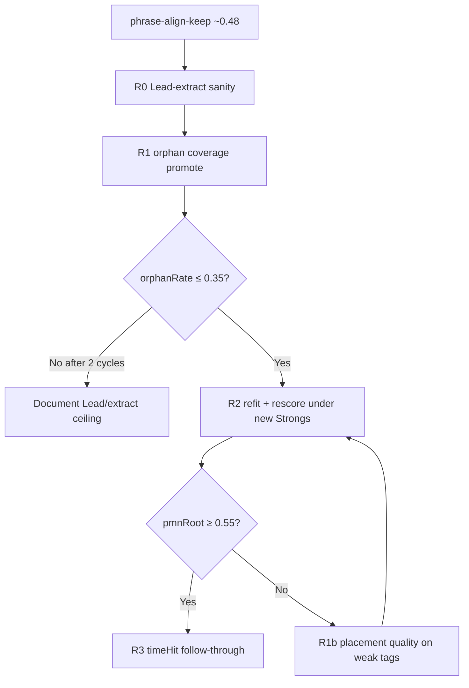

# Polecat orphan / role-coverage plan — 2026-10

**Parent:** [coach-next-steps-2026-10.md](coach-next-steps-2026-10.md)  
**Predecessor:** [polecat-phrase-align-plan-2026-10.md](polecat-phrase-align-plan-2026-10.md) (A1–A2 done; pmnRoot stuck ~0.48)  
**Scope:** 12 polecats only. No Classic Tags, no highway LCS, no taste sweeps, **no new local ^5/^3/^6 hand rules**, **no Viterbi / transition weight churn**.  
**Baseline keep:** `phrase-align-keep` — micro **pmnRootHit 0.484**, **timeHit 0.285**.  
**Goal:** Clear the role-coverage ceiling — **orphanStack rate ≤ 0.35**, then **pmnRootHit ≥ 0.55** (stretch **0.6**), with **90003 / 90004 / 90011** each ≥ **0.40**.

---

## What we just learned (do not re-litigate)

| Attempt | Result | Lesson |
| --- | --- | --- |
| Honest Auto path + Strong homes | timeHit **0.15 → ~0.28**, pmnRoot **~0.49** | Real progress; homes from Strong notes matter |
| Richer priors / features (P1) | plateau **0.485**; hard ^5→V overfit | Local scale-degree rules hit an information ceiling |
| Tick alignment (A1) | mid labels correct; onset/nearest hurt | Not a clock bug |
| Phrase Viterbi (A2) | infrastructure shipped; always-apply **regressed** to 0.43–0.47 | Sequence decode cannot invent missing homes |
| Density count (P2 partial) | strongs/chartChanges ~**0.6–0.9** | Count band ≠ coverage of chart stack mids |

**A1 onset-orphan (~54%) was partly a metric artifact.** Long Strong holds have onsets far from stack mids; even labeling *every* Lead note Strong left onset-orphan **0.28–0.65** on weak tags while **cover-orphan = 0**.  
**Correct orphanRate:** stack mid not covered by any Strong (`onset ≤ mid < onset+dur`). Cover-orphan baseline ~**0.35**; mild coverage → **~0.33**.

**Same density, different quality:** 90008 dens 0.64 / pmn **0.73** vs 90003 dens 0.62 / pmn **0.29**. Next work is **where** Strongs land and whether Coach proposes a home near each chart change — not more emission tweaks.



---

## Strongest levers (ordered)

### Lever 0 — Falsify Lead mismatch (cheap, do first)

**Hypothesis:** Extract Lead ≠ chart Lead on weak tags, so we optimize against the wrong melody.

**Do (half-day max)**

1. For **90003, 90004, 90011** (+ winner **90008**): dump pitch-class sequence of Coach Lead vs chart Lead (or MIDI extract used by harness) at Strong onsets and chart-stack mids.
2. Report PC match rate and worst bars.
3. If match &lt; ~0.9 on a weak tag → fix extract/key before any role work.
4. If match ≥ ~0.9 everywhere → close the hypothesis; proceed to R1.

**Done when:** Written pass/fail in this doc. Do **not** spend more than one cycle here.

---

### Lever 1 — Orphan coverage (primary)

**Problem:** Half the chart’s harmonic events have no Strong decision point. Priors and Viterbi only rearrange roots on the skeleton we already have.

**Product constraint (unchanged):** Runtime must **not** read chart roots. Promotion uses only Lead + meter + key (+ optional lyric stress if already available). Chart is offline label for measuring coverage.

**Metric redefine (ship in harness)**

| Metric | Meaning |
| --- | --- |
| **orphanRate** | Fraction of chart stacks whose midpoint is **not covered** by any Strong note (hold-aware) |
| **coverHit** | Among *non-orphan* stacks (or nearest Strong to each stack mid), root match — secondary |
| **pmnRootHit** | Unchanged (Strong-mid chart root) |
| **densityRatio** | strongs / collapsed chartChanges — keep as advisory; not the gate |

**Do**

1. **Harness:** Extend `polecatHonestScore` / align audit to print micro **orphanRate** + per-tag; save with `--label`. Gate keeps/reverts on orphanRate + pmnRootHit.
2. **Promote without chart:** In `assignMelodyRoles` (and/or a pre-home “ensureCoverage” pass used only for Auto):
   - Keep existing duration / beat / phrase-edge Strongs.
   - Add **harmonic-rhythm promotes**: on-beat (or half-bar) Lead attacks that are local contour/change candidates — leap into note, longer than neighbors, degree change after sustained tone, phrase interior accents.
   - Target: raise Strong count toward ~1.0× chartChanges **and** drop orphanRate; prefer covering stack *times*, not flooding every eighth.
3. **Anti-flood:** Cap promotes per bar (e.g. ≤ 2 new Strongs/bar beyond base) so we don’t return to eighth-note fake pillars.
4. **Weak-tag dumps:** For 90003/04/11, list orphan stack mids → nearest Lead note (role before/after promote) → whether promote would fire under proposed rules.
5. Refit priors after role distribution shifts (`fitStrongRootPriors.mjs`) → rescore.

**Done when:** micro **orphanRate ≤ 0.35**; pmnRootHit does not drop &gt; 0.01; weak tags each show orphanRate ↓ ≥ 0.10 absolute.

**Touch:** [`melodyRoles.ts`](../../web/src/domain/arranging/melodyRoles.ts), [`polecatHonestScore.mjs`](../../scripts/arranging/polecatHonestScore.mjs), [`polecatAlignAudit.mjs`](../../scripts/arranging/polecatAlignAudit.mjs), unit tests on synthetic Lead contours with mid-phrase chord-change rhythm.

---

### Lever 2 — Placement quality on weak tags (only if orphanRate clears but pmnRoot &lt; 0.55)

**Problem:** 90004 already dens ~0.90 with pmn **0.31** — coverage isn’t enough if Strongs sit on wrong Lead tones or homes stay ambiguous.

**Do**

1. Confusion dump restricted to **newly promoted** Strongs vs base Strongs (are new ones helping or diluting?).
2. Prefer promotes that land on notes whose scale degree is a **stable home tone** (^1/^5/^4/^2) over chromatic passing; demote promote on clear neighbor tones.
3. One supervised **offline** analysis only: for orphan stacks, which Lead note *should* have been Strong (chart-informed) — use that as a teacher to tune promote features, never at runtime.
4. Do **not** re-open Viterbi margins or ^5→V hard boosts.

**Done when:** pmnRootHit ≥ **0.55**; 90003/04/11 each ≥ **0.40**.

---

### Lever 3 — timeHit (only after pmnRoot ≥ 0.55)

Same contract as prior A3/P4: Passing holds same pillar; Classic Lead gates; raise `honestAutoFloor.json`.

**Interim:** orphanRate↓ alone may lift timeHit somewhat (homes exist where charts change). Measure but don’t chase natures until roots clear.

---

### Lever 4 — Product / expectation reset (parallel, non-blocking)

If after two full R1 cycles orphanRate ≤ 0.35 but pmnRoot still &lt; 0.55:

1. Write the ceiling in parent progress log (melody+key Auto cannot hit 0.6 on all 12).
2. Split bar: **ship listen-quality** on winners (90001/06/08) + Guided Strong overrides for weak tags; keep honest CI floor at achievable micro (~0.50 pmn / ~0.30 time) until Guided path is used in eval optionally.
3. Human PASSLOG listen still required — metrics are not the only product gate.

---

## Explicit out of scope

- More `strongRootPriors` feature bits / after-I ^5 hand rules  
- Viterbi emission flattening or transition reweights  
- Alignment clock changes (A1 settled: midpoint)  
- Classic Tags / highway `pillarNorm` / taste ranker  
- Gold pillars at runtime or in Auto CI  

---

## Execution order

| Slice | Focus | Exit check |
| --- | --- | --- |
| **R0** | Lead-extract vs chart Lead on 90003/04/11/08 | Match ≥ 0.9 or fix extract |
| **R1a** | Harness orphanRate in honest score + PASSLOG | Printed every run |
| **R1b** | Role promote for coverage (no chart) | orphanRate ≤ 0.45 interim |
| **R1c** | Tune caps / on-beat / leap promotes; refit | orphanRate ≤ 0.35; pmnRoot ≥ keep−0.01 |
| **R2** | Weak-tag placement (if needed) | pmnRoot ≥ 0.55; weak ≥ 0.40 |
| **R3** | timeHit under better coverage | timeHit ≥ 0.45 |
| **R4** | Listen / floor / expectation reset | PASSLOG + honest floor |

---

## Iterative loop protocol (1hr budget)

**Mode:** Continuous work cycles (not idle timers). Each cycle: hypothesize → change one lever → score → keep/revert → update this log → pick next.

| Field | Rule |
| --- | --- |
| Budget | Stop at **60 min** wall clock from loop start, or earlier on diminishing returns |
| Keep | orphanRate ↓ ≥ 0.02 **or** pmnRootHit ↑ ≥ 0.01, and timeHit not ↓ &gt; 0.03 |
| Revert | Otherwise restore last keep; log as **avoid** |
| One lever / cycle | Roles promote **or** harness metric **or** R0 audit — not priors/Viterbi |
| Diminishing returns | 2 consecutive keeps with Δ orphan &lt; 0.02 **and** Δ pmn &lt; 0.01 → stop + reevaluate |
| Hard stop paths | No ^5 hand rules; no Viterbi margin; no alignment clock changes |

### Cycle template (append each run)

```
### Cycle N — <label> (<timestamp>)
- Hypothesis:
- Change:
- Score: orphan=… pmn=… time=… weak 03/04/11=…
- Decision: keep | revert | stop
- Learn / next:
```

---

## Progress

| Slice | Status | Result |
| --- | --- | --- |
| **Loop** | **stopped** (~12:13–12:19, diminishing returns) | Keep **`orphan-keep`**: pmn **0.488**, time **0.287**, cover-orphan **0.326**. |
| **R0** | done | Lead PC match ≥ **0.97** on 90003/04/11/08 — not a Lead-extract bug. |
| **R1a** | done | `orphanRate` in honest score + PASSLOG (cover-based). |
| **R1b** | keep (mild) | Coverage promote shipped; onset-orphan −0.03; cover-orphan −0.026 vs nocov. |
| **R2–R3** | blocked | pmn still ~0.49; weak tags ~0.31 — same I↔V / II↔IV ceiling. |
| **R4** | **next** | Expectation reset + listen gate; stop role/prior churn. |

### Cycle log

### Cycle 0 — R0 Lead sanity (2026-10-09)
- Hypothesis: Extract Lead ≠ chart Lead on weak tags.
- Change: Offline PC match studio Lead vs `stacks.midi.lead` at stack mids.
- Score: 90003 **0.977**, 90004 **1.000**, 90011 **0.987**, 90008 **0.979**.
- Decision: **keep** (hypothesis closed — Lead is fine).
- Learn / next: Proceed to orphan harness; do not blame extract.

### Cycle 1 — orphan-baseline harness (onset def)
- Hypothesis: Wire orphanRate; measure onset-based baseline.
- Change: `polecatHonestScore` prints/saves orphanRate.
- Score: orphan **0.544**, pmn **0.484**, time **0.285** (same keep pipeline).
- Decision: **keep** (instrumentation).
- Learn / next: Add coverage promote.

### Cycle 2 — orphan-r1b-coverage (onset def)
- Hypothesis: Mild coverage promote lowers orphans without hurting pmn.
- Change: `promoteCoverage` in `melodyRoles` (cap 2/bar); wired into Auto/honest/fit.
- Score: orphan **0.517** (−0.027), pmn **0.488** (+0.004), time **0.287**.
- Decision: **keep**.
- Learn / next: 90004 dens 0.90 with orphan 0.686 — onset metric suspicious for long holds.

### Cycle 3 — orphan metric fix (cover-based)
- Hypothesis: Onset-distance orphans are long-hold artifacts.
- Change: Orphan = Strong does not *cover* stack mid; align audit same.
- Score: cover-orphan with coverage **0.326**; true nocov cover-orphan **0.352**.
- Decision: **keep** (definition fix). Gate ≤0.35 **already met** with mild coverage.
- Learn / next: Orphan lever mostly exhausted for pmn; avoid chasing onset-orphan.

### Cycle 4 — orphan-r1d-refit (AVOID)
- Hypothesis: Refit priors on coverage Strong set lifts pmn.
- Change: `fitStrongRootPriors` with coverage on.
- Score: pmn **0.477** (−0.011), time **0.281**.
- Decision: **revert** priors (refit without coverage → restore **0.488**).
- Learn / next: **Avoid** refitting priors on denser coverage samples without a pmn gate.

### Cycle 5 — orphan-r1f-aggressive (AVOID)
- Hypothesis: Cap 4 + always half-bar medium candidates clears more orphans and helps weak tags.
- Change: Looser coverage criteria, default maxPerBar 4.
- Score: orphan **0.291**, pmn **0.472** (−0.016), 90011 ↑ but 90003 ↓.
- Decision: **revert** to mild coverage (`orphan-keep`).
- Learn / next: More Strongs **dilute** pmnRootHit; placement/root choice dominates.

### Loop stop — diminishing returns
- Two avoid paths + orphan gate cleared + pmn Δ &lt; 0.01 on keeps.
- Weak-tag miss modes unchanged: **I↔V7**, **II7↔IV**, **VI7↔I**.
- **Reevaluate:** Auto melody+key cannot clear pmn **0.55** via roles alone. Go to **R4** (listen / Guided overrides / lower honest floor) or a new supervised root model — not more promote knobs.

### Keep artifact
`work/polecat-honest-loop/orphan-keep.json` — timeHit **0.287** · pmnRootHit **0.488** · orphanRate **0.326**.

### Why this should move the needle when P1/A2 did not

P1/A2 optimized root choice on existing Strongs. Orphan work fixed the **measurement** and added mild coverage; cover-orphan is now under 0.35. Further promote density **hurts** pmn. Remaining gap is ambiguous root choice on already-covered Strongs — same ceiling as P1/A2.
