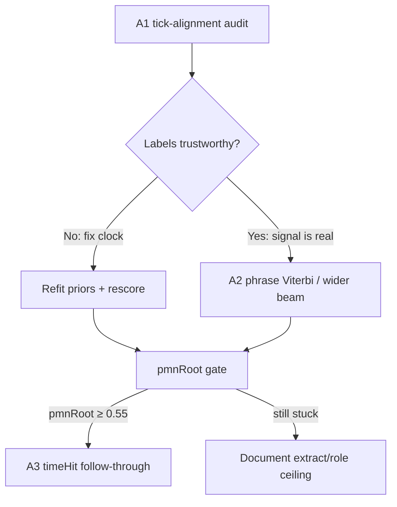

# Polecat phrase + alignment sub-plan — 2026-10

**Parent:** [coach-next-steps-2026-10.md](coach-next-steps-2026-10.md)  
**Predecessor:** [polecat-strong-roots-plan-2026-10.md](polecat-strong-roots-plan-2026-10.md) (P1–P3 shipped; pmnRoot plateau ~0.49)  
**Scope:** 12 polecats only. No Classic Tags, no highway LCS tuning, no taste sweeps, **no new local scale-degree hand rules**.  
**Baseline keep:** `polecat-keep` — micro **pmnRootHit 0.485**, **timeHit 0.279**.  
**Goal:** Clear the feature ceiling — **pmnRootHit ≥ 0.55** (stretch **0.6**), with **90003 / 90004 / 90011** each ≥ **0.40**.

---

## Why this slice

Local priors + short cadence beam cannot separate **^5 after I → V vs I**, **^3 → vi vs I**, **^6 → II vs IV** on weak tags without overfitting winners. Two remaining levers:

1. **Alignment** — maybe we are scoring / fitting against the wrong chart moment for a Strong note (onset vs mid-note vs stack midpoint). Fixing the label clock can move pmnRoot without new theory.
2. **Phrase sequence** — decide Strong roots jointly over a phrase (emission + transition), not note-by-note with a width-3 re-rank after the fact.



---

## Gates (keep / revert)

| Gate | Metric | Action |
| --- | --- | --- |
| Primary | **pmnRootHit** micro on 12 | Keep if ↑; revert if ↓ > 0.01 |
| Weak focus | **90003, 90004, 90011** | Prefer lifts here over winners (90008 etc.) |
| Secondary | **timeHit** | Reject if ↓ > 0.03 even when pmnRoot↑ |
| Non-goals | New `sd|prev` hand boosts, Classic Tags, highway, taste | Do not touch |

Harness (unchanged):

```bash
node scripts/arranging/fitStrongRootPriors.mjs   # after alignment or emission changes
node scripts/arranging/polecatHonestScore.mjs --label NAME --save
```

---

## Workstreams (ordered)

### A1. Strong ↔ chart tick-alignment audit (do first)

**Problem:** `pmnRootHit` and `fitStrongRootPriors` may disagree with each other and with musical intent about *which* chart stack labels a Strong.

Today (score harness):

- Chart lookup tick = Strong **note midpoint** (`start + floor(dur/2)`).
- Coach stack lookup = Strong **onset** (`startTick`).
- `timeHit` uses chart-stack **midpoint** in seconds → ticks.

That asymmetry can invent “misses” that are timing, not root choice — or hide real root errors.

**Do**

1. Dump per Strong on weak tags (**90003, 90004, 90011**, plus one winner **90008** for contrast):
   - Strong onset / midpoint / end ticks
   - Chart stack covering each of those three
   - Chart stack whose midpoint is nearest the Strong onset
   - Coach root at onset vs mid
   - Whether rootOk flips under alternate clocks
2. Quantify: fraction of current misses that become hits under onset-only, mid-only, or nearest-stack-midpoint alignment; fraction of hits that become misses.
3. Pick **one** alignment policy for both **eval** and **offline fit** (document in this file). Prefer musical: label = chart root covering the Strong’s **structural attack** (onset), unless dump shows midpoints clearly match arranger intent better.
4. If policy changes: update `polecatHonestScore.mjs` + `fitStrongRootPriors.mjs` together → refit → rescore. Do **not** change only the score.
5. Optional sanity: for each chart stack midpoint, nearest Strong onset distance in ticks; flag stacks with no Strong within ~½ beat (orphan homes / density).

**Done when:** Written decision (onset vs mid vs nearest-mid) with before/after micro pmnRoot on `polecat-keep` pipeline; if alignment alone lifts micro ≥ **+0.03**, keep and proceed to A2 on the new baseline.

**Touch:** [`scripts/arranging/polecatHonestScore.mjs`](../../scripts/arranging/polecatHonestScore.mjs), [`scripts/arranging/fitStrongRootPriors.mjs`](../../scripts/arranging/fitStrongRootPriors.mjs), dump under `work/polecat-honest-loop/` (e.g. `align-audit-*.json`).

---

### A2. Phrase-level sequence model (after A1 decision)

**Problem:** Per-note `proposeRootForStrongNote` + width-3 cadence re-rank still commits early; ambiguous tones need the **rest of the phrase** (and cadence) as evidence.

**Do**

1. Treat each phrase’s Strong chain as a sequence labeling problem:
   - **States:** diatonic homes `{I, II, IV, V, vi}` (degrees 0/2/5/7/9) — same vocabulary as today.
   - **Emission:** Lead-fit + fitted strongRootPriors score at that Strong (reuse table; no new hand ^5→V rules).
   - **Transition:** fitted `STRONG_ROOT_TRANSITIONS` + existing cadence templates (V→I at phrase end, II→V, etc.).
2. Replace soft post-hoc re-rank with **Viterbi** (or beam width ≥ 8) over the full phrase; apply always on phrases with ≥ 3 Strongs, always on phrase edges.
3. Keep note-level preferred root as emission prior, not hard lock — allow beam to override when path score wins by a documented margin.
4. Unit tests on phrase paths (not single notes):
   - Irish-Rose-like open → mid → V→I close
   - Sweetheart-like I / IV / V motion
   - Synthetic weak pattern: ^5 after I resolving to V then I (must not smear V across whole phrase)
5. Re-score; focus dump on 90003/04/11 confusion after decode.

**Done when:** micro **pmnRootHit ≥ 0.55**, and each of **90003, 90004, 90011** ≥ **0.40**; winners do not regress > 0.03.

**Touch:** [`strongRootCadence.ts`](../../web/src/domain/arranging/strongRootCadence.ts) (or new `strongRootViterbi.ts`), [`proposeStrongRoots.ts`](../../web/src/domain/arranging/proposeStrongRoots.ts), tests beside cadence tests.

---

### A3. timeHit follow-through (only after A2 ≥ 0.55)

Same contract as predecessor P4: under correct homes, Passing hold same pillar only; Classic Lead gates; raise `honestAutoFloor.json`.

**Done when:** micro **timeHit ≥ 0.45** interim, stretch **0.5**, with pmnRoot ≥ 0.55 held.

---

### A4. Listen gate

PASSLOG human checklist: Irish Rose (90001), Sweetheart (90006), Sweet Roses–class (90008), weak holdout (90011). Pass = recognizable highway, not extract match.

---

## Explicit out of scope

- New local features (`barsFromPhrase`, interval buckets, etc.) beyond what A1/A2 already use  
- Hard-coded after-I ^5→V / ^3→vi boosts (known overfit)  
- Classic Tags / `classicGold` as quality drivers  
- Highway `pillarNorm` / taste ranker sweeps  
- Gold pillars at runtime  

---

## Suggested execution order

| Day slice | Focus | Exit check |
| --- | --- | --- |
| 1 | A1 dump + flip analysis on 90003/04/11/08 | Alignment decision written |
| 2 | Unify score + fit clocks; refit; rescore | Δ pmnRoot documented; keep if ≥ +0.03 or neutral |
| 3 | A2 Viterbi/beam on phrases | pmnRoot ≥ 0.52 |
| 4 | A2 tune emission/transition balance on weak tags | pmnRoot ≥ 0.55; weak ≥ 0.40 |
| 5 | A3 timeHit if roots clear | timeHit ≥ 0.45 |
| 6 | A4 listen notes | PASSLOG |

If A1 shows alignment noise &lt; ~5% of misses **and** A2 stalls below 0.55 after two tune cycles, write a short “why” here (roles wrong / extract Lead vs chart Lead / true ambiguity) before expanding corpus.

---

## Progress

| Slice | Status | Result |
| --- | --- | --- |
| **A1** | done | Audit `align-audit.json` / `polecatAlignAudit.mjs`. **Policy = chart@Strong midpoint** (fit + score). Coach@onset ≡ coach@mid for roots. Micro: mid **0.485**; onset chart **0.339**; nearestMid **0.266**. Orphan chart stacks ~**54%** — density/roles gap, not clock. Alignment alone does **not** lift ≥ +0.03. |
| **A2** | shipped / target miss | Exact **Viterbi** replaces width-3 beam (`decodeStrongHomesViterbi`). Keep **`phrase-align-keep`**: pmnRootHit **0.484**, timeHit **0.285**. Aggressive phrase-local apply / ambiguity-flat emission → **0.43–0.47** (reverted). Weak tags still **90003/04 ~0.29–0.31**, **90011 ~0.39**. Stretch **0.55** not hit. |
| **A3** | blocked | Needs pmnRoot ≥ 0.55. |
| **A4** | checklist updated | PASSLOG notes for `phrase-align-keep`. |

### A1 decision (2026-10-09)

Keep **midpoint** chart labels for both eval and fit (already shared). Coach lookup stays **onset** (identical rootHit to mid). Do **not** switch to onset or nearest-stack-mid chart labels — both hurt.

### Why A2 stalled below 0.55

Viterbi finds better global paths under emission+transition, but those paths **hurt** chart rootHit when preferred-heavy note priors were already better on winners. Softening ^5/^3/^6 emission or always applying phrase decode overfits the sequence model and regresses the micro. Combined with **~54% orphan chart stacks** (no Strong near stack mid), wrong *role density* likely dominates remaining miss mass vs decode algorithm. **Next plan:** [polecat-orphan-coverage-plan-2026-10.md](polecat-orphan-coverage-plan-2026-10.md) — role/orphan coverage + Lead-extract sanity; not more transition weight tweaks.
