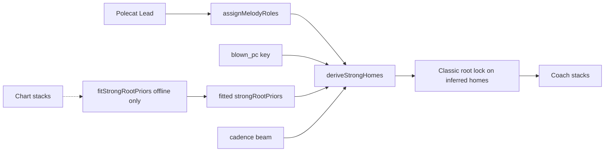

# Polecat Strong-roots sub-plan — 2026-10

**Parent:** [coach-next-steps-2026-10.md](coach-next-steps-2026-10.md)  
**Scope:** 12 polecats only (gold + holdout). No Classic Tags corpus, no highway LCS tuning, no taste sweeps.  
**Baseline:** `phase-a-final` — micro **pmnRootHit ~0.49**, **timeHit ~0.26** (Lead + blown-pitch key + roles; no gold pillars).  
**Goal:** Finish 5.5 on polecats — **pmnRootHit ≥ 0.6**, **timeHit ≥ 0.5**.

---

## Why this slice

Wrong **Strong-note roots** still dominate misses. Homes are locked into Path Optimize for inferred pillars, so improving `proposeStrongRoots` / roles moves both metrics. Vocabulary and Classic Tags will not.



---

## Gates (keep / revert)

| Gate | Metric | Action |
| --- | --- | --- |
| Primary | **pmnRootHit** micro on 12 | Keep if ↑; revert if ↓ > 0.01 |
| Secondary | **timeHit** | Reject if ↓ > 0.03 even when pmnRoot↑ |
| Focus | Worst three tags | Prefer lifts on **90003, 90004, 90011** (and 90012) over winners |
| Non-goals | Highway LCS, Classic Tags, taste weights | Do not touch until 5.5 clears |

Harness:

```bash
node scripts/arranging/fitStrongRootPriors.mjs   # after feature/key changes
node scripts/arranging/polecatHonestScore.mjs --label NAME --save
```

---

## Workstreams (ordered)

### P1. Error-driven prior features (highest leverage)

**Problem:** Table + scorer plateau ~0.49; openings and I/IV/vi swaps still dominate weak tags.

**Do**

1. Extend `fitStrongRootPriors.mjs` dump: per-tag confusion for Strong ticks (chartDeg vs predDeg × `sd|prev|edge`).
2. Add 2–3 features that fix the top error modes only, e.g.:
   - `barsFromPhraseStart` (0 / 1 / 2+)
   - `leadIntervalFromPrevStrong` (step / leap)
   - `durationBucket` (eighth / quarter / longer)
3. Refit → regenerate `strongRootPriors.generated.ts` → re-score.
4. Keep scorer in `proposeRootForStrongNote` as blend (table weight > rules > Lead fit).

**Done when:** micro **pmnRootHit ≥ 0.55**, and 90003/90011 each ≥ 0.40.

**Touch:** [`scripts/arranging/fitStrongRootPriors.mjs`](../../scripts/arranging/fitStrongRootPriors.mjs), [`strongRootPriors.ts`](../../web/src/domain/arranging/strongRootPriors.ts), [`proposeStrongRoots.ts`](../../web/src/domain/arranging/proposeStrongRoots.ts).

---

### P2. Strong density = chart change rhythm

**Problem:** Too many / misplaced Strongs smear PMN rootHit; too few miss real homes.

**Do**

1. Log per tag: `#strongs` vs `#collapsed chart roots` (roman collapse length).
2. Tune `assignMelodyRoles` + change-point promote so strong count is within ~0.7–1.3× chart-change count on gold four.
3. Ensure promoted change-points stay in **roles** (PMN metric), not only in home derivation.

**Done when:** median `|strongs − chartChanges| / chartChanges` ≤ 0.35 on gold four; pmnRootHit does not regress.

**Touch:** [`melodyRoles.ts`](../../web/src/domain/arranging/melodyRoles.ts), harness dump lines.

---

### P3. Cadence beam that helps weak tags

**Problem:** Soft cadence re-rank rarely fires; weak tags need V→I / II→V→I / I→IV→V at phrase scale.

**Do**

1. Score beam with Lead-fit + fitted transition counts from offline (same fit script, transition matrix).
2. Apply re-rank when beam beats preferred by a smaller margin on phrase edges (open/close always consider beam).
3. Unit tests: Irish-Rose-like and Sweetheart-like Strong chains.

**Done when:** pmnRootHit ≥ 0.55 holds; 90001 and 90006 do not regress > 0.03.

**Touch:** [`strongRootCadence.ts`](../../web/src/domain/arranging/strongRootCadence.ts), fit script (emit transition priors).

---

### P4. timeHit follow-through (only after P1≥0.55)

**Problem:** timeHit ~0.26 trails roots; Passing / natures under correct homes should lift it.

**Do**

1. Confirm inferred Strong root lock still on; Passing holds **same** pillar only (already fixed for adversarial).
2. Under correct homes: Classic Lead gates only (Dom9-on-9, I/IV triad on 1/5) — no new vocabulary.
3. Raise `honestAutoFloor.json` after each keep.

**Done when:** micro **timeHit ≥ 0.5** with pmnRootHit ≥ 0.6.

---

### P5. Polecat listen gate (after P4)

Human checklist already in `work/polecat-honest-loop/PASSLOG.md`: Irish Rose (90001), Sweetheart (90006), Sweet Roses–class (90008), one weak holdout (90011).  
Pass = recognizable highway, not extract match.

---

## Explicit out of scope

- Classic Tags / classicGold sequence loops as quality drivers  
- Raising highway `pillarNorm` expects  
- Circle/Busy taste or ranker weight sweeps  
- Pillar UX redesign beyond current Auto copy  

---

## Suggested execution order

| Day slice | Focus | Exit check |
| --- | --- | --- |
| 1 | P1 features + refit + score | pmnRoot ≥ 0.52 |
| 2 | P1 continue on 90003/11 dumps | pmnRoot ≥ 0.55 |
| 3 | P2 role density | density band + no regress |
| 4 | P3 cadence transitions | hold 0.55; lift weak tags |
| 5 | P4 timeHit | timeHit ≥ 0.45 then 0.5 |
| 6 | P5 listen | PASSLOG human notes |

If stuck below 0.55 after two full P1 cycles, write a short “why” in this doc (feature ceiling vs extract/tick alignment) before expanding scope.

---

## Progress (2026-10-09 execution)

| Slice | Status | Result |
| --- | --- | --- |
| **P1** | shipped / target miss | Richer priors (`d`/`i`/`f` features), confusion dump, scorer blend. Best keep: **pmnRootHit 0.485**, timeHit **0.279** (`polecat-keep`). Hard boosts on after-I ^5→V overfit and regressed. **90003/04 still ~0.29** — below 0.40 gate. |
| **P2** | partial | Density logged (`strongs/chartChanges`); gold dens ~0.6–0.8 (under 0.7–1.3 band slightly). Change-point promote restored for coverage. |
| **P3** | shipped | Fitted `strongRootTransitions.generated.ts`; beam uses empirical transitions + Irish Rose / Sweetheart unit tests. |
| **P4** | blocked on roots | timeHit 0.279; not chasing natures until pmnRoot ≥ 0.55. |
| **P5** | checklist updated | PASSLOG listen section refreshed with `polecat-keep` numbers. |

### Why P1 stalled below 0.55

Ambiguous Lead tones (**^5 after I**, **^3→vi vs I**, **^6→II vs IV**) are not separable from melody+key alone at ~50% rate on weak tags; stronger hand rules overfit winners and hurt the micro. Next: **[polecat-phrase-align-plan-2026-10.md](polecat-phrase-align-plan-2026-10.md)** (tick-alignment audit → phrase Viterbi; no more local feature bits).
