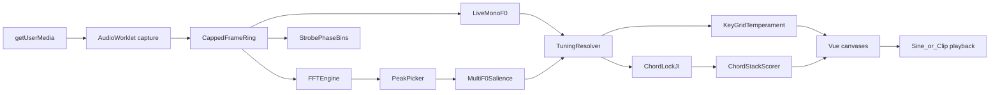
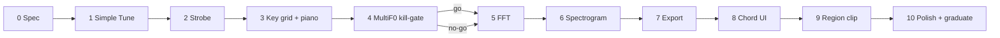

# Digital Tuner — pitch analysis for vocalists

> **Status:** Proposed (revised after adversarial review)  
> **Updated:** 2026-11-09  
> **Goal:** On-device Digital Tuner for singers: trustworthy simple Tune + strobe first; key/grid temperament separate from chord-lock JI; FFT/spectrogram analysis; chord stack only after a multi-F0 kill-gate on real ensemble audio.  
> **Placement:** Labs-gated `/tuner` → graduate to **always-available under More** (Recorder/Optical pattern). Users may pin it; **not** added to `DEFAULT_PRIMARY_NAV_ORDER` (avoids crowding pins next to Pitch Pipe).  
> **Clients:** Desktop and mobile; **portrait and landscape**; density/layout adapt via shared narrow + orientation breakpoints (not a separate “mobile app”).  
> **Privacy:** All analysis on-device; mic audio never leaves the browser; analysis rings capped and cleared on leave  
> **Primary use case:** Chromatic / key-aware tuning for a single vocalist (one-glance Tune chrome — no mode tabs at first)  
> **North-star differentiator:** Quartet chord stack — in-tune-with-self vs in-tune-with-key — **gated on kill-gate evidence**  
> **Related:** [audio-recorder-roadmap.md](audio-recorder-roadmap.md) (tuner explicitly **not** inside recorder), [virtual-piano.md](virtual-piano.md), [tag-audio-pitch-import.md](tag-audio-pitch-import.md), [justIntonation.ts](../../web/src/domain/arranging/justIntonation.ts), [narrowViewport.ts](../../web/src/lib/narrowViewport.ts)

---

## Research synthesis

| Product | Relevant strengths | Takeaway for us |
| --- | --- | --- |
| [TonalEnergy](https://www.tonalenergy.com/tet-user-guide-ios) | Target/bar tuner first; Equal vs Just with key center; freeze spectral/harmonic views; tone generator + keyboard | Progressive disclosure; temperament reshapes *targets*; freeze/compare for teaching; headphones when sounding refs |
| [Fine Tuna](https://finetuna.app/) | Shared engine across views; strobe families; JI “barbershop” sevenths; review/pitch map | One measurement pipeline → many visuals; passage review is optional later, not Phase-1 |
| [insTuner](https://eumlab.com/instuner/) | Instant / fine / strobe / FFT / spectrogram modes | Mode taxonomy for *Analyze*, not for first paint |
| [Vocaldemy](https://www.vocaldemy.com/) / Spectral | Browser-only classical DSP; Tune vs Study | Privacy + deterministic goldens; “one thing to look at while singing” |
| Peterson / StroboPro | Strobe = phase vs reference | True phase-comparator strobe (single-bin DFT), with ¢→motion goldens — no fake stripes |

### Vocal / barbershop acoustics

- Quartet “ring” comes from shared harmonics; barbershop seventh ≈ **4:5:6:7** (harmonic seventh ≈ **−31¢** vs ET).
- Reuse Rylander JI in `justIntonation.ts` and natures in `chords.ts` for **chord-lock** targets — not as a substitute for key-grid temperament.
- Multi-F0 on one mic is hard and often incomplete. Classical harmonic-salience first; **ML only after kill-gate fails**, via ADR + size/license budget.

### What this repo already has

| Concern | Location |
| --- | --- |
| Mic + Analyser metering | `web/src/audio/liveMeter.ts`, `recorderCapture.ts` |
| Offline YIN (reference only) | `web/src/lib/tagRoll/pitchExtract/yin.ts` — **not** a live drop-in |
| Note / Hz / cents + concert A | `web/src/audio/pitchUiLabels.ts`, Pitch Pipe prefs |
| Tone playback | `web/src/audio/pitchTone.ts` |
| Piano UI geometry | Pitch Pipe, `SheetPianoDock.vue` |
| Symbolic chord ID | `web/src/domain/arranging/chordNatureIdentify.ts` (needs hysteresis when fed live PCs) |
| AudioWorklet precedent | `soundfonts.ts` — serve worklet from `public/` |
| Shared audio unlock | `interactiveAudioContext.ts` — **mandatory** for tuner |

**Gap:** no live tuner, no spectrogram UI, no proven real-time multi-F0.

---

## Product principles

1. **Tune first, chrome later.** Phase 1–3 ship a single Tune surface (needle, then strobe). No Tune|FFT|Spectrogram|Chord tab strip until Analyze exists.
2. **One engine, many views.** Later surfaces consume the same frame stream.
3. **Split tuning semantics.** **Key grid temperament** (Equal / Just-triad / Custom) is separate from **Chord lock** (Barbershop JI roles for a nature). Never one overloaded “temperament” enum.
4. **Honest polyphony.** Chord UI is pitch-ordered with confidence; no TTBB part labels until assignment is proven. No Chord promises until kill-gate passes.
5. **On-device, capped retention.** No PCM upload; rings ≤30 s; clear on route leave / Labs off; **settings only** in app-state backup.
6. **False-precision policy.** Cents decimals follow estimator confidence (e.g. 0.1¢ only when clarity high; else 1¢). Always show what “green” is relative to (Equal vs chord lock).
7. **Neutral coaching language.** Prefer “+12¢ vs target” over “Lead is sharp.”
8. **Responsive by breakpoint, not by device sniffing.** Layout density follows viewport width + orientation; touch targets and safe-areas work with existing App chrome (`--header-h`, `--bottom-nav-h`, `env(safe-area-inset-*)`).

---

## Information architecture

| Surface | Route | Notes |
| --- | --- | --- |
| Digital Tuner | `/tuner` | Labs-gated v1; More when enabled |
| Labs card | `/labs` | `singtags.labs.digitalTuner.enabled.v1` + privacy blurb (mic stays on device; rings cleared on leave) |
| Pitch Pipe | `/pitch-pipe` | Pay-the-key; shared A4 / global detune |

### Progressive chrome (by phase)

**Phases 1–3 (Tune only)** — wireframes vary by breakpoint; see [Responsive layout](#responsive-layout--desktop--mobile--orientation).

Desktop / wide landscape (conceptual):

```
┌─ Tuner ── Key · Grid · A4 · Hold · [🎹] · [⚙] ──────────────────┐
│  [ Big note + cents + legend ]     [ Needle / Strobe canvas ]   │
│  Level ──────────────────────────────────────────────────────── │
└─────────────────────────────────────────────────────────────────┘
```

Narrow portrait:

```
┌─ Key·Grid·A4 · Hold · 🎹 · ⚙ ─┐
│         NOTE  ±¢               │
│         legend                 │
│     [ needle / strobe ]        │
│     level                      │
└─ (bottom nav outside view) ───┘
```

**Phases 5+:** single **Analyze** control (menu or segmented control that collapses on narrow), not four equal-weight tabs fighting the readout.

### Defaults chosen

- Labs first; graduate to **always-on under More** (see [Closed product decisions](#closed-product-decisions-formerly-open)).
- Classical DSP only until kill-gate; ML requires ADR.
- Strobe v1 = **horizontal stripe** only + phase goldens; ring/wave and vertical-landscape mapper deferred.
- Chord stack rows = **low→high pitch**, not voice parts.
- Default FFT size **4096** with latency labeled; max selectable but not default.
- Layout follows **narrow + orientation** matrices below; piano defaults **off** on short landscape until user opens it.
- Mic permission logic starts **duplicated** in `useTunerCapture` (extract shared helper only if a third mic consumer appears).

---

## Responsive layout — desktop / mobile / orientation

Tuner must be usable while holding a phone at a mic, on a tablet on the music stand, and on a laptop in rehearsal. Analysis canvases are secondary to a readable Tune readout at every breakpoint.

### Breakpoints (reuse app primitives)

| Signal | Source | Role |
| --- | --- | --- |
| **Narrow** | `NARROW_VIEWPORT_MQ` = `(max-width: 639px)` via [`narrowViewport.ts`](../../web/src/lib/narrowViewport.ts) / `html[data-narrow]` | Compact chrome, sheet settings, touch-first |
| **Wide** | not narrow (≥640px) | Side-by-side Tune + visual; denser toolbars |
| **Short** | `(max-height: 500px)` or equivalent | Landscape phones: collapse secondary chrome |
| **Orientation** | `(orientation: landscape)` / `portrait` (CSS + optional JS for canvas relayout) | Axis swaps for strobe/FFT; piano dock placement |
| **App chrome** | `--header-h`, `--bottom-nav-h`, `env(safe-area-inset-*)` from `App.vue` | Tuner fills `100dvh` minus header/nav; no content under home indicator |

Do **not** UA-sniff “mobile.” A narrow desktop window gets the compact layout; an iPad landscape gets the wide layout.

### Layout matrix

| Viewport | Tune (primary) | Analyze (FFT / Spec / Chord) | Piano dock |
| --- | --- | --- | --- |
| **Wide + portrait** (tablet / desktop window) | Readout left (~40%), needle/strobe right (~60%); toolbar one row | Canvas dominant below or right; peak table / stack as side rail | Bottom horizontal strip (Pitch Pipe–style), collapsible |
| **Wide + landscape** | Same split, more horizontal room for strobe stripes | FFT: horizontal frequency axis full width; spectrogram maximizes height | Dock thinner or end-drawer; hide by default if height tight |
| **Narrow + portrait** (phone) | **Stacked:** toolbar → giant note/¢ → visual → level. Settings in bottom sheet. Hit targets ≥44px | Full-bleed canvas under a compact Analyze header; peak labels limited (top N); stack is full-width list | Optional; overlays bottom third or navigates to sheet — **off by default** so Tune stays one glance |
| **Narrow + landscape / short** (phone on side) | **Density mode:** single horizontal band — note+¢ left, needle/strobe center, Hold+level right. Hide legend to one icon/tooltip; Key/Grid/A4 behind a compact chip → sheet | Spectrogram/FFT get almost all height; toolbar becomes icon rail; pause/export in overflow | **Forced off** while short unless user pins; never cover the readout |

```mermaid
flowchart TB
  subgraph widePortrait [Wide portrait]
    W1[Toolbar]
    W2[Readout | Strobe]
    W3[Optional piano]
  end
  subgraph narrowPortrait [Narrow portrait]
    N1[Compact toolbar]
    N2[Giant note]
    N3[Strobe]
    N4[Level]
  end
  subgraph narrowLandscape [Narrow landscape short]
    L1[Note+cents | Strobe | Hold]
  end
```

### Density rules

1. **One primary focal point while singing.** On short/narrow landscape, never show FFT + piano + stack at once.
2. **Toolbar progressive disclosure.** Wide: Key, Grid temp, A4, Hold, Piano, Settings inline. Narrow: chips / icons; full controls in `TunerSettingsSheet` (existing sheet patterns).
3. **Analyze is a disclosure**, not four peer tabs. Narrow: `Tune | Analyze` segmented control; Analyze opens FFT/Spec/Chord via nested control or sheet. Wide: may show segmented Analyze modes in the second row.
4. **Typography scale.** Narrow portrait note name uses large display type (clamp); landscape-short uses medium type so strobe keeps pixels. Cents never smaller than 16px on touch.
5. **Touch vs pointer.** Canvases support pointer + touch; spectrogram region-drag uses larger handles on narrow; click-to-sine uses a visible crosshair + confirm on first use for touch (avoid accidental beeps).
6. **Safe areas.** Padding: top under header, bottom above `bottom-nav-h + safe-area`. Landscape notches: horizontal `safe-area-inset-left/right` on the tuner root.
7. **Canvas resize.** `ResizeObserver` on the stage; DPR-aware backing store; on orientation change, redraw overlays from last frame (do not clear Hold buffer). Throttle relayout during rotate animation.
8. **Performance by viewport.** Narrow defaults: lower spectrogram scroll DPR / cap FFT to 4096 unless user raises it; auto-degrade FPS sooner on short battery mobile (Phase 10). Wide desktop may allow 8192+ more freely.
9. **Strobe orientation.** v1: **horizontal** stripe drift (left flat / right sharp) in all orientations; short landscape gets a taller band / compact readout instead of a second mapper.
10. **FFT / spectrogram axes.** Portrait FFT: frequency on X (or vertical bars). Narrow landscape: prefer frequency on X with reduced label density; spectrogram time on X always, frequency on Y — on short height, shrink Y range to vocal default faster (or offer “zoom to voice”).
11. **Chord stack.** Wide: side rail beside spectrogram/FFT. Narrow portrait: replace canvas with stack list (or split 50/50). Narrow landscape: compact horizontal “pitch chips” row (low→high) with ¢ under each — not a tall table.
12. **Piano.** Reuse Pitch Pipe horizontal geometry; on narrow, default hidden; when shown, use existing scroll/zoom helpers and do not steal focus from Hold. Short landscape: piano off unless `pianoPinned`.
13. **Settings & export.** Never push a modal that covers the live readout without an easy dismiss; prefer sheets that leave a peek of note/¢ on tall phones.
14. **Reduced motion / accessibility.** Text twin readout remains visible at all breakpoints; strobe→needle under `prefers-reduced-motion` regardless of orientation.

### Prefs additions (layout)

```ts
pianoPinned: boolean           // keep piano in short landscape
analyzeChrome: 'auto' | 'icons' | 'labels'
// optional explicit override; default 'auto' follows narrow+short
density: 'auto' | 'comfortable' | 'compact'
```

Persist only if user overrides; `auto` recomputes on resize/orientation.

### Responsive acceptance (cross-phase)

| Check | Pass condition |
| --- | --- |
| Narrow portrait Tune | Note + cents readable at arm’s length; Hold reachable thumb-zone; no horizontal page scroll |
| Narrow landscape Tune | Single-band density; no piano unless pinned; strobe still interpretable |
| Wide desktop Tune | Side-by-side readout + visual; settings inline |
| Orientation flip | Hold state preserved; canvas resizes without blanking >1 frame burst; no stuck scroll lock |
| Analyze on phone | Usable one-handed; peak inspect + sine without mis-taps dominating |
| App chrome | No tuner controls under bottom nav or notch |
| iPad landscape | Matches **wide** layout (not phone density) |

### Original product requirements (tracked)

1. Strobe-style tuning visual  
2. FFT mode (adjustable resolution) with peak frequencies / note / ±cents  
3. Scrolling spectrogram + pitch/scale grid overlays  
4. Pause FFT/spectrograms; click for pitches / notes / tuning  
5. Export images and data  
6. Configure singing key for an appropriate grid  
7. Assign temperament to the grid from key  
8. Visually see when sung note(s) are in tune  
9. Multi-singer fundamentals → chord; self-lock vs key; clear stack visual  
10. Optional piano  
11. Click → sine  
12. Spectrogram region → repeating chord-frequency clip  
13. Easy; simple tuning primary  
14. Peer-informed without cloning TE wholesale  

---

## Architecture



### Layers

| Layer | Location | Responsibility |
| --- | --- | --- |
| Domain (pure) | `web/src/domain/tuner/` | Key-grid vs chord-lock targets, cents display policy, peaks, stack scoring policy, export schema |
| Application | `web/src/application/tuner/` | Session, hold, ring lifecycle, export jobs, tone-play → detect-suppress |
| Audio adapters | `web/src/audio/tuner/` | Worklet (from `public/`), live mono F0, FFT/Worker, strobe, multi-F0, resynth |
| UI | Thin `TunerView.vue` + `components/tuner/*` + composables | ≤800 lines/file (`godFiles.test.ts`); dumb canvases + text twin |
| Prefs | `singtags.digitalTuner.v1` + Labs flag | Settings only — never f0 history |
| Ports | **None in v1** | Follow recorder/pitch-pipe style (`audio/` adapters). Do **not** invent `ports/tuner*` unless a later ADR says so; update `docs/architecture.md` wording when shipping |

**Hard rules:**

- **AudioContext (corrected):** There is **no** shared singleton today — `createInteractiveAudioContext()` only constructs a low-latency context; Pitch Pipe / `liveMeter` each own their own. Phase 1: tuner owns a **dedicated** context via `createInteractiveAudioContext()` + keepalive; **do not** call `createLiveInputMeter` (it allocates a private context). Coexistence with Pitch Pipe = both contexts resume on gesture; node-graph sharing is **out of scope** until a separate ADR.
- Heavy DSP off main thread (worklet and/or Worker); UI ≤30 Hz updates.
- `yin.ts` is algorithm reference only — new `liveMonoF0` with live hops, Fmin≈55 Hz, octave guards.
- `application/tuner/` stays pure (no Vue/Pinia) — `portsBoundaries.test.ts` walks all `application/`.

### Module sketch

```
web/src/domain/tuner/          # pure; unit-tested
  types.ts
  keyGridTemperament.ts
  chordLock.ts
  displayCents.ts
  peaks.ts
  chordStack.ts
  exportSchema.ts

web/src/application/tuner/     # pure session orchestration
  session.ts                   # start/stop/hold/clear rings
  detectSuppress.ts            # while reference tone plays

web/src/audio/tuner/
  captureWorkletHost.ts        # addModule from public/ + blob fallback (soundfonts pattern)
  ringBuffer.ts
  liveMonoF0.ts                # pure on Float32Array frames — CI-friendly
  fft.ts                       # pure / Worker
  strobe.ts                    # pure phase → paint model
  multiF0.ts
  resynth.ts
web/public/worklets/tuner-capture.js   # served asset; no Vite ?url

web/src/lib/preferences/digitalTuner.ts  # default/parse/normalize/load/save (pitchPipe mold)
web/src/stores/preferences/digitalTunerActions.ts

web/src/composables/
  useTunerCapture.ts           # mic permission, device list, ctx lifecycle, dispose on leave
  useTunerLayout.ts            # narrow + short MQ + orientation → density class

web/src/views/TunerView.vue    # shell only — KEEP UNDER 800 LINES
web/src/components/tuner/…
```

### Prefs sketch (split semantics)

```ts
// singtags.digitalTuner.v1 — SETTINGS ONLY (app-state backup OK)
{
  schema: 'singtags.digitalTuner.v1'
  analyzeSurface: 'hidden' | 'fft' | 'spectrogram' | 'chord'  // chord if kill-gate go|conditional; hidden if no-go
  tuneDisplay: 'needle' | 'strobe'
  keyPc: number
  scaleMode: 'major' | 'minor' | 'chromatic'
  /** Scale / overlay grid — NOT chord-role JI */
  keyGridTemperament: 'equal' | 'justTriad' | 'custom'
  customOffsetsCents: number[12]
  /** Chord-lock layer — independent of keyGridTemperament */
  chordLockEnabled: boolean
  chordNatureId: string | null
  chordRootPolicy: 'lowest' | 'pinned' | 'commonShift'
  pinnedRootPc: number | null
  a4Hz: number | 'followPitchPipe'
  inTuneWindowCents: number       // solo / chromatic green window (e.g. 10)
  chordLockWindowCents: number    // JI chord / role green window (default 5)
  inputDeviceId: string | null
  noiseGateDb: number | null
  fftSize: number            // default 4096
  specFreqMinHz: number
  specFreqMaxHz: number
  specScrollPxPerSec: number
  historyCapSec: number      // default 15, max 30
  pianoVisible: boolean
  pianoPinned: boolean       // keep piano visible in short landscape
  density: 'auto' | 'comfortable' | 'compact'
  analyzeChrome: 'auto' | 'icons' | 'labels'
}
```

**Prefs hygiene (required):** `normalizeDigitalTuner` clamps `fftSize` to allowed set, `historyCapSec` to ≤30, `customOffsetsCents` to length 12, unknown enums → defaults — corrupt `localStorage` must not brick the route. Mirror [`pitchPipe.ts`](../../web/src/lib/preferences/pitchPipe.ts) + tests.

**A4 follow:** when `a4Hz === 'followPitchPipe'`, read live from pitch-pipe prefs / `globalPitchDetuneCents` (or equivalent) inside the composable — no cross-schema write. Document the join in `digitalTunerActions.ts`.

### Chord-stack scoring policy (domain, before UI)

Documented and tested in `chordStack.ts` before any Chord chrome ships:

| Score | Definition |
| --- | --- |
| **Self / Locked** | Given F0s + nature, assign roles; choose root per `chordRootPolicy`; measure each voice’s ¢ error vs JI role ratio. Locked if all \|errors\| ≤ window **after** removing a single common shift (policy `commonShift`) or vs pinned/lowest root. |
| **Key / Centered** | Each F0’s ¢ error vs **key-grid** target (Equal/justTriad/custom) at that PC. |
| **Shifted** | Self Locked, but median F0 vs key-grid is ≥ window (chord in tune with itself, sharp/flat of key). |
| **Unstable** | High F0 variance / vibrato / missing voices → scores greyed; no red/green blame. |

UI shows active policy name. Rows labeled by note name + octave, never Tenor/Lead/… in v1.

---

## JI chord-in-tune visual design (barbershop differentiator)

**Status of coverage before this section:** the plan had **scoring semantics** (Locked / Centered / Shifted) and a thin Phase 8 bullet list, but **not** a comprehensive visual/teaching design for “is our chord in tune in just intonation?” This section is that design. Phase 8 implements it; Phase 3 covers the solo precursor.

### What barbershoppers need to see at a glance

1. **Are we locked with each other?** (JI intervals / roles — the ring)  
2. **Who is off, and by how much?** (per sounding pitch, ±¢ vs JI role target — not ET)  
3. **Are we locked but sharp/flat of the key?** (common shift)  
4. **What chord / nature are we judging against?** (pinned or detected — never silent)  
5. **What does green mean right now?** (legend: “vs Chord lock (JI)” ≠ “vs Equal”)

If any of these five are missing, the visual is incomplete for rehearsal use.

### Solo precursor (Phase 3) — one singer, JI target

When **Chord lock** is on and a nature (+ root) is pinned:

- Detected (or locked) note shows ±¢ vs **that role’s JI target**, not vs ET.
- Readout legend: `vs Chord lock · C7` (example).
- Optional small **role chip**: `3` / `5` / `7` / … from `roleCents` / Rylander map in [`justIntonation.ts`](../../web/src/domain/arranging/justIntonation.ts).
- Piano highlight (if open) marks the JI target pitch (detuned visually or with a secondary marker), not only the ET key center.

This teaches one voice at a time before multi-F0 exists.

### Ensemble Chord surface (Phase 8) — required chrome

```
┌─ Chord lock (JI) · C7 · policy: commonShift ── confidence ●●●○ ─┐
│  [ Locked ]  [ Shifted +18¢ ]  [ Centered ✕ ]     Unstable grey │
│                                                                  │
│  LOW → HIGH                                                      │
│  ┌──────────┐ ┌──────────┐ ┌──────────┐ ┌──────────┐            │
│  │  C3  1   │ │  E3  3   │ │  G3  5   │ │ Bb3 7    │            │
│  │  0¢  ███ │ │ −2¢ ███  │ │ +1¢ ███  │ │ +14¢ ░░  │ ← red/amber│
│  │  target  │ │ −14¢ ET* │ │  +2¢ ET* │ │ −31¢ ET* │ *JI vs ET │
│  └──────────┘ └──────────┘ └──────────┘ └──────────┘            │
│                                                                  │
│  Intervals (vs root after common-shift removal):                 │
│  1→3  −2¢   1→5  +1¢   1→7  +14¢                                 │
│                                                                  │
│  Nature: [ seventh ▾ ]  Root: [ C ▾ ]  Pin required? (assisted)│
└──────────────────────────────────────────────────────────────────┘
```

\* “JI vs ET” is a small secondary hint (how far the JI target sits from Equal) so singers who grew up on ET tuners understand why green isn’t where Guitar Tuna put it.

### Visual elements (normative)

| Element | Spec |
| --- | --- |
| **Summary chips** | Exactly the four states: Locked / Centered / Shifted (±N¢) / Unstable. Shifted shows signed common-shift magnitude. Only one of Locked/Unstable primary; Centered and Shifted can combine with Locked (Locked+Shifted is the classic “rings but sharp of key” case). |
| **Pitch cards (low→high)** | Note name + octave; **chord-tone role** (1/3/5/7/…); large ±¢ vs **JI role target**; mini meter (−window…+window) with center = JI target; color green/amber/red by \|error\| vs `inTuneWindowCents` (default **5¢** for chord lock — tighter than solo ET 10¢ optional pref `chordLockWindowCents`). |
| **Role labels** | From nature + assigned PC via existing arranging role helpers — **not** Tenor/Lead/Bari/Bass. |
| **Interval strip** | Cents error of each non-root tone vs root after applying scoring policy (shows “the third is wide” even when absolute Hz blame is ambiguous). |
| **Nature / root** | Always visible. Assisted (conditional kill-gate): pin required before colors. Go: auto with hysteresis + manual override. |
| **Legend** | Persistent: `Colors vs Chord lock (JI · Rylander)` and separate key-grid chip state for Centered. |
| **Missing voices** | If fewer F0s than nature tones: show empty slots / “listening for N” — do not pretend a triad is a full seventh Locked. |
| **Unstable** | Desaturate meters; show “Hold a steady chord” — no red blame during scoops. |
| **Responsive** | Wide: cards column or side rail. Narrow portrait: vertical card stack. Narrow landscape: horizontal chips with ¢ + role, interval strip collapsed behind “Intervals” disclosure. |

### Supported natures (v1 visual)

Reuse `BARBERSHOP_CHORDS` + `roleCents` — **all catalog natures** are eligible when pinned. Auto-detect priority for kill-gate / Go mode (first pass):

1. `seventh` (barbershop 4:5:6:7)  
2. `major`  
3. `minor`  
4. `sixth`, `m7`, `maj7`  
5. Others when pinned only (until auto-ID proven)

Publish which natures were measured in the Phase 4 table.

### What we deliberately do **not** claim in v1 visuals

- Part-named blame (“Lead is sharp”).  
- Live “ring meter” from partial coincidence / roughness (interesting research; out of scope — Locked JI roles are the proxy).  
- Beat-frequency oscilloscope between two partials.  
- That a phone mic heard all four singers when confidence is low.

### Domain outputs the UI must consume

`chordStack.ts` (or adjacent) exposes a stable view-model, e.g.:

```ts
type ChordStackView = {
  natureId: string
  rootPc: number
  policy: 'lowest' | 'pinned' | 'commonShift'
  confidence: number          // 0–1
  voiceCountExpected: number
  voiceCountDetected: number
  commonShiftCents: number    // vs key grid
  selfLocked: boolean
  keyCentered: boolean
  unstable: boolean
  assistedPinRequired: boolean
  tones: {
    hz: number
    note: string              // spelling
    role: ChordToneRole
    errorCentsVsJi: number    // vs role target after policy
    errorCentsVsKeyGrid: number
    jiTargetCentsVsEt: number // teaching hint (−14 for M3, etc.)
    inTuneSelf: boolean
  }[]
  intervals: { fromRole: ChordToneRole; toRole: ChordToneRole; errorCents: number }[]
}
```

Canvases/components render **only** this model — no ad-hoc cents math in Vue.

### Teaching copy (short strings)

- Locked: “In tune with each other (JI)”  
- Locked + Shifted: “Locked together, ~N¢ sharp/flat of key”  
- Not locked: “Adjust the highlighted pitch(es)”  
- Assisted: “Pin chord and root for reliable colors”  
- Unstable: “Hold steady to score”

### Phase mapping

| Piece | Phase |
| --- | --- |
| Solo chord-lock ±¢ + legend + role chip | 3 |
| `ChordStackView` domain model + goldens | 0 / 4 |
| Full ensemble visual above | 8 |
| Interval strip + JI-vs-ET hints | 8 |
| Optional spectrogram JI guide lines when nature pinned | 6 (overlay only; not the primary lock UI) |

---

## Phased delivery (revised order)



Phase 4 runs **before** spectrogram polish so we learn whether Chord mode is shippable. FFT/spectrogram still ship on a no-go. Chord Analyze entry: **hidden on no-go**; **shown with Assisted banner on conditional**; **shown normally on go** — see kill-gate rubric below. No second Labs flag for Chord.

### Phase 0 — Spec & golden harness

- This plan (done) + [README.md](README.md) index + recorder cross-link.
- Domain stubs: `keyGridTemperament`, `chordLock`, `displayCents`, `chordStack` scoring policy tests.
- Prefs module skeleton: `digitalTuner.ts` default/parse/normalize + unit tests (no UI yet).
- Fixtures: pure sines; 4:5:6:7 stacks; ±5/10/20¢ detunes; octave-ambiguous missing-F0 tones; noise beds — **store as generated Float32 in tests or small committed PCM under `web/src/audio/tuner/fixtures/`** (not under `public/` to avoid Workbox precache bloat).
- Enforce layering: `TunerView.vue` shell-only; `godFiles` ≤800; `application/tuner` pure.
- Decide worklet host helper (copy `soundfonts.ts` public URL + blob fallback + strip sourceMappingURL).
- Doc stubs when coding starts: row in `docs/status.md` Open; one paragraph in `docs/architecture.md` that tuner lives under `audio/` + `domain/tuner` (no ports).

**Exit:** Domain + prefs normalize goldens pass offline; scoring policy tests green; fixture generation script or checked-in buffers documented.

### Phase 1 — Simple Tune (primary use case)

**Scope:** Mic → live mono F0 → note + confidence-scaled cents + needle + green hold. **No Analyze tabs.** Responsive Tune shell for wide / narrow / short.

- Route `/tuner`, Labs flag, nav when enabled; privacy blurb — complete the [registration checklist](#labs--nav--router-registration-checklist).
- Worklet from `web/public/worklets/tuner-capture.js` via host helper; dedicated tuner `AudioContext` from `createInteractiveAudioContext()` + keepalive; resample; `statechange` / `visibilitychange` handling; **dispose stream + ctx on route leave**.
- New `liveMonoF0` (YIN/MPM-inspired): pure function on frames for CI; live hops, Fmin≈55 Hz, clarity gate, hold-last-good, octave guard.
- Mic UX in `useTunerCapture`: map `NotAllowedError` / `NotFoundError`; retry button; device enumerate (recorder pattern); do **not** reuse `createLiveInputMeter`.
- Settings: A4 (follow Pitch Pipe), in-tune window, sensitivity, **input device picker**, basic noise gate, transpose spelling.
- Text readout always present (a11y twin); idle empty-state before mic grant (“Allow microphone to tune”).
- Suppress / pause detection while reference tone plays; headphone banner.
- **Layout:** Tune matrix via `useTunerLayout`; `TUNER_SHORT_MQ` lives in tuner composable first (avoid global `narrowViewport` churn); safe-area + app chrome; `ResizeObserver`; ≥44px targets on narrow.
- If Recorder (or another mic consumer) already holds the device, show a clear conflict message — browsers often allow one active mic track; define “stop other app mic / retry” copy.

**Phase 1 exit criteria (not deferred to polish):**

- Synthetic C2–C6 within ±2¢ steady; clarity gating verified (**offline unit tests** — not real worklet in Vitest).
- Safari iOS + Chrome Android smoke: mic permission, worklet `addModule`, background interrupt recovery.
- Open tuner while Pitch Pipe warm — both features produce sound/analysis after gesture (separate contexts OK).
- Permission-denied + suspended-context CTAs; clean dispose on navigate away (no leaked tracks).
- One-glance Tune with **no** mode tabs; `TunerView.vue` still under 800 lines.
- **Responsive:** pass narrow-portrait, narrow-landscape, and wide desktop checks in the [responsive acceptance](#responsive-acceptance-cross-phase) table (Tune rows).

### Phase 2 — Strobe mode

- Phase-comparator stripe at detected or **user-locked** target; optional harmonic lanes 2–4.
- Goldens: known detune → phase advance direction/magnitude; document ¢→visual mapping.
- Needle | Strobe toggle on Tune page only.
- `prefers-reduced-motion` → force needle.
- **Layout (v1):** **horizontal drift only** (left=flat / right=sharp) in all orientations. Short landscape uses a **taller stripe band** (and may shrink note type) rather than a second vertical paint mapper — one golden suite, less risk of “looks right / wrong physics.” Vertical mapper is Phase 10+ optional polish if horizontal feels cramped on phones.
- DPR-aware canvas resize on rotate without dropping Hold.

**Exit:** Horizontal strobe goldens pass; no ship without them.

### Phase 3 — Key grid, optional piano, chord-lock *targets* (solo)

**Scope:** Requirements 6, 7, 8, 10 for a **single** singer. Implements the [solo precursor](#solo-precursor-phase-3--one-singer-ji-target) of the JI visual design.

- Key + scaleMode → scale-degree highlights on readout / optional piano.
- **Key grid temperament** control: Equal | Just triad | Custom (¢ per PC).
- Optional **Chord lock** toggle + nature/root picker: ±¢ and green vs **JI role target**; role chip; legend `vs Chord lock · …` (never conflated with key grid).
- Pref: `chordLockWindowCents` (default 5) separate from solo chromatic window if useful.
- Piano dock: highlight JI target; tap = reference tone (with detect-suppress).
- Legend always visible on tall layouts; collapses to chip/tooltip on short landscape.
- **Layout:** piano **off by default** on narrow; **forced off** on short landscape unless `pianoPinned`; wide uses bottom horizontal strip (Pitch Pipe helpers).

**Tests:** Just-triad M3≈−14¢, P5≈+2¢ vs ET; barbershop V7 uses `JUST_RATIOS.harm7` under chord lock; custom offsets round-trip; piano visibility rules match matrix; legend switches when chord lock toggles.

### Phase 4 — Multi-F0 kill-gate (spike, little/no product chrome)

**Scope:** Decide whether requirement 9 is honest enough to ship.

- Offline pipeline on **real quartet WAV fixtures** (held chords, tags, noisy room if available) + synthetic stacks.
- Classical harmonic-salience multi-F0 → PC set → nature match with hysteresis helpers.
- Publish accuracy table: voice-count recall, PC set accuracy, nature accuracy, self/key score correctness on synthetics — **with fixture provenance**.

**Provisional rubric** (spike may tighten numbers in the ADR; do not loosen without writing why):

| Result | Synthetics (held JI / shifted / one-voice-sharp stacks) | Real or labeled-proxy held ensemble |
| --- | --- | --- |
| **Go** | ≥95% frames: correct Locked / Shifted / single-voice-fault discrimination; nature ID ≥90% under hysteresis | Annotated held takes: ≥70% frames recover the expected PC set (F0s within ±50¢ of reference annotation when present); nature stable ≥80% of scored frames **without** requiring a pin |
| **Conditional** | Synthetics meet Go | Real/proxy: &lt;70% unassisted PC-set **but** ≥60% with manual nature+root pin and hysteresis; scores usable when pinned |
| **No-go** | Synthetics fail Locked/Shifted discrimination (&lt;95%) **or** thrash too hard to trust assisted mode | — |

**Product consequence (locked):**

| Result | Chord in Analyze |
| --- | --- |
| **Go** | Chord surface ships; normal copy; still pitch-order, no TTBB labels |
| **Conditional** | Chord surface ships as **Assisted** — persistent banner: pin nature/root for reliable coloring; rows grey until pin when confidence low. **No** extra Labs flag |
| **No-go** | Chord Analyze entry **hidden**; `multiF0` code may remain behind a dev-only or commented path; revisit ML ADR or multi-mic later |

**Fixtures:** Synthetics always in-repo. Real: short CC0/internal clips under `web/src/audio/tuner/fixtures/quartet/` (git-lfs if large) **or** polecat-mix proxies labeled separately (mix ≠ room mic). Do not block Phase 4 start on perfect field recordings.

**Exit:** ADR or plan appendix records go/conditional/no-go + measured table; Phase 8 implements the matching consequence.

### Phase 5 — FFT analysis + pause + sine click

**Scope:** Requirements 2, 4 (FFT), 11. Introduce **Analyze** disclosure (FFT only at first) — not four peer tabs.

- Default fftSize 4096; show approximate latency in settings; narrow devices discourage >8192 without warning.
- Linear/log X; peak labels vs **active key-grid** (and chord-lock annotation if enabled); **limit visible peak labels on narrow** (top N).
- Pause freezes capped ring; click/tap → Hz/note/¢ + sine (detect-suppress); touch uses larger hit slop / optional confirm.
- Worker/worklet FFT; UI messages ≤30 Hz.
- **Layout:** wide — canvas + side peak list; narrow — full-bleed canvas + bottom readout sheet for selected peak.

**Tests:** Multi-partial peaks; axis mapping; freeze; no main-thread jank on mid mobile; orientation change keeps selection.

### Phase 6 — Scrolling spectrogram + grids

**Scope:** Requirements 3, 4 (spec).

- Canvas first; WebGL only if FPS &lt; 30.
- Controls: FFT size, freq range (default ~60–2000 Hz), scroll speed, colormap, gain — **narrow:** primary controls in sheet; icon rail on-canvas.
- Overlays from **key grid**; optional chord-lock guide lines when nature pinned; reduce overlay label density on short height.
- History cap (`historyCapSec`); clear on leave; lower default DPR/scroll cost on narrow.
- Pause + click/tap inspect + sine; region handles enlarged on touch (Phase 9 prep).
- **Layout:** maximize canvas under compact Analyze header; on short landscape, toolbar → overflow.

**Tests:** Chirp ridge; overlay Hz match grid; ring cleared on navigate away; rotate preserves pause buffer + redraws.

### Phase 7 — Export (+ light practice strip)

**Scope:** Requirement 5; optional thin coach affordance.

- PNG via `canvas.toBlob` **with burned-in metadata strip** (A4, key, keyGridTemperament, chordLock, FFT params) or mandatory sidecar JSON.
- CSV/JSON: user-initiated f0/peaks/stack snapshots only — never auto-backup.
- Optional: rolling **% in-tune** for current session (TE-like) — small strip, not full passage review.

**Tests:** Schema versioned; PNG/sidecar provenance present.

### Phase 8 — Chord stack UI (only if Phase 4 ≠ no-go)

**Scope:** Requirements 8–9 ensemble UX. Skip entirely on **no-go**. **Implements the full [JI chord-in-tune visual design](#ji-chord-in-tune-visual-design-barbershop-differentiator)** — not a minimal chip strip.

- Render `ChordStackView`: summary chips, pitch cards with role + JI ±¢ + meter, interval strip, nature/root controls, legend, missing-voice slots, teaching strings.
- Confidence + detected vs expected voice count; policy selector shown.
- **No TTBB labels** unless a later ADR proves assignment.
- Neutral copy only.
- **If Phase 4 = conditional:** Assisted banner; **require pin before coloring**; low-confidence → grey not red.
- **If Phase 4 = go:** pin optional; auto nature with hysteresis; still show confidence.
- **Layout:** per visual design responsive rules (cards / stack / landscape chips).
- Optional: small JI-vs-ET hint under each role (−14¢ for M3, −31¢ for harm7, etc.).

**Acceptance:** Matches visual design checklist (five glance questions); synthetic 4:5:6:7 → Locked; +20¢ global → Locked+Shifted; one voice +15¢ → that card flagged; incomplete voicing ≠ Locked; assisted enforces pin; landscape chips usable.

### Phase 9 — Region audition

**Scope:** Requirement 12.

- Drag-select on paused spectrogram; **enlarged handles / hit slop on narrow touch**.
- Modes clearly labeled: **Resynthesized partials** (default) vs **Raw audio loop**.
- Short loops; never claim separated parts.
- On short landscape, selection UI must not obscure the compact note/¢ peek.

**Tests:** Known chord region ratios; empty no-op; labels visible; usable with thumb on phone landscape.

### Phase 10 — Polish, ADR, graduate

- Full responsive pass on the acceptance table; battery/thermal for long spectrogram; a11y pass (text twin at all breakpoints).
- ADR `docs/decisions/digital-tuner-engine.md` (mono algorithm, kill-gate result + measured table, ML yes/no).
- **Graduate:** flip Labs soft-flag to always-on (Recorder pattern) so Tuner appears under More without visiting Labs; keep out of `DEFAULT_PRIMARY_NAV_ORDER`; users can pin manually.
- Optional polish only if needed: vertical strobe mapper for short landscape (not required to graduate).
- Perf: ≥30 FPS spectrogram on mid mobile portrait **and** landscape; auto-lower FFT / DPR under load.

---

## Requirements → phases

| # | Requirement | Phase |
| --- | --- | --- |
| 1 | Strobe visual | 2 |
| 2 | FFT + peaks/notes/¢ | 5 |
| 3 | Spectrogram + grids | 6 |
| 4 | Pause + click analysis | 5–6 |
| 5 | Export images/data | 7 |
| 6 | Key for grid | 3 |
| 7 | Temperament (key grid) | 3 |
| 8 | In-tune visuals | 3 (+8 stack) |
| 9 | Multi-singer chord / self vs key | 4 kill-gate → 8 UI |
| 10 | Optional piano | 3 |
| 11 | Click → sine | 5–6 |
| 12 | Region → chord clip | 9 |
| 13 | Simple tuning primary | 1–3 IA |
| 14 | Peer-informed UX | throughout |

---

## Non-goals

- Metronome, TE practice journal, string fretboard, TE Harmonic Energy view.
- Cloud analysis / voice upload; auto-backup of PCM or f0 traces.
- Full historical temperament encyclopedia / piano stretch curves.
- Recorded-file / contest-audio load (live mic only in this plan).
- Replacing Pitch Pipe or Arranging Coach; Tag Studio chart comparison.
- Guaranteed four-voice separation; **TTBB-named blame** in v1.
- Multi-mic / per-singer hardware routing.
- Embedding inside Audio Recorder ([audio-recorder-roadmap.md](audio-recorder-roadmap.md)).
- Instrument transposition modes (unless later requested).
- ML multi-F0 without kill-gate failure + ADR (license, ≤~500 KB, Cache API, Safari, classical fallback).

---

## Test plan (cross-cutting)

1. **Unit (domain):** key-grid tables, chord-lock roles, `displayCents`, peak interp, stack scoring policies.
2. **Unit (prefs):** normalize clamps; corrupt LS recovery; A4 follow read path.
3. **Golden audio (pure):** `web/src/audio/tuner/fixtures/` — sines, JI chords, shifted chords, missing-F0, vibrato; Phase 4 adds quartet/proxy with provenance labels.
4. **Capture host:** unit-test URL/blob helper if extracted; **no** real worklet in Vitest.
5. **Component/smoke:** Labs route; registration gates; Analyze disclosure phase-gated; Chord absent on no-go; `TunerView` line count under god-file cap.
6. **Device matrix (Phase 1 exit):** Safari iOS, Chrome Android, Bluetooth headset sample-rate warn, Pitch Pipe + tuner together, dispose on leave (chrome://media-internals or OS mic indicator clears).
7. **Responsive / orientation matrix (manual + optional Playwright viewports):**
   - Narrow portrait (~390×844), narrow landscape (~844×390), iPad landscape (~1024×768), desktop (~1280×800).
   - Assert: no content under bottom nav; Hold reachable; density class swaps on rotate; Hold/pause buffer survives orientation change.
   - Strobe remains horizontal and readable in short landscape (taller band).
8. **Perf:** FPS + worklet timing on mid phone in **both** orientations; auto-degrade.
9. **Privacy:** no analysis network calls; rings cleared; backup = settings + labs flag only (no PCM).
10. **Trust:** reference-tone detect-suppress; metadata on exports; legend for green meaning.

---

## Risks

| Risk | Mitigation |
| --- | --- |
| Multi-F0 too weak for Chord UI | Phase 4 kill-gate; hide or assisted-only |
| Just vs JI user confusion | Split controls + always-on legend |
| Mode-tab clutter | No tabs until Analyze; Tune-default forever |
| False 0.1¢ trust | `displayCents` policy |
| Speaker feedback | Detect-suppress + headphone banner |
| Safari / context fights | Phase 1 exit criteria |
| RAM / sync bloat | Cap 30 s; settings-only backup |
| Rehearsal social harm | Pitch-order stack; neutral copy; no fake part labels |
| Labs starvation | Graduate to always-on More (not default pin) |
| Phone landscape crushes readout | Short/density band layout; piano forced off; Analyze overflow |
| Canvas blur / blank on rotate | ResizeObserver + DPR redraw; preserve Hold |
| Accidental sine beeps on touch | Larger hit slop; optional first-tap confirm |
| iPad treated as “phone” | Width-based narrow MQ only — iPad landscape = wide layout |
| Assumed shared AudioContext | Dedicated tuner ctx; coexistence = dual resume |
| Fat TunerView fails CI | Shell + composables; 800-line god-file cap |
| Incomplete Labs wiring | Full registration checklist |
| Vitest can’t run worklets | Pure DSP goldens; device smoke for worklet |
| Mic held by Recorder | Conflict CTA + retry |
| Corrupt prefs brick route | Strict `normalizeDigitalTuner` |
| Phase 4 without real WAVs | Synthetics + labeled proxies; provenance in writeup |

---

## Implementation readiness — gaps closed for a smooth build

Findings from a 2026-11-09 re-review against the repo. Decisions below are **binding** for implementation unless a later ADR supersedes them.

### Labs / nav / router registration checklist

The plan’s original “5 files” list was incomplete. Mirror a Labs feature (e.g. wireless / local library) across **all** of:

| Step | Files |
| --- | --- |
| Flag constant | `web/src/stores/preferences/storage.ts` **and** `web/src/lib/preferences/keys.ts` |
| Labs setters | `web/src/stores/preferences/labsFlags.ts` + export from `stores/preferences.ts` |
| Settings blob | `web/src/lib/preferences/digitalTuner.ts` + `stores/preferences/digitalTunerActions.ts` |
| Route + `meta` + `beforeEach` auto-enable | `web/src/router/index.ts` (+ `router.test.ts` deep-link case) |
| Nav catalog | `primaryNav.ts`: `PRIMARY_NAV_IDS`, `PRIMARY_NAV_LAB_IDS`, `PRIMARY_NAV_ITEMS`, gates, `primaryNavIdForRouteName` |
| Gate consumers | `App.vue`, `AppMoreMenu.vue`, `SettingsView.vue` (lab hide switch) |
| Labs card | `LabsView.vue` (+ test) |
| Backup / Drive app-state | `appStateBackup.ts` `APP_STATE_LOCAL_KEYS` — **both** `singtags.labs.digitalTuner.enabled.v1` and `singtags.digitalTuner.v1` |
| Nav tests | `primaryNav.test.ts`, More menu tests as needed |
| Icon | Pick an existing icon set entry used by nav (same pattern as Pitch Pipe / Recorder) |

Forgetting `SettingsView` hide wiring or one of the dual key files is the usual desync bug.

### Audio / mic decisions

| Topic | Decision |
| --- | --- |
| Worklet URL | `web/public/worklets/tuner-capture.js`; host copies SpessaSynth pattern (public URL → blob fallback, strip `sourceMappingURL`) |
| Vite `?url` | **Forbidden** for worklet modules (known breakage) |
| AudioContext | Dedicated tuner context via `createInteractiveAudioContext()`; not a singleton; not `liveMeter`’s context |
| Pitch Pipe coexistence | Separate contexts OK; both must resume on user gesture |
| Mic permission UX | Own `useTunerCapture` (recorder string mapping + retry); no shared permission composable exists yet — optional extract later if duplication hurts |
| Mic conflict | Detect failed `getUserMedia` / ended tracks when another feature holds mic; show retry copy |
| Lifecycle | Stop tracks, disconnect worklet, clear rings, suspend/close ctx on `onBeforeUnmount` / route leave |
| Keepalive | Use `ensureAudioKeepalive` on tuner ctx if playing reference tones; don’t leave keepalive running after leave |

### Testing decisions (CI vs device)

| Layer | In Vitest CI | Manual / device |
| --- | --- | --- |
| Domain cents / temperament / stack scores | Yes | — |
| `liveMonoF0` / strobe phase / FFT peaks on synthetic buffers | Yes (pure functions) | — |
| Prefs normalize | Yes | — |
| Route / Labs flag / nav gate | Yes (existing patterns) | — |
| Real `audioWorklet.addModule` | **No** (happy-dom won’t) | Safari/Chrome smoke |
| Canvas pixels / spectrogram paint | Mock `getContext` only | Visual check |
| Mic permission | Stubbed errors in composable unit test if feasible | Real devices |

Do not block Phase 1 on inventing worklet integration tests in CI.

### Architecture / docs / size

| Topic | Decision |
| --- | --- |
| Ports | No `ports/tuner*` in v1 |
| `TunerView.vue` | Shell only; **hard cap 800 lines** (`godFiles.test.ts`) — logic in composables/components |
| `docs/status.md` | Add Open row when Phase 1 starts |
| `docs/architecture.md` | Note tuner as `domain/tuner` + `audio/tuner` Labs tool (non–Tag Studio) when Phase 1 starts |
| Short MQ | `useTunerLayout` local constant first; promote to shared lib only if a second feature needs it |

### Product / UX holes that still need care during build

1. **Idle / denied / suspended states** — three distinct CTAs; don’t leave a blank canvas.
2. **First gesture** — Start/Allow control that resumes AudioContext + requests mic (autoplay policy).
3. **Hold vs Pause naming** — Tune “Hold” (freeze reading) vs Analyze “Pause” (freeze ring); use consistent copy in UI strings.
4. **Export on iOS Safari** — prefer Share / download patterns already used elsewhere; test `toBlob` + file naming.
5. **PWA precache** — worklet `.js` in `public/` will be precached (small OK); keep fixture WAVs out of `public/`.
6. **Dark/light** — use existing CSS variables; no one-off purple/glow (follow app tokens).
7. **Concurrent navigation** — leaving `/tuner` mid-sine must `stop()` tones (detect-suppress cleanup).
8. **Keyboard** — desktop: space = Hold, Esc = release settings sheet (document in Phase 1 if cheap).

### Phase 4 fixture hole

Accuracy claims need provenance. Ship synthetics always; real quartet WAVs are best-effort with labeled proxy vs field. Kill-gate writeup must say which.

---

## Implementation touchpoints

- This plan + [README.md](README.md)
- Full [registration checklist](#labs--nav--router-registration-checklist) above
- `appStateBackup.ts` — labs flag **and** settings blob
- `docs/status.md` + light `docs/architecture.md` note at Phase 1 start
- Later: `docs/decisions/digital-tuner-engine.md` (post Phase 4)

---

## Graduate checklist (Labs → always-on More)

- [ ] Phase 1–3 used in real rehearsal without P0 bugs  
- [ ] Safari iOS worklet + mic path solid  
- [ ] Tune remains default; Analyze is secondary  
- [ ] Phase 4 result recorded (go / conditional / no-go); Chord matches consequence table  
- [ ] Privacy copy accurate; rings clear on leave  
- [ ] Export provenance present  
- [ ] Responsive acceptance table passed (phone portrait + landscape, tablet/desktop wide)  
- [ ] Orientation change preserves Hold / pause without layout breakage  
- [ ] Labs flag forced always-on (Recorder-style); **not** inserted into `DEFAULT_PRIMARY_NAV_ORDER`  
- [ ] Manual pin still works for users who want a bottom-tab slot  

---

## Adversarial review — disposition

Full adversarial findings from 2026-11-07 were folded into this revision; later passes added responsive layout and implementation-readiness closures. Summary of **incorporated** amendments:

| Amendment | Where in plan now |
| --- | --- |
| Multi-F0 kill-gate before Chord / before spectrogram polish | Phase 4; phase order diagram |
| Split key-grid vs chord-lock | Principles, prefs, Phase 3, scoring policy |
| Defer mode tabs | IA progressive chrome; Phase 1 |
| Cap/clear history; settings-only backup | Principles, ringBuffer, prefs, non-goals |
| Pitch-order stack, no TTBB labels | Scoring policy, Phase 8, non-goals |
| Document root/common-shift scoring | `chordStack` policy table |
| Extra non-goals (file load, harmonic energy, part blame, ML gates) | Non-goals |
| Safari + dedicated AudioContext coexistence as Phase 1 exit | Phase 1; AudioContext decision (not a false singleton) |
| False-precision / green legend | Principles, `displayCents`, Phase 3 |
| Reorder vs differentiator | Phases 4→5→6→8 |
| Input device + noise gate | Phase 1 settings |
| Detect-suppress on reference tones | Phase 1, 5, 9 |
| Export provenance | Phase 7 |
| Optional % in-tune strip | Phase 7 (thin; not full passage review) |
| Graduate time-box | Placement + graduate checklist |
| Desktop + mobile density; portrait + landscape | [Responsive layout](#responsive-layout--desktop--mobile--orientation) |
| Impl readiness (registration fan-out, CI limits, god-files, prefs, fixtures, mic lifecycle) | [Implementation readiness](#implementation-readiness--gaps-closed-for-a-smooth-build) |
| Former residual TBDs closed | [Closed product decisions](#closed-product-decisions-formerly-open) |
| JI chord-in-tune visual design (was under-specified) | [JI chord-in-tune visual design](#ji-chord-in-tune-visual-design-barbershop-differentiator); Phase 3 solo + Phase 8 ensemble |

---

## Closed product decisions (formerly open)

These were residual TBDs; they are now **decided** so implementation does not stall.

| Topic | Decision | Rationale |
| --- | --- | --- |
| **Phase 4 numeric rubric** | Provisional thresholds in Phase 4 (synthetics ≥95% Locked/Shifted/fault discrimination; real **Go** ≥70% PC-set within ±50¢ and ≥80% nature unassisted; **Conditional** ≥60% with nature+root pin; else **No-go**). Spike may **tighten** numbers in the ADR, not silently loosen. | Auditable bar before Chord UI; outcomes remain data-dependent but rules are not TBD |
| **Graduate path** | Always-available under **More** (force Labs flag on — Recorder/Optical pattern). **Do not** add to `DEFAULT_PRIMARY_NAV_ORDER`. User may pin manually. | Ships as a core tool without stealing default pins from Browse/Pitch Pipe |
| **Conditional Chord UX** | Show Chord in Analyze with persistent **Assisted** banner; require pin before coloring rows; **no** second Labs flag | Honest polyphony; differentiator stays reachable without a hidden experiment toggle |
| **Short-landscape strobe** | **Horizontal-only** in v1; taller stripe band + compact readout. Vertical paint mapper = optional Phase 10+ only | One physics→paint golden path; less “pretty but wrong” risk |
| **Shared `useMicPermission`** | **Do not extract** in v1; keep mic UX in `useTunerCapture`. Revisit only if a third mic feature duplicates it painfully | Avoids premature abstraction |

**Phase 1 can start with no product TBDs.** Phase 4 still *measures* fixtures against the rubric (go/conditional/no-go is empirical); the rubric and UI consequences are fixed.
