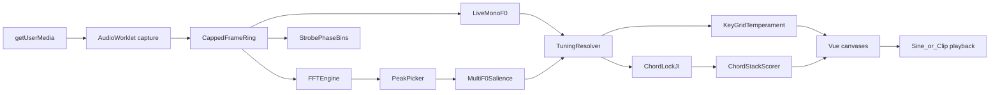
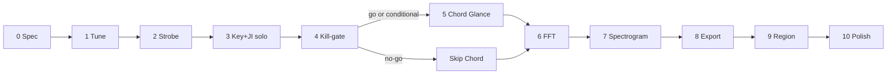

# Digital Tuner — pitch analysis for vocalists

> **Status:** In progress — Phases 1–8 scaffolded on `tuner` (Conditional Chord; FFT/Spec/Export); Phase 9–10 open  
> **Updated:** 2026-11-10 (kill-gate Conditional ADR; Assisted Chord; FFT/Spec/Export)  
> **Goal:** On-device Digital Tuner for singers: trustworthy simple Tune + strobe first; key/grid temperament separate from chord-lock JI; **P0 Chord Glance after kill-gate (before FFT/spec)**; P1 analysis/export afterward.  
> **Placement:** Labs-gated `/tuner` → graduate to **always-available under More** (Recorder/Optical pattern). Users may pin it; **not** added to `DEFAULT_PRIMARY_NAV_ORDER` (avoids crowding pins next to Pitch Pipe).  
> **Clients:** Desktop and mobile; **portrait and landscape**; density/layout adapt via shared narrow + orientation breakpoints (not a separate “mobile app”).  
> **Privacy:** All analysis on-device; mic audio never leaves the browser; analysis rings capped and cleared on leave  
> **Primary use cases:** (1) Solo chromatic / key-aware Tune. (2) **Rehearsal glance** — quartet ~6–10 ft from a phone, singing toward it, reading in-tune / out-of-tune (JI lock, shift, who) from across the room via **fullscreen Glance mode**. Detail breakdown in non-fullscreen.  
> **North-star differentiator:** Quartet chord stack — in-tune-with-self vs in-tune-with-key — **gated on kill-gate evidence**; Glance mode optimized for distance readability  

> **Related:** [audio-recorder-roadmap.md](audio-recorder-roadmap.md) (tuner explicitly **not** inside recorder), [virtual-piano.md](virtual-piano.md), [tag-audio-pitch-import.md](tag-audio-pitch-import.md), [justIntonation.ts](../../web/src/domain/arranging/justIntonation.ts), [narrowViewport.ts](../../web/src/lib/narrowViewport.ts)

---

## Research synthesis

| Product | Relevant strengths | Takeaway for us |
| --- | --- | --- |
| [TonalEnergy](https://www.tonalenergy.com/tet-user-guide-ios) | Target/bar tuner first; Equal vs Just with key center; freeze spectral/harmonic views; tone generator + keyboard | Progressive disclosure; temperament reshapes *targets*; freeze/compare for teaching; headphones when sounding refs |
| [Fine Tuna](https://finetuna.app/) | Shared engine across views; strobe families; JI “barbershop” sevenths; review/pitch map | One measurement pipeline → many visuals; passage review is optional later, not Phase-1 |
| [insTuner](https://eumlab.com/instuner/) | Instant / fine / strobe / FFT / spectrogram modes | Mode taxonomy for *Analyze*, not for first paint |
| [Vocaldemy](https://www.vocaldemy.com/) / Spectral | Browser-only classical DSP; Tune vs Study | Privacy + deterministic goldens; “one thing to look at while singing” |
| Peterson / StroboPro | Strobe = phase vs reference | True phase-comparator strobe (single-bin DFT), with ¢→motion goldens — no fake stripes |

### Vocal / barbershop acoustics

- Quartet “ring” comes from shared harmonics; barbershop seventh ≈ **4:5:6:7** (harmonic seventh ≈ **−31¢** vs ET).
- Reuse Rylander JI in `justIntonation.ts` and natures in `chords.ts` for **chord-lock** targets — not as a substitute for key-grid temperament.
- Multi-F0 on one mic is hard and often incomplete. Classical harmonic-salience first; **ML only after kill-gate fails**, via ADR + size/license budget.

### What this repo already has

| Concern | Location |
| --- | --- |
| Mic + Analyser metering | `web/src/audio/liveMeter.ts`, `recorderCapture.ts` |
| Offline YIN (reference only) | `web/src/lib/tagRoll/pitchExtract/yin.ts` — **not** a live drop-in |
| Note / Hz / cents + concert A | `web/src/audio/pitchUiLabels.ts`, Pitch Pipe prefs |
| Tone playback | `web/src/audio/pitchTone.ts` |
| Piano UI geometry | Pitch Pipe, `SheetPianoDock.vue` |
| Symbolic chord ID | `web/src/domain/arranging/chordNatureIdentify.ts` (needs hysteresis when fed live PCs) |
| AudioWorklet precedent | `soundfonts.ts` — serve worklet from `public/` |
| Low-latency AudioContext factory | `interactiveAudioContext.ts` — factory only; tuner gets a **dedicated** context (see Architecture) |

**Gap:** no live tuner, no spectrogram UI, no proven real-time multi-F0.

---

## Product principles

1. **Tune first, chrome later.** Phase 1–3 ship a single Tune surface (needle, then strobe). No Tune|FFT|Spectrogram|Chord tab strip until Analyze exists.
2. **One engine, many views.** Later surfaces consume the same frame stream.
3. **Split tuning semantics.** **Key grid temperament** (Equal / Just-triad / Custom) is separate from **Chord lock** (Barbershop JI roles for a nature). Never one overloaded “temperament” enum.
4. **Honest polyphony.** Chord UI is pitch-ordered with confidence; no TTBB part labels until assignment is proven. No Chord promises until kill-gate passes.
5. **On-device, capped retention.** No PCM upload; rings ≤30 s; clear on route leave / Labs off; **settings only** in app-state backup.
6. **False-precision policy.** Cents decimals follow estimator confidence (e.g. 0.1¢ only when clarity high; else 1¢). Always show what “green” is relative to (Equal vs chord lock).
7. **Neutral coaching language.** Prefer “+12¢ vs target” over “Lead is sharp.”
8. **Responsive by breakpoint, not by device sniffing.** Layout density follows viewport width + orientation; touch targets and safe-areas work with existing App chrome (`--header-h`, `--bottom-nav-h`, `env(safe-area-inset-*)`).
9. **Glance vs detail.** Fullscreen Glance is for arm’s-length-to-room distance (quartet watching a phone). Non-fullscreen Detail is for close inspection (¢, intervals, settings). Never require reading small type to know locked vs not from across the room.

---

## Information architecture

| Surface | Route | Notes |
| --- | --- | --- |
| Digital Tuner | `/tuner` | Labs-gated v1; More when enabled |
| Labs card | `/labs` | `singtags.labs.digitalTuner.enabled.v1` + privacy blurb (mic stays on device; rings cleared on leave) |
| Pitch Pipe | `/pitch-pipe` | Pay-the-key; shared A4 / global detune |

### Progressive chrome (by phase)

**Phases 1–3 (Tune only)** — wireframes vary by breakpoint; see [Responsive layout](#responsive-layout--desktop--mobile--orientation).

Desktop / wide landscape (conceptual):

```
┌─ Tuner ── Key · Grid · A4 · Freeze · [Rehearsal] · [🎹] · [⚙] ─┐
│  [ Big note + cents + legend ]     [ Needle / Strobe canvas ]   │
│  Level ──────────────────────────────────────────────────────── │
└─────────────────────────────────────────────────────────────────┘
```

Narrow portrait:

```
┌─ Key·Grid·A4 · Freeze · Rehearsal · 🎹 · ⚙ ─┐
│         NOTE  ±¢                            │
│         legend                              │
│     [ needle / strobe ]                     │
│     level                                   │
└─ (bottom nav outside view) ────────────────┘
```

**Phases 5+:** single **Analyze** control (menu or segmented control that collapses on narrow), not four equal-weight tabs fighting the readout.

### Defaults chosen

- Labs first; graduate to **always-on under More** (see [Closed product decisions](#closed-product-decisions-formerly-open)).
- Classical DSP only until kill-gate; ML requires ADR.
- Strobe v1 = **horizontal stripe** only + phase goldens; ring/wave and vertical-landscape mapper deferred.
- Chord stack rows = **low→high pitch**, not voice parts.
- Default FFT size **4096** with latency labeled; max selectable but not default.
- Layout follows **narrow + orientation** matrices below; piano defaults **off** on short landscape until user opens it.
- Mic permission logic starts **duplicated** in `useTunerCapture` (extract shared helper only if a third mic consumer appears).

---

## Responsive layout — desktop / mobile / orientation

Tuner must be usable while holding a phone at a mic, on a tablet on the music stand, and on a laptop in rehearsal. Analysis canvases are secondary to a readable Tune readout at every breakpoint.

### Breakpoints (reuse app primitives)

| Signal | Source | Role |
| --- | --- | --- |
| **Narrow** | `NARROW_VIEWPORT_MQ` = `(max-width: 639px)` via [`narrowViewport.ts`](../../web/src/lib/narrowViewport.ts) / `html[data-narrow]` | Compact chrome, sheet settings, touch-first |
| **Wide** | not narrow (≥640px) | Side-by-side Tune + visual; denser toolbars |
| **Short** | `(max-height: 500px)` or equivalent | Landscape phones: collapse secondary chrome |
| **Orientation** | `(orientation: landscape)` / `portrait` (CSS + optional JS for canvas relayout) | Density / Glance block layout; strobe stays horizontal; piano dock placement |
| **App chrome** | `--header-h`, `--bottom-nav-h`, `env(safe-area-inset-*)` from `App.vue` | Tuner fills `100dvh` minus header/nav; no content under home indicator |

Do **not** UA-sniff “mobile.” A narrow desktop window gets the compact layout; an iPad landscape gets the wide layout.

### Layout matrix

| Viewport | Tune (primary) | Analyze (FFT / Spec / Chord) | Piano dock |
| --- | --- | --- | --- |
| **Wide + portrait** (tablet / desktop window) | Readout left (~40%), needle/strobe right (~60%); toolbar one row | Canvas dominant below or right; peak table / stack as side rail | Bottom horizontal strip (Pitch Pipe–style), collapsible |
| **Wide + landscape** | Same split, more horizontal room for strobe stripes | FFT: horizontal frequency axis full width; spectrogram maximizes height | Dock thinner or end-drawer; hide by default if height tight |
| **Narrow + portrait** (phone) | **Stacked:** toolbar → giant note/¢ → visual → level. Settings in bottom sheet. Hit targets ≥44px | Full-bleed canvas under a compact Analyze header; peak labels limited (top N); stack is full-width list | Optional; overlays bottom third or navigates to sheet — **off by default** so Tune stays one glance |
| **Narrow + landscape / short** (phone on side) | **Density mode:** single horizontal band — note+¢ left, needle/strobe center, Freeze+level right. Hide legend to one icon/tooltip; Key/Grid/A4 behind a compact chip → sheet | Spectrogram/FFT get almost all height; toolbar becomes icon rail; pause/export in overflow | **Forced off** while short unless user pins; never cover the readout |

```mermaid
flowchart TB
  subgraph widePortrait [Wide portrait]
    W1[Toolbar]
    W2[Readout | Strobe]
    W3[Optional piano]
  end
  subgraph narrowPortrait [Narrow portrait]
    N1[Compact toolbar]
    N2[Giant note]
    N3[Strobe]
    N4[Level]
  end
  subgraph narrowLandscape [Narrow landscape short]
    L1[Note+cents | Strobe | Freeze]
  end
```

### Density rules

1. **One primary focal point while singing.** On short/narrow landscape, never show FFT + piano + stack at once.
2. **Toolbar progressive disclosure.** Wide: Key, Grid temp, A4, Freeze, Rehearsal, Piano, Settings inline. Narrow: chips / icons; full controls in `TunerSettingsSheet` (existing sheet patterns).
3. **Analyze is a disclosure**, not four peer tabs. Narrow: `Tune | Analyze` segmented control; Analyze opens FFT/Spec/Chord via nested control or sheet. Wide: may show segmented Analyze modes in the second row.
4. **Typography scale.** Narrow portrait note name uses large display type (clamp); landscape-short uses medium type so strobe keeps pixels. Cents never smaller than 16px on touch.
5. **Touch vs pointer.** Canvases support pointer + touch; spectrogram region-drag uses larger handles on narrow; click-to-sine uses a visible crosshair + confirm on first use for touch (avoid accidental beeps).
6. **Safe areas.** Padding: top under header, bottom above `bottom-nav-h + safe-area`. Landscape notches: horizontal `safe-area-inset-left/right` on the tuner root.
7. **Canvas resize.** `ResizeObserver` on the stage; DPR-aware backing store; on orientation change, redraw overlays from last frame (do not clear Freeze buffer). Throttle relayout during rotate animation.
8. **Performance by viewport.** Narrow defaults: lower spectrogram scroll DPR / cap FFT to 4096 unless user raises it; auto-degrade FPS sooner on short battery mobile (Phase 10). Wide desktop may allow 8192+ more freely.
9. **Strobe orientation.** v1: **horizontal** stripe drift (left flat / right sharp) in all orientations; short landscape gets a taller band / compact readout instead of a second mapper.
10. **FFT / spectrogram axes.** Portrait FFT: frequency on X (or vertical bars). Narrow landscape: prefer frequency on X with reduced label density; spectrogram time on X always, frequency on Y — on short height, shrink Y range to vocal default faster (or offer “zoom to voice”).
11. **Chord stack.** Wide: side rail beside spectrogram/FFT. Narrow portrait: replace canvas with stack list (or split 50/50). Narrow landscape: compact horizontal “pitch chips” row (low→high) with ¢ under each — not a tall table.
12. **Piano.** Reuse Pitch Pipe horizontal geometry; on narrow, default hidden; when shown, use existing scroll/zoom helpers and do not steal focus from Freeze. Short landscape: piano off unless `pianoPinned`. **Always off in Glance.**
13. **Settings & export.** Never push a modal that covers the live readout without an easy dismiss; prefer sheets that leave a peek of note/¢ on tall phones. Disabled in Glance.
14. **Reduced motion / accessibility.** Text twin readout remains visible in Detail; Glance uses words+shapes (strobe off); strobe→needle under `prefers-reduced-motion` in Detail.
15. **Glance exit.** Large enough hit target (not a 24px corner X); swipe-from-edge or persistent `Exit` chip with contrast border for bright rooms.

### Prefs additions (layout)

```ts
pianoPinned: boolean           // keep piano in short landscape (Detail only)
analyzeChrome: 'auto' | 'icons' | 'labels'
density: 'auto' | 'comfortable' | 'compact'
glanceFullscreen: boolean      // sticky; ignored on cold start until mic running
```

Persist only if user overrides; `auto` density recomputes on resize/orientation.

### Responsive acceptance (cross-phase)

| Check | Pass condition |
| --- | --- |
| Narrow portrait Tune | Note + cents readable at arm’s length; Freeze reachable thumb-zone; no horizontal page scroll |
| Narrow landscape Tune | Single-band density; no piano unless pinned; strobe still interpretable |
| Wide desktop Tune | Side-by-side readout + visual; settings inline |
| Orientation flip | Freeze state preserved; canvas resizes without blanking >1 frame burst; no stuck scroll lock |
| Analyze on phone | Usable one-handed; peak inspect + sine without mis-taps dominating |
| App chrome | No tuner controls under bottom nav or notch |
| iPad landscape | Matches **wide** layout (not phone density) |
| Glance @ ~10 ft | Status word + off-block identifiable without reading ¢ |
| Glance chrome | Header/bottom nav hidden; Wake Lock on; exit control reachable |
| Detail | Full ¢ / intervals / nature controls available after exiting Glance |

### Original product requirements (tracked)

1. Strobe-style tuning visual  
2. FFT mode (adjustable resolution) with peak frequencies / note / ±cents  
3. Scrolling spectrogram + pitch/scale grid overlays  
4. Pause FFT/spectrograms; click for pitches / notes / tuning  
5. Export images and data  
6. Configure singing key for an appropriate grid  
7. Assign temperament to the grid from key  
8. Visually see when sung note(s) are in tune  
9. Multi-singer fundamentals → chord; self-lock vs key; clear stack visual  
10. Optional piano  
11. Click → sine  
12. Spectrogram region → repeating chord-frequency clip  
13. Easy; simple tuning primary  
14. Peer-informed without cloning TE wholesale  

---

## Architecture



### Layers

| Layer | Location | Responsibility |
| --- | --- | --- |
| Domain (pure) | `web/src/domain/tuner/` | Key-grid vs chord-lock targets, cents display policy, peaks, stack scoring policy, export schema |
| Application | `web/src/application/tuner/` | Session, hold, ring lifecycle, export jobs, tone-play → detect-suppress |
| Audio adapters | `web/src/audio/tuner/` | Worklet (from `public/`), live mono F0, FFT/Worker, strobe, multi-F0, resynth |
| UI | Thin `TunerView.vue` + `components/tuner/*` + composables | ≤800 lines/file (`godFiles.test.ts`); dumb canvases + text twin |
| Prefs | `singtags.digitalTuner.v1` + Labs flag | Settings only — never f0 history |
| Ports | **None in v1** | Follow recorder/pitch-pipe style (`audio/` adapters). Do **not** invent `ports/tuner*` unless a later ADR says so; update `docs/architecture.md` wording when shipping |

**Hard rules:**

- **AudioContext (corrected):** There is **no** shared singleton today — `createInteractiveAudioContext()` only constructs a low-latency context; Pitch Pipe / `liveMeter` each own their own. Phase 1: tuner owns a **dedicated** context via `createInteractiveAudioContext()` + keepalive; **do not** call `createLiveInputMeter` (it allocates a private context). Coexistence with Pitch Pipe = both contexts resume on gesture; node-graph sharing is **out of scope** until a separate ADR.
- Heavy DSP off main thread (worklet and/or Worker); UI ≤30 Hz updates.
- `yin.ts` is algorithm reference only — new `liveMonoF0` with live hops, Fmin≈55 Hz, octave guards.
- `application/tuner/` stays pure (no Vue/Pinia) — `portsBoundaries.test.ts` walks all `application/`.

### Module sketch

```
web/src/domain/tuner/          # pure; unit-tested
  types.ts
  keyGridTemperament.ts
  chordLock.ts
  displayCents.ts
  peaks.ts
  chordStack.ts
  exportSchema.ts

web/src/application/tuner/     # pure session orchestration
  session.ts                   # start/stop/hold/clear rings
  detectSuppress.ts            # while reference tone plays

web/src/audio/tuner/
  captureWorkletHost.ts        # addModule from public/ + blob fallback (soundfonts pattern)
  ringBuffer.ts
  liveMonoF0.ts                # pure on Float32Array frames — CI-friendly
  fft.ts                       # pure / Worker
  strobe.ts                    # pure phase → paint model
  multiF0.ts
  resynth.ts
web/public/worklets/tuner-capture.js   # served asset; no Vite ?url

web/src/lib/preferences/digitalTuner.ts  # default/parse/normalize/load/save (pitchPipe mold)
web/src/stores/preferences/digitalTunerActions.ts

web/src/composables/
  useTunerCapture.ts           # mic permission, device list, ctx lifecycle, dispose on leave
  useTunerLayout.ts            # narrow + short MQ + orientation → density class

web/src/views/TunerView.vue    # shell only — KEEP UNDER 800 LINES
web/src/components/tuner/…
```

### Prefs sketch (split semantics)

```ts
// singtags.digitalTuner.v1 — SETTINGS ONLY (app-state backup OK)
{
  schema: 'singtags.digitalTuner.v1'
  analyzeSurface: 'hidden' | 'fft' | 'spectrogram' | 'chord'  // chord if kill-gate go|conditional; hidden if no-go
  tuneDisplay: 'needle' | 'strobe'
  keyPc: number
  scaleMode: 'major' | 'minor' | 'chromatic'
  /** Scale / overlay grid — NOT chord-role JI */
  keyGridTemperament: 'equal' | 'justTriad' | 'custom'
  customOffsetsCents: number[12]
  /** Chord-lock layer — independent of keyGridTemperament */
  chordLockEnabled: boolean
  chordNatureId: string | null
  chordRootPolicy: 'lowest' | 'pinned' | 'commonShift'
  pinnedRootPc: number | null
  a4Hz: number | 'followPitchPipe'
  inTuneWindowCents: number       // solo / chromatic green window (e.g. 10)
  chordLockWindowCents: number    // JI chord / role green window (default 5)
  inputDeviceId: string | null
  noiseGateDb: number | null
  fftSize: number            // default 4096
  specFreqMinHz: number
  specFreqMaxHz: number
  specScrollPxPerSec: number
  historyCapSec: number      // default 15, max 30
  pianoVisible: boolean
  pianoPinned: boolean       // keep piano visible in short landscape
  density: 'auto' | 'comfortable' | 'compact'
  analyzeChrome: 'auto' | 'icons' | 'labels'
  /** Rehearsal fullscreen — hide app chrome; distance-first visuals */
  glanceFullscreen: boolean
}
```

**Prefs hygiene (required):** `normalizeDigitalTuner` clamps `fftSize` to allowed set, `historyCapSec` to ≤30, `customOffsetsCents` to length 12, unknown enums → defaults — corrupt `localStorage` must not brick the route. Mirror [`pitchPipe.ts`](../../web/src/lib/preferences/pitchPipe.ts) + tests.

**A4 follow:** when `a4Hz === 'followPitchPipe'`, read live from pitch-pipe prefs / `globalPitchDetuneCents` (or equivalent) inside the composable — no cross-schema write. Document the join in `digitalTunerActions.ts`.

### Chord-stack scoring policy (domain, before UI)

Documented and tested in `chordStack.ts` before any Chord chrome ships:

| Score | Definition |
| --- | --- |
| **Self / Locked** | Given F0s + nature, assign roles; choose root per `chordRootPolicy`; measure each voice’s ¢ error vs JI role ratio. Locked if all \|errors\| ≤ window **after** removing a single common shift (policy `commonShift`) or vs pinned/lowest root. |
| **Key / Centered** | Each F0’s ¢ error vs **key-grid** target (Equal/justTriad/custom) at that PC. |
| **Shifted** | Self Locked, but median F0 vs key-grid is ≥ window (chord in tune with itself, sharp/flat of key). |
| **Unstable** | High F0 variance / vibrato / missing voices → scores greyed; no red/green blame. |

UI shows active policy name. Rows labeled by note name + octave, never Tenor/Lead/… in v1.

---

## JI chord-in-tune visual design (barbershop differentiator)

**Status of coverage before this section:** the plan had **scoring semantics** (Locked / Centered / Shifted) and a thin Chord UI bullet list, but **not** a comprehensive visual/teaching design for “is our chord in tune in just intonation?” This section is that design. **Phase 5** implements it; Phase 3 covers the solo precursor.

### Rehearsal context (normative)

**Primary ensemble scenario:** Phone on a stand or table; four singers roughly **6–10 feet (≈2–3 m)** away, facing the device; room may be bright. They need to know *locked / not / shifted / who* **without walking up**. Detail (exact ¢, interval strip, nature picker) is for when someone steps closer or exits fullscreen.

### What barbershoppers need to see at a glance

**From across the room (Glance / fullscreen) — shape + color, huge type:**

1. **Are we locked with each other?** (full-bleed status: Locked / Fix / Unstable)  
2. **Are we locked but sharp/flat of the key?** (Shifted badge with direction — sharp/flat — readable as icon+word)  
3. **Which pitch(es) are off?** (large colored blocks low→high; off blocks pulse or show bold flat/sharp chevron — **not** dependent on reading “+14¢”)  

**When closer (Detail / non-fullscreen) — numbers + teaching:**

4. **How much?** (±¢ vs JI role, meters, interval strip)  
5. **What chord / nature?** (pin/detect controls)  
6. **What does green mean?** (legend: Chord lock JI vs Equal / key grid)

If Glance cannot answer 1–3 from ~2–3 m, the visual fails the primary ensemble use case.

### Solo precursor (Phase 3) — one singer, JI target

When **Chord lock** is on and a nature (+ root) is pinned:

- Detected (or locked) note shows ±¢ vs **that role’s JI target**, not vs ET.
- Readout legend: `vs Chord lock · C7` (example).
- Optional small **role chip**: `3` / `5` / `7` / … from `roleCents` / Rylander map in [`justIntonation.ts`](../../web/src/domain/arranging/justIntonation.ts).
- Piano highlight (if open) marks the JI target pitch (detuned visually or with a secondary marker), not only the ET key center.

This teaches one voice at a time before multi-F0 exists.

### Two surfaces: Glance (fullscreen) vs Detail (standard)

| Mode | When | Chrome | Information density |
| --- | --- | --- | --- |
| **Glance** | Rehearsal; enter via prominent **Fullscreen / Glance** control (and landscape preferred) | Hide app header + bottom nav; optional thin edge affordance to exit; **Screen Wake Lock** while active | Status wash + huge word + 2–4 pitch blocks; minimal text |
| **Detail** | Coaching / setup / close reading | Normal App chrome + responsive matrix | Full cards, ¢, intervals, nature/root, legend, settings |

Toggle persists as `glanceFullscreen` (also `?glance=1`). **Cold start:** if mic not yet granted or session not running, open **Detail** first (setup); after running, honor sticky Glance. Exiting Glance restores Detail without clearing freeze/nature pin.

#### Glance wireframe (phone landscape — preferred for four blocks)

```
┌──────────────────────────────────────────────────────────────┐
│████████████████  LOCKED  ·  KEY ▲  ██████████████████████████│  ← amber wash if key-shifted
│                                                              │
│   ┌────────┐   ┌────────┐   ┌────────┐   ┌────────┐         │
│   │   ●    │   │   ●    │   │   ●    │   │  ▲▲▲   │         │  ← big blocks
│   │  OK    │   │  OK    │   │  OK    │   │       │         │     (▲/▼ = vs JI)
│   └────────┘   └────────┘   └────────┘   └────────┘         │
│      low ───────────────────────────────► high               │
│                                         [ Exit rehearsal ]   │
└──────────────────────────────────────────────────────────────┘
```

- **Wash + word (never color-only; avoid “green means all good” when shifted):**  
  - Locked + centered → green wash + `LOCKED`  
  - Locked + shifted → **amber/gold wash** (not green) + `LOCKED` + large `KEY ▲` / `KEY ▼` (see [Vocabulary](#vocabulary--consistency-locked))  
  - Not locked → red/rose wash + `FIX`  
  - Unstable / not ready → neutral grey + `WAIT`  
- **Pitch blocks:** ≥~22% of short viewport edge; OK = calm fill; off = bold `▲` / `▼` (voice vs JI — **not** the word SHARP/FLAT). Cents hidden in Glance.  
- **Portrait Glance:** status on top (½ height); blocks 2×2 or column — no ¢.  
- **Solo Tune Glance:** full-bleed in-tune wash + huge `IN TUNE` / `FLAT` / `SHARP` / `WAIT`; needle optional small; **strobe off in Glance** (motion fights distance reading; Detail-only).  
- **Piano off in Glance.** Settings/export/sine-click disabled until Detail.

#### Detail wireframe (non-fullscreen — close reading)

```
┌─ Chord lock (JI) · C7 · policy: commonShift ── confidence ●●●○ ─┐
│  [ Locked ]  [ Shifted +18¢ ]  [ Centered ✕ ]     [ Glance ⛶ ] │
│                                                                  │
│  LOW → HIGH                                                      │
│  ┌──────────┐ ┌──────────┐ ┌──────────┐ ┌──────────┐            │
│  │  C3  1   │ │  E3  3   │ │  G3  5   │ │ Bb3 7    │            │
│  │  0¢  ███ │ │ −2¢ ███  │ │ +1¢ ███  │ │ +14¢ ░░  │            │
│  │  target  │ │ −14¢ ET* │ │  +2¢ ET* │ │ −31¢ ET* │            │
│  └──────────┘ └──────────┘ └──────────┘ └──────────┘            │
│  Intervals: 1→3 −2¢ · 1→5 +1¢ · 1→7 +14¢                        │
│  Nature: [ seventh ▾ ]  Root: [ C ▾ ]                            │
└──────────────────────────────────────────────────────────────────┘
```

\* JI-vs-ET hint is Detail-only teaching chrome.

### Visual elements (normative)

| Element | Glance (fullscreen) | Detail (standard) |
| --- | --- | --- |
| **Summary** | Wash + `LOCKED` / `FIX` / `WAIT`; key shift as `KEY ▲`/`KEY ▼` on **amber** wash | Chips: Locked / Centered / Shifted (±N¢) / Unstable |
| **Pitch row** | 2–4 large blocks; `OK` / `▲` / `▼`; optional one-letter sticker if user-assigned | Cards: note+octave, **role**, ±¢ vs JI, mini meter; `chordLockWindowCents` (default **5¢**) |
| **Role labels** | Optional / tiny | Required on cards |
| **Interval strip** | Hidden | Visible |
| **Nature / root** | Hidden (last pin; tiny abbrev if space) | Always visible; Assisted requires pin before colors |
| **Legend** | Implied by wash + words | Persistent JI vs key-grid legend |
| **Missing voices** | Empty/dim blocks; never `LOCKED` | Empty slots + “listening for N” |
| **Unstable** | Grey wash + `WAIT` | Desaturated meters + “Hold steady to score” |
| **Color access** | Word + chevron + wash (never color alone); bright-room contrast border on status word | Same redundancy on chips/meters |
| **Responsive** | Prefer landscape; portrait = status half + blocks half | Wide rail / narrow stack / landscape chips per earlier matrix |

**Distance readability budget (Glance, ~2–3 m on a ~6″ phone):**

- Status word: display size roughly **≥10% of viewport height** (clamp), high contrast.  
- Pitch blocks: each **≥1.5″ (≈38 mm)** on the short edge when four-across in landscape, or scale down only if more than four.  
- Avoid hairline rules, grey-on-grey, and ¢ as the only offline signal.  
- Test acceptance: a person at **10 ft** can correctly report Locked vs Fix vs key-shifted (`KEY ▲`/`KEY ▼`) and which block shows `▲`/`▼` in a staged mock (even paper prototype before DSP).

### Supported natures (v1 visual)

Reuse `BARBERSHOP_CHORDS` + `roleCents` — **all catalog natures** are eligible when pinned. Auto-detect priority for kill-gate / Go mode (first pass):

1. `seventh` (barbershop 4:5:6:7)  
2. `major`  
3. `minor`  
4. `sixth`, `m7`, `maj7`  
5. Others when pinned only (until auto-ID proven)

Publish which natures were measured in the Phase 4 table.

### What we deliberately do **not** claim in v1 visuals

- Part-named blame (“Lead is sharp”).  
- Live “ring meter” from partial coincidence / roughness (interesting research; out of scope — Locked JI roles are the proxy).  
- Beat-frequency oscilloscope between two partials.  
- That a phone mic heard all four singers when confidence is low.

### Domain outputs the UI must consume

`chordStack.ts` (or adjacent) exposes a stable view-model, e.g.:

```ts
type ChordStackView = {
  natureId: string
  rootPc: number
  policy: 'lowest' | 'pinned' | 'commonShift'
  confidence: number          // 0–1
  voiceCountExpected: number
  voiceCountDetected: number
  commonShiftCents: number    // vs key grid
  selfLocked: boolean
  keyCentered: boolean
  unstable: boolean
  assistedPinRequired: boolean
  tones: {
    hz: number
    note: string              // spelling
    role: ChordToneRole
    errorCentsVsJi: number    // vs role target after policy
    errorCentsVsKeyGrid: number
    jiTargetCentsVsEt: number // teaching hint (−14 for M3, etc.)
    inTuneSelf: boolean
    sticker?: string          // optional user label T/L/Br/Bs — cosmetic only
  }[]
  intervals: { fromRole: ChordToneRole; toRole: ChordToneRole; errorCents: number }[]
}
```

Canvases/components render **only** this model — no ad-hoc cents math in Vue.

### Vocabulary & consistency (locked)

Ambiguous words were failing usability review. Canonical terms:

| Concept | Glance word | Detail label | Do **not** use |
| --- | --- | --- | --- |
| Freeze live reading / spectrum | — | **Freeze** | “Hold” for freeze |
| Unstable / not scoring yet | **WAIT** | “Hold steady to score” | Glance word `HOLD` |
| Chord in tune with itself (JI) | **LOCKED** | “In tune with each other (JI)” | “In tune” alone when key-shifted |
| Chord locked but off key | amber wash + **KEY ▲** / **KEY ▼** | “Locked · N¢ sharp/flat of key” | Wash staying green; word `SHARP` alone for key |
| Solo note flat/sharp of target | **FLAT** / **SHARP** | ±¢ + needle | — |
| One voice flat/sharp of JI role | block **▼** / **▲** only | “+12¢ vs target” | Block label `SHARP`/`FLAT` (collides with key shift) |
| Analyze pause ring | — | **Pause** | “Freeze” for spectrum if we need both — Freeze=tuner reading, Pause=analysis buffer; document in UI tooltip |

### Teaching copy (short strings)

**Glance:** `LOCKED` · `FIX` · `WAIT` · `KEY ▲` · `KEY ▼` · solo `IN TUNE` / `SHARP` / `FLAT`. Blocks: `OK` / `▲` / `▼` only.

**Detail:**

- Locked: “In tune with each other (JI)”  
- Locked + Shifted: “Locked together, ~N¢ sharp/flat of key”  
- Not locked: “Adjust the highlighted pitch(es)”  
- Assisted: “Pin chord and root for reliable colors”  
- Unstable: “Hold steady to score”  

### Entry path — rehearsal without a scavenger hunt

Conflict: Tune-first IA buried Chord under Analyze, but ensemble Glance is a **primary** use case.

**Locked UX:**

1. Detail Tune remains default cold start (mic, key, chord nature pin).  
2. Persistent **Rehearsal** control (same place as Glance entry) that: ensures Chord lock on + nature/root pinned (prompt if missing) → switches Analyze surface to Chord (when shipped) → enters Glance.  
3. Until Phase 5 ships, Rehearsal/Glance on Tune only shows solo in-tune wash (still useful for unison checks).  
4. After Phase 5, Rehearsal is the quartet happy path — not “open Analyze → Chord → Glance.”

### “Who is off?” without TTBB labels

From 10 ft, low→high blocks answer **which pitch**, not **which person**. That is intentional (honest polyphony) but weak for self-correction.

**Locked v1:** Blocks stay pitch-ordered. Optional Detail control: **assign labels** (T/L/Br/Bs or custom) to slots — cosmetic stickers only, stored in prefs, **not** inferred. Glance may show one-letter sticker on each block if assigned. No auto “Lead is sharp.”

### Phase mapping

| Piece | Phase |
| --- | --- |
| Solo Tune **Glance** / Rehearsal entry (wash + words; strobe **off**) | 1 |
| Strobe Detail-only | 2 |
| Solo chord-lock ±¢ + legend + role chip (Detail) | 3 |
| `ChordStackView` domain model + goldens | 0 / 4 |
| Ensemble **Glance** + Detail Chord UI | **5** (was 8 — pulled forward) |
| Interval strip + JI-vs-ET hints | 5 Detail only |
| Wake Lock + sticky glance pref + exit affordance | 1 / 5 |
| FFT / spectrogram / export / region | 6–9 (after Chord if kill-gate ≠ no-go) |
| Optional spectrogram JI guide lines when nature pinned | 7 (overlay only) |
| Distance dogfood (10 ft walk-back test) | 5 exit + graduate checklist |

---

## Priority, dogfood slices, and critical path

Barbershop value is **Tune → JI lock Glance**, not spectrogram tourism. Analysis views are real requirements but **must not block** rehearsal dogfood.

### Priority tiers

| Tier | Goal | Includes | Dogfood? |
| --- | --- | --- | --- |
| **P0 — Solo tuner** | Credible Labs Tune | Phases 0–3 (domain, Tune Detail+Glance, strobe Detail, key grid, solo chord-lock) | Yes — individuals |
| **P0.5 — Kill-gate** | Honest go/no-go | Phase 4 only (offline; little UI) | Spike report |
| **P0 — Quartet Glance** | Room-distance JI lock | Phase 5 Chord Detail+Glance + Rehearsal path (**requires** Phase 4 ≠ no-go) | Yes — primary ensemble |
| **P1 — Analysis** | FFT / spectrogram / pause / click-sine | Phases 6–7 | Optional |
| **P1 — Export / region** | Share + clip audition | Phases 8–9 | Optional |
| **P2 — Polish / graduate** | Perf, ADR, always-on More | Phase 10 | Graduate |

On Phase 4 **no-go**: ship P0 solo forever; skip Phase 5 Chord; still allow P1 analysis later. On **conditional**: Phase 5 ships Assisted. On **go**: Phase 5 full.

### Critical path (do not reorder casually)



**Rule:** After a green/conditional kill-gate, implement **Phase 5 Chord before** FFT/spectrogram. Analysis can proceed in parallel only if two people; single-threaded work always prefers Chord.

### Explicit deferrals (keep out of P0)

- Vertical strobe mapper, ring/wave strobes  
- ML multi-F0  
- Passage-review / % in-tune strip (thin strip only if cheap in export phase)  
- Part stickers (nice in Phase 5 Detail; not required for 10 ft gate)  
- Historical temperaments, file load, Harmonic Energy  

---

## Phased delivery (priority-revised order)

Phase 4 decides Chord. **Chord UI is Phase 5** (ahead of FFT/spec). FFT/spectrogram/export/region follow. Chord Analyze entry: **hidden on no-go**; **Assisted on conditional**; **normal on go**. No second Labs flag for Chord.

### Phase 0 — Spec & golden harness

- This plan (done) + [README.md](README.md) index + recorder cross-link.
- Domain stubs: `keyGridTemperament`, `chordLock`, `displayCents`, `chordStack` scoring policy tests.
- Prefs module skeleton: `digitalTuner.ts` default/parse/normalize + unit tests (no UI yet).
- Fixtures: pure sines; 4:5:6:7 stacks; ±5/10/20¢ detunes; octave-ambiguous missing-F0 tones; noise beds — **store as generated Float32 in tests or small committed PCM under `web/src/audio/tuner/fixtures/`** (not under `public/` to avoid Workbox precache bloat).
- Enforce layering: `TunerView.vue` shell-only; `godFiles` ≤800; `application/tuner` pure.
- Decide worklet host helper (copy `soundfonts.ts` public URL + blob fallback + strip sourceMappingURL).
- Doc stubs when coding starts: row in `docs/status.md` Open; one paragraph in `docs/architecture.md` that tuner lives under `audio/` + `domain/tuner` (no ports).

**Exit:** Domain + prefs normalize goldens pass offline; scoring policy tests green; fixture generation script or checked-in buffers documented.

### Phase 1 — Simple Tune (primary use case)

**Scope:** Mic → live mono F0 → note + confidence-scaled cents + needle + green hold. **No Analyze tabs.** Responsive Tune shell for wide / narrow / short.

- Route `/tuner`, Labs flag, nav when enabled; privacy blurb — complete the [registration checklist](#labs--nav--router-registration-checklist).
- Worklet from `web/public/worklets/tuner-capture.js` via host helper; dedicated tuner `AudioContext` from `createInteractiveAudioContext()` + keepalive; resample; `statechange` / `visibilitychange` handling; **dispose stream + ctx on route leave**.
- New `liveMonoF0` (YIN/MPM-inspired): pure function on frames for CI; live hops, Fmin≈55 Hz, clarity gate, hold-last-good, octave guard.
- Mic UX in `useTunerCapture`: map `NotAllowedError` / `NotFoundError`; retry button; device enumerate (recorder pattern); do **not** reuse `createLiveInputMeter`.
- Settings: A4 (follow Pitch Pipe), in-tune window, sensitivity, **input device picker**, basic noise gate, transpose spelling.
- Text readout always present in Detail (a11y twin); idle empty-state before mic grant (“Allow microphone to tune”).
- Suppress / pause detection while reference tone plays; headphone banner.
- **Layout:** Tune matrix via `useTunerLayout`; `TUNER_SHORT_MQ` in composable first; safe-area + app chrome in Detail; `ResizeObserver`; ≥44px targets on narrow.
- **Rehearsal / Glance shell (Tune):** Control hides header/bottom nav; wash + `IN TUNE`/`SHARP`/`FLAT`/`WAIT`; **no strobe in Glance**; Wake Lock; large Exit; `glanceFullscreen` sticky only after mic running. Cold start always Detail for mic/settings.
- Freeze control (not “Hold”) for freezing the live reading.
- If Recorder already holds the mic, conflict CTA + retry.

**Phase 1 exit criteria (not deferred to polish):**

- Synthetic C2–C6 within ±2¢ steady; clarity gating verified (**offline unit tests** — not real worklet in Vitest).
- Safari iOS + Chrome Android smoke: mic permission, worklet `addModule`, background interrupt recovery.
- Open tuner while Pitch Pipe warm — both features produce sound/analysis after gesture (separate contexts OK).
- Permission-denied + suspended-context CTAs; clean dispose on navigate away; Wake Lock released on exit/leave.
- Detail Tune with **no** mode tabs; Glance readable as in-tune vs not without ¢; vocabulary matches [Vocabulary](#vocabulary--consistency-locked); `TunerView.vue` under 800 lines.
- **Responsive:** pass narrow-portrait, narrow-landscape, and wide desktop checks in the [responsive acceptance](#responsive-acceptance-cross-phase) table (Tune rows).

### Phase 2 — Strobe mode

- Phase-comparator stripe at detected or **user-locked** target; optional harmonic lanes 2–4.
- Goldens: known detune → phase advance direction/magnitude; document ¢→visual mapping.
- Needle | Strobe toggle on Tune **Detail** only — **Glance never shows strobe**.
- `prefers-reduced-motion` → force needle.
- **Layout (v1):** **horizontal drift only** in all orientations; short landscape taller band. Vertical mapper Phase 10+ optional.
- DPR-aware canvas resize on rotate without dropping Freeze.

**Exit:** Horizontal strobe goldens pass; no ship without them.

### Phase 3 — Key grid, optional piano, chord-lock *targets* (solo)

**Scope:** Requirements 6, 7, 8, 10 for a **single** singer. Implements the [solo precursor](#solo-precursor-phase-3--one-singer-ji-target) of the JI visual design.

- Key + scaleMode → scale-degree highlights on readout / optional piano.
- **Key grid temperament** control: Equal | Just triad | Custom (¢ per PC).
- Optional **Chord lock** toggle + nature/root picker: ±¢ and green vs **JI role target**; role chip; legend `vs Chord lock · …` (never conflated with key grid).
- Pref: `chordLockWindowCents` (default 5) separate from solo chromatic window if useful.
- Piano dock: highlight JI target; tap = reference tone (with detect-suppress).
- Legend always visible on tall layouts; collapses to chip/tooltip on short landscape.
- **Layout:** piano **off by default** on narrow; **forced off** on short landscape unless `pianoPinned`; wide uses bottom horizontal strip (Pitch Pipe helpers).

**Tests:** Just-triad M3≈−14¢, P5≈+2¢ vs ET; barbershop V7 uses `JUST_RATIOS.harm7` under chord lock; custom offsets round-trip; piano visibility rules match matrix; legend switches when chord lock toggles.

### Phase 4 — Multi-F0 kill-gate (spike, little/no product chrome)

**Scope:** Decide whether requirement 9 is honest enough to ship.

- Offline pipeline on **real quartet WAV fixtures** (held chords, tags, noisy room if available) + synthetic stacks.
- Classical harmonic-salience multi-F0 → PC set → nature match with hysteresis helpers.
- Publish accuracy table: voice-count recall, PC set accuracy, nature accuracy, self/key score correctness on synthetics — **with fixture provenance**.

**Provisional rubric** (spike may tighten numbers in the ADR; do not loosen without writing why):

| Result | Synthetics (held JI / shifted / one-voice-sharp stacks) | Real or labeled-proxy held ensemble |
| --- | --- | --- |
| **Go** | ≥95% frames: correct Locked / Shifted / single-voice-fault discrimination; nature ID ≥90% under hysteresis | Annotated held takes: ≥70% frames recover the expected PC set (F0s within ±50¢ of reference annotation when present); nature stable ≥80% of scored frames **without** requiring a pin |
| **Conditional** | Synthetics meet Go | Real/proxy: &lt;70% unassisted PC-set **but** ≥60% with manual nature+root pin and hysteresis; scores usable when pinned |
| **No-go** | Synthetics fail Locked/Shifted discrimination (&lt;95%) **or** thrash too hard to trust assisted mode | — |

**Product consequence (locked):**

| Result | Chord in Analyze |
| --- | --- |
| **Go** | Chord surface ships; normal copy; still pitch-order, no TTBB labels |
| **Conditional** | Chord surface ships as **Assisted** — persistent banner: pin nature/root for reliable coloring; rows grey until pin when confidence low. **No** extra Labs flag |
| **No-go** | Chord Analyze entry **hidden**; `multiF0` code may remain behind a dev-only or commented path; revisit ML ADR or multi-mic later |

**Fixtures:** Synthetics always in-repo. Real: short CC0/internal clips under `web/src/audio/tuner/fixtures/quartet/` (git-lfs if large) **or** polecat-mix proxies labeled separately (mix ≠ room mic). Do not block Phase 4 start on perfect field recordings.

**Exit:** ADR or plan appendix records go/conditional/no-go + measured table; **Phase 5** implements the matching consequence (or skip Chord on no-go).

### Phase 5 — Chord stack UI (P0 ensemble — only if Phase 4 ≠ no-go)

**Scope:** Requirements 8–9. Skip on **no-go**. Full [JI visual design](#ji-chord-in-tune-visual-design-barbershop-differentiator) + Glance/Detail. **Do this before FFT/spectrogram.**

- **Detail:** `ChordStackView` chips, pitch cards, interval strip, nature/root, legend, optional stickers, **Rehearsal** entry.
- **Glance / Rehearsal:** vocabulary wash/words/blocks; Wake Lock; landscape preferred; pin prompt → Glance.
- Assisted vs go per Phase 4 consequence table.
- Optional Detail-only: JI-vs-ET hints; stickers not required for 10 ft gate.

**Exit / acceptance:** Detail checklist; **10 ft walk-back**; amber wash when Locked+key-shifted; synthetics Locked/Shifted/fault; Rehearsal ≤2 taps after pin; consistency checklist.

### Phase 6 — FFT analysis + pause + sine click (P1)

**Scope:** Requirements 2, 4 (FFT), 11. Introduce **Analyze** disclosure if not already opened via Rehearsal/Chord.

- Default fftSize 4096; latency labeled; narrow discourages >8192.
- Peak labels vs key-grid (+ chord-lock annotation if on); limit labels on narrow.
- Pause ring; click/tap → sine (detect-suppress); off main thread; ≤30 Hz UI.
- Wide: canvas + peak list; narrow: full-bleed + bottom readout sheet.

**Exit:** Multi-partial peaks; axis mapping; Pause; no mid-mobile jank; orientation keeps selection.

### Phase 7 — Scrolling spectrogram + grids (P1)

**Scope:** Requirements 3, 4 (spec).

- Canvas first; WebGL only if FPS &lt; 30.
- Controls + narrow sheet; key-grid overlays; optional JI guide lines; history cap; clear on leave.
- Pause + inspect + sine; enlarged touch handles (Phase 9 prep).

**Exit:** Chirp ridge; overlay Hz match; ring cleared on leave; rotate preserves Pause buffer.

### Phase 8 — Export (+ optional thin % strip) (P1)

**Scope:** Requirement 5.

- PNG + metadata strip/sidecar; CSV/JSON snapshots; never auto-backup PCM.
- Optional thin session % in-tune — only if cheap; not a P0 blocker.

**Exit:** Schema versioned; provenance present.

### Phase 9 — Region audition (P1)

**Scope:** Requirement 12.

- Drag-select; resynth vs raw labels; short loops; thumb-friendly on landscape.

**Exit:** Known-chord region ratios; empty no-op; usable one-handed.

### Phase 10 — Polish, ADR, graduate (P2)

- Responsive + battery/thermal + a11y; ADR with kill-gate table; always-on More graduate; optional vertical strobe.
- Perf: ≥30 FPS spectrogram both orientations; auto-degrade.

**Exit:** [Graduate checklist](#graduate-checklist-labs--always-on-more) complete.

---

## Requirements → phases

| # | Requirement | Phase |
| --- | --- | --- |
| 1 | Strobe visual | 2 |
| 2 | FFT + peaks/notes/¢ | 6 |
| 3 | Spectrogram + grids | 7 |
| 4 | Pause + click analysis | 6–7 |
| 5 | Export images/data | 8 |
| 6 | Key for grid | 3 |
| 7 | Temperament (key grid) | 3 |
| 8 | In-tune visuals | 3 (+5 stack) |
| 9 | Multi-singer chord / self vs key | 4 kill-gate → **5** UI |
| 10 | Optional piano | 3 |
| 11 | Click → sine | 6–7 |
| 12 | Region → chord clip | 9 |
| 13 | Simple tuning primary | 1–3 IA |
| 14 | Peer-informed UX | throughout |

---

## Non-goals

- Metronome, TE practice journal, string fretboard, TE Harmonic Energy view.
- Cloud analysis / voice upload; auto-backup of PCM or f0 traces.
- Full historical temperament encyclopedia / piano stretch curves.
- Recorded-file / contest-audio load (live mic only in this plan).
- Replacing Pitch Pipe or Arranging Coach; Tag Studio chart comparison.
- Guaranteed four-voice separation; **TTBB-named blame** in v1.
- Multi-mic / per-singer hardware routing.
- Embedding inside Audio Recorder ([audio-recorder-roadmap.md](audio-recorder-roadmap.md)).
- Instrument transposition modes (unless later requested).
- ML multi-F0 without kill-gate failure + ADR (license, ≤~500 KB, Cache API, Safari, classical fallback).

---

## Test plan (tightened)

### Investment order (where time goes)

1. **Domain goldens first** (cheapest, gate every phase) — cents, temperament, `ChordStackView` scoring, display policy.  
2. **Prefs normalize** — corrupt LS must not brick.  
3. **Route/Labs smoke** — registration checklist.  
4. **Device smoke only for P0 exits** (Phases 1 and 5) — not every commit.  
5. **FFT/spec/export tests** — after Chord ships; don’t block P0 dogfood.

Vitest never runs real AudioWorklet/mic; pure buffers only. No canvas pixel goldens in CI.

### Definition of Done by phase (must all pass to merge phase)

| Phase | CI must-pass | Manual / device (blocking for that phase) |
| --- | --- | --- |
| **0** | Domain + prefs normalize + scoring policy tests | — |
| **1** | Route/Labs/nav tests; `liveMonoF0` sine goldens ±2¢; god-file cap | Safari iOS + Chrome Android: mic, worklet, dispose, Tune Glance wash, Pitch Pipe coexistence |
| **2** | Strobe phase goldens (¢→motion) | Spot-check Detail strobe; confirm absent in Glance |
| **3** | Key-grid + chord-lock target tables; legend unit if extracted | Solo chord-lock legend switches; piano visibility matrix |
| **4** | Synthetic multi-F0 / stack discrimination ≥ rubric | Write measured table + go/conditional/no-go ADR note (**merge gate for Phase 5**) |
| **5** | `ChordStackView` view-model tests; Assisted pin behavior | **10 ft walk-back**; Rehearsal path; amber wash; consistency checklist |
| **6–7** | Peak/FFT helpers; overlay Hz | Mid-phone FPS ≥30 or auto-degrade proven |
| **8–9** | Export schema; resynth interval checks | Share/download on iOS Safari once |
| **10** | — | Full graduate checklist |

**Hard gate:** Phase 5 code must not merge without Phase 4 outcome recorded. Phase 6+ must not delay starting Phase 5 after a go/conditional.

### Manual scripts (keep short)

**Tune Glance (Phase 1):** Grant mic → Detail shows note → Rehearsal/Glance → from 10 ft call IN TUNE vs SHARP/FLAT/WAIT → Exit → Detail restores.

**Chord Rehearsal (Phase 5):** Pin C7 → Rehearsal → Glance → staged Locked / key-shifted / one-voice-sharp mocks or live → report LOCKED / KEY ▲ / which block ▲ → Exit → Detail shows ¢.

**Vocabulary audit:** ripgrep UI strings for forbidden Glance `HOLD`, bare block `SHARP`/`FLAT`, green wash when `selfLocked && !keyCentered`.

### Device matrix cadence

- **Every P0 phase exit:** one iOS Safari + one Android Chrome pass of that phase’s manual script.  
- **Pre-graduate:** full responsive acceptance table + both orientations spectrogram perf (if P1 shipped) or skip spec perf if analysis deferred.

---

## Risks

| Risk | Mitigation |
| --- | --- |
| Multi-F0 too weak for Chord UI | Phase 4 kill-gate; hide or assisted-only |
| Just vs JI user confusion | Split controls + always-on legend |
| Mode-tab clutter | No tabs until Analyze; Tune-default forever |
| False 0.1¢ trust | `displayCents` policy |
| Speaker feedback | Detect-suppress + headphone banner |
| Safari / context fights | Phase 1 exit criteria |
| RAM / sync bloat | Cap 30 s; settings-only backup |
| Rehearsal social harm | Pitch-order stack; neutral copy; no fake part labels |
| Labs starvation | Graduate to always-on More (not default pin) |
| Phone landscape crushes readout | Short/density band layout; piano forced off; Analyze overflow |
| Canvas blur / blank on rotate | ResizeObserver + DPR redraw; preserve Freeze |
| Accidental sine beeps on touch | Larger hit slop; optional first-tap confirm; disabled in Glance |
| iPad treated as “phone” | Width-based narrow MQ only — iPad landscape = wide layout |
| Can’t read tuner from across room | Glance: wash + words + block ▲/▼; ¢ Detail-only |
| Screen sleeps mid-tag | Screen Wake Lock while Glance active |
| Color-only / green=good when key-shifted | Amber wash for Locked+Shifted; `KEY ▲`/`KEY ▼` |
| SHARP means two things | Key shift ≠ voice error vocabulary table |
| Hold/HOLD/Pause collision | Freeze / WAIT / Pause |
| Chord Glance buried under Analyze | Rehearsal happy path |
| Who is off? | Pitch blocks + optional stickers; no fake TTBB |
| Assumed shared AudioContext | Dedicated tuner ctx; coexistence = dual resume |
| Fat TunerView fails CI | Shell + composables; 800-line god-file cap |
| Incomplete Labs wiring | Full registration checklist |
| Vitest can’t run worklets | Pure DSP goldens; device smoke for worklet |
| Mic held by Recorder | Conflict CTA + retry |
| Corrupt prefs brick route | Strict `normalizeDigitalTuner` |
| Phase 4 without real WAVs | Synthetics + labeled proxies; provenance in writeup |

---

## Implementation readiness — gaps closed for a smooth build

Findings from a 2026-11-09 re-review against the repo. Decisions below are **binding** for implementation unless a later ADR supersedes them.

### Labs / nav / router registration checklist

The plan’s original “5 files” list was incomplete. Mirror a Labs feature (e.g. wireless / local library) across **all** of:

| Step | Files |
| --- | --- |
| Flag constant | `web/src/stores/preferences/storage.ts` **and** `web/src/lib/preferences/keys.ts` |
| Labs setters | `web/src/stores/preferences/labsFlags.ts` + export from `stores/preferences.ts` |
| Settings blob | `web/src/lib/preferences/digitalTuner.ts` + `stores/preferences/digitalTunerActions.ts` |
| Route + `meta` + `beforeEach` auto-enable | `web/src/router/index.ts` (+ `router.test.ts` deep-link case) |
| Nav catalog | `primaryNav.ts`: `PRIMARY_NAV_IDS`, `PRIMARY_NAV_LAB_IDS`, `PRIMARY_NAV_ITEMS`, gates, `primaryNavIdForRouteName` |
| Gate consumers | `App.vue`, `AppMoreMenu.vue`, `SettingsView.vue` (lab hide switch) |
| Labs card | `LabsView.vue` (+ test) |
| Backup / Drive app-state | `appStateBackup.ts` `APP_STATE_LOCAL_KEYS` — **both** `singtags.labs.digitalTuner.enabled.v1` and `singtags.digitalTuner.v1` |
| Nav tests | `primaryNav.test.ts`, More menu tests as needed |
| Icon | Pick an existing icon set entry used by nav (same pattern as Pitch Pipe / Recorder) |

Forgetting `SettingsView` hide wiring or one of the dual key files is the usual desync bug.

### Audio / mic decisions

| Topic | Decision |
| --- | --- |
| Worklet URL | `web/public/worklets/tuner-capture.js`; host copies SpessaSynth pattern (public URL → blob fallback, strip `sourceMappingURL`) |
| Vite `?url` | **Forbidden** for worklet modules (known breakage) |
| AudioContext | Dedicated tuner context via `createInteractiveAudioContext()`; not a singleton; not `liveMeter`’s context |
| Pitch Pipe coexistence | Separate contexts OK; both must resume on user gesture |
| Mic permission UX | Own `useTunerCapture` (recorder string mapping + retry); no shared permission composable exists yet — optional extract later if duplication hurts |
| Mic conflict | Detect failed `getUserMedia` / ended tracks when another feature holds mic; show retry copy |
| Lifecycle | Stop tracks, disconnect worklet, clear rings, suspend/close ctx on `onBeforeUnmount` / route leave |
| Keepalive | Use `ensureAudioKeepalive` on tuner ctx if playing reference tones; don’t leave keepalive running after leave |

### Testing decisions (CI vs device)

| Layer | In Vitest CI | Manual / device |
| --- | --- | --- |
| Domain cents / temperament / stack scores | Yes | — |
| `liveMonoF0` / strobe phase / FFT peaks on synthetic buffers | Yes (pure functions) | — |
| Prefs normalize | Yes | — |
| Route / Labs flag / nav gate | Yes (existing patterns) | — |
| Real `audioWorklet.addModule` | **No** (happy-dom won’t) | Safari/Chrome smoke |
| Canvas pixels / spectrogram paint | Mock `getContext` only | Visual check |
| Mic permission | Stubbed errors in composable unit test if feasible | Real devices |

Do not block Phase 1 on inventing worklet integration tests in CI.

### Architecture / docs / size

| Topic | Decision |
| --- | --- |
| Ports | No `ports/tuner*` in v1 |
| `TunerView.vue` | Shell only; **hard cap 800 lines** (`godFiles.test.ts`) — logic in composables/components |
| `docs/status.md` | Add Open row when Phase 1 starts |
| `docs/architecture.md` | Note tuner as `domain/tuner` + `audio/tuner` Labs tool (non–Tag Studio) when Phase 1 starts |
| Short MQ | `useTunerLayout` local constant first; promote to shared lib only if a second feature needs it |

### Product / UX holes that still need care during build

1. **Idle / denied / suspended states** — three distinct CTAs; don’t leave a blank canvas.
2. **First gesture** — Start/Allow control that resumes AudioContext + requests mic (autoplay policy).
3. **Freeze vs Pause naming** — Tune **Freeze** (live reading) vs Analyze **Pause** (spectrum ring); never Glance word `HOLD`.
4. **Export on iOS Safari** — prefer Share / download patterns already used elsewhere; test `toBlob` + file naming.
5. **PWA precache** — worklet `.js` in `public/` will be precached (small OK); keep fixture WAVs out of `public/`.
6. **Dark/light** — use existing CSS variables; no one-off purple/glow (follow app tokens).
7. **Concurrent navigation** — leaving `/tuner` mid-sine must `stop()` tones (detect-suppress cleanup).
8. **Keyboard** — desktop: space = Freeze, Esc = dismiss sheet / Exit Glance (Phase 1 if cheap).

### Phase 4 fixture hole

Accuracy claims need provenance. Ship synthetics always; real quartet WAVs are best-effort with labeled proxy vs field. Kill-gate writeup must say which.

---

## Implementation touchpoints

- This plan + [README.md](README.md)
- Full [registration checklist](#labs--nav--router-registration-checklist) above
- `appStateBackup.ts` — labs flag **and** settings blob
- `docs/status.md` + light `docs/architecture.md` note at Phase 1 start
- Later: `docs/decisions/digital-tuner-engine.md` (post Phase 4)

---

## Graduate checklist (Labs → always-on More)

- [ ] Phase 1–3 used in real rehearsal without P0 bugs  
- [ ] Safari iOS worklet + mic path solid  
- [ ] Tune remains default; Analyze is secondary  
- [ ] Phase 4 result recorded (go / conditional / no-go); Chord matches consequence table  
- [ ] Privacy copy accurate; rings clear on leave  
- [ ] Export provenance present **if** Phase 8 shipped (not required to graduate on P0-only)  
- [ ] Responsive acceptance table passed (phone portrait + landscape, tablet/desktop wide)  
- [ ] Orientation change preserves Freeze / Pause without layout breakage  
- [ ] Labs flag forced always-on (Recorder-style); **not** inserted into `DEFAULT_PRIMARY_NAV_ORDER`  
- [ ] Manual pin still works for users who want a bottom-tab slot  
- [ ] Glance / Rehearsal: 10 ft walk-back passed; amber wash when Locked+key-shifted  
- [ ] Vocabulary audit: no Glance `HOLD`; voice errors are ▲/▼ not SHARP/FLAT on blocks  
- [ ] Rehearsal control reaches Chord Glance without Analyze menu diving  
- [ ] Wake Lock does not leak after leave / exit Glance  

---

## Adversarial review — disposition

Full adversarial findings from 2026-11-07 were folded into this revision; later passes added responsive layout and implementation-readiness closures. Summary of **incorporated** amendments:

| Amendment | Where in plan now |
| --- | --- |
| Multi-F0 kill-gate; Chord before FFT/spec; P0/P1 tiers; DoD | Phase 4→**5 Chord**→6+; [Priority](#priority-dogfood-slices-and-critical-path); [Test plan](#test-plan-tightened) |
| Split key-grid vs chord-lock | Principles, prefs, Phase 3, scoring policy |
| Defer mode tabs | IA progressive chrome; Phase 1 |
| Cap/clear history; settings-only backup | Principles, ringBuffer, prefs, non-goals |
| Pitch-order stack, no TTBB labels | Scoring policy, Phase 5, non-goals |
| Document root/common-shift scoring | `chordStack` policy table |
| Extra non-goals (file load, harmonic energy, part blame, ML gates) | Non-goals |
| Safari + dedicated AudioContext coexistence as Phase 1 exit | Phase 1; AudioContext decision (not a false singleton) |
| False-precision / green legend | Principles, `displayCents`, Phase 3 |
| Input device + noise gate | Phase 1 settings |
| Detect-suppress on reference tones | Phase 1, 5, 9 |
| Export provenance / thin % strip | Phase 8 (P1; not graduate-blocking) |
| Graduate time-box | Placement + graduate checklist |
| Desktop + mobile density; portrait + landscape | [Responsive layout](#responsive-layout--desktop--mobile--orientation) |
| Impl readiness | [Implementation readiness](#implementation-readiness--gaps-closed-for-a-smooth-build) |
| Former residual TBDs closed | [Closed product decisions](#closed-product-decisions-formerly-open) |
| JI chord-in-tune visual + Glance/Detail | [JI visual design](#ji-chord-in-tune-visual-design-barbershop-differentiator); Phase 3 + 5 |
| Room-distance Glance | Wake Lock; 10 ft acceptance |
| Consistency/usability (vocab, wash, Rehearsal) | [Consistency adversarial](#consistency--usability-adversarial-2026-11-09) |

---

## Consistency & usability adversarial (2026-11-09)

Attacked the plan for **internal contradictions** and **rehearsal UX failure modes**. Findings and closures:

### Critical (fixed in-plan)

| Issue | Why it hurts | Closure |
| --- | --- | --- |
| **`HOLD` vs Hold vs Pause** | Three meanings; Glance `HOLD` reads as freeze from 10 ft | Vocabulary table: **Freeze** / **WAIT** / **Pause** |
| **`SHARP` = key shift AND voice error** | Quartet cannot tell “we’re sharp of key” from “Bb is sharp” | Key: `KEY ▲`/`KEY ▼`; voices: block `▲`/`▼` only |
| **Green wash + Locked+Shifted** | Distance readers see “all good” | **Amber wash** when Locked but key-shifted |
| **Chord Glance buried under Analyze** | Primary ensemble use case requires menu diving | **Rehearsal** happy path → pin → Chord → Glance |
| **Strobe in Glance** | Fine motion is unreadable at 10 ft and fights wash | **Strobe Detail-only**; Glance = wash + words |
| **Sticky Glance on cold start** | Skip mic CTA / settings | Glance sticky only after session running; else Detail |
| **“Who is off?” with pitch-only blocks** | Singers can’t map blocks to people | Optional **cosmetic stickers**; no fake TTBB inference |
| **Prefs `glanceMode` vs `glanceFullscreen`** | Spec drift | Single name: `glanceFullscreen` |

### High (fixed or constrained)

| Issue | Closure |
| --- | --- |
| Orientation blurb still implied strobe axis swap | Horizontal-only; orientation affects density/blocks only |
| “Shared AudioContext mandatory” leftover | Corrected to dedicated context + factory |
| Piano / sine / settings in Glance | Forced off / disabled |
| Tiny Exit control | Large Exit chip + contrast; bright-room border on status word |
| justTriad vs Chord lock confusion | Keep split controls; legend always states which green |
| Principle “Tune first” vs ensemble primary | Tune Detail cold start; Rehearsal is the quartet path once Chord ships |

### Residual usability risks (accepted, monitor)

| Risk | Mitigation if it bites |
| --- | --- |
| Bright sunlight still washes amber/green | Add pattern fill (stripes) behind status word in Phase 10 |
| Four blocks too small on SE phone landscape | Drop to 2×2 or allow landscape-lock prompt |
| Rehearsal prompts every time nature unset | Remember last nature/root aggressively |
| Optional stickers become “fake science” | UI copy: “Labels are reminders only” |

### Consistency checklist (ship gate)

- [ ] No user-visible string `Hold` meaning freeze (use Freeze)  
- [ ] No Glance string `HOLD`  
- [ ] No pitch-block caption `SHARP`/`FLAT` (chevrons only)  
- [ ] Key shift never uses bare `SHARP`/`FLAT` without `KEY`  
- [ ] Locked+key-shifted ≠ green wash  
- [ ] Glance disables strobe, piano, sine, export  
- [ ] Rehearsal reaches Chord Glance ≤2 taps after pin exists  
- [ ] 10 ft walk-back script uses vocabulary above

---

## Closed product decisions (formerly open)

These were residual TBDs; they are now **decided** so implementation does not stall.

| Topic | Decision | Rationale |
| --- | --- | --- |
| **Phase 4 numeric rubric** | Provisional thresholds in Phase 4 (synthetics ≥95% Locked/Shifted/fault discrimination; real **Go** ≥70% PC-set within ±50¢ and ≥80% nature unassisted; **Conditional** ≥60% with nature+root pin; else **No-go**). Spike may **tighten** numbers in the ADR, not silently loosen. | Auditable bar before Chord UI; outcomes remain data-dependent but rules are not TBD |
| **Graduate path** | Always-available under **More** (force Labs flag on — Recorder/Optical pattern). **Do not** add to `DEFAULT_PRIMARY_NAV_ORDER`. User may pin manually. | Ships as a core tool without stealing default pins from Browse/Pitch Pipe |
| **Conditional Chord UX** | Show Chord in Analyze with persistent **Assisted** banner; require pin before coloring rows; **no** second Labs flag | Honest polyphony; differentiator stays reachable without a hidden experiment toggle |
| **Short-landscape strobe** | **Horizontal-only** in v1; taller stripe band + compact readout. Vertical paint mapper = optional Phase 10+ only | One physics→paint golden path; less “pretty but wrong” risk |
| **Shared `useMicPermission`** | **Do not extract** in v1; keep mic UX in `useTunerCapture`. Revisit only if a third mic feature duplicates it painfully | Avoids premature abstraction |

**Phase 1 can start with no product TBDs.** Phase 4 still *measures* fixtures against the rubric (go/conditional/no-go is empirical); the rubric and UI consequences are fixed.
