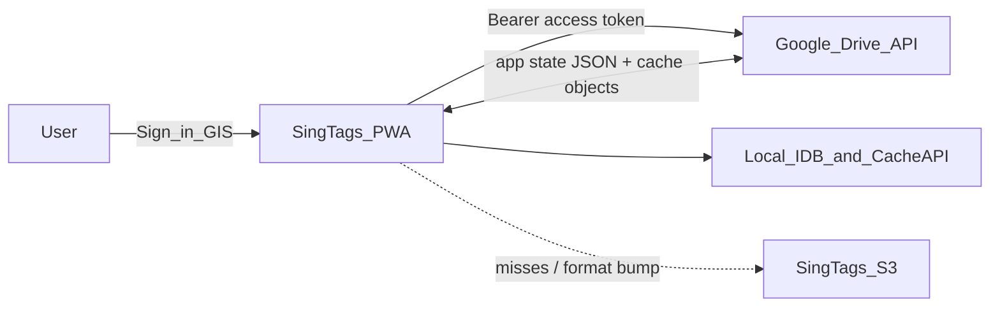

# Google Drive sync — app state + optional offline cache mirror

> **Status:** In progress — Phases 0–2 on branch `user-login` (auth + app-state Drive I/O); Google Cloud console steps and live smoke test pending; Phases 3+ not started  
> **Created:** 2026-11-02  
> **Related:** [labs-wireless-transfer-and-drive-sync.md](labs-wireless-transfer-and-drive-sync.md) (Feature 4 sketch — this plan is the SSOT for Drive sync), [catalog-split-and-s3-pull.md](catalog-split-and-s3-pull.md) (origin egress), [../decisions/offline-library.md](../decisions/offline-library.md), [../decisions/audio-storage-cache.md](../decisions/audio-storage-cache.md), [`web/src/lib/appStateBackup.ts`](../../web/src/lib/appStateBackup.ts), [`web/src/offline/cacheManage.ts`](../../web/src/offline/cacheManage.ts)

## How AI agents should use this document

1. **Execute one phase at a time.** Do not start phase *N+1* until phase *N* acceptance is met and checkboxes are updated.
2. Check off tasks (`- [ ]` → `- [x]`) and append a short `### Gate — YYYY-MM-DD` under the phase.
3. **Never put a Google client secret in the SPA, git, or `web/public/`.** Only the OAuth **Web client ID** (and optional API key restricted to Drive metadata if ever needed) may ship as `VITE_*` build-time public config.
4. Prefer reusing [`appStateBackup.ts`](../../web/src/lib/appStateBackup.ts), [`favoritesBackup`](../../web/src/lib/favoritesBackup.ts), [`cacheManage.ts`](../../web/src/offline/cacheManage.ts), [`tagRollDb.ts`](../../web/src/offline/tagRollDb.ts), [`localLibraryBackup.ts`](../../web/src/lib/localLibraryBackup.ts).
5. Do **not** commit unless the human asks. Do **not** push unless asked.
6. After TypeScript phases: focused Vitest for auth stubs / merge / manifest; no live Drive calls in CI.

---

## North-star

| # | Goal | Meaning |
| --- | --- | --- |
| G1 | **Sign in with Google** | User grants Drive scopes once; SingTags remembers they are connected |
| G2 | **Background hydrate** | After login, pull cloud **user data** and merge into local prefs / favorites / recents / Tag Studio / My Library without blocking first paint |
| G3 | **Background backup** | Debounced upload of app state after local changes while signed in |
| G4 | **Optional cache mirror (the only opt-in)** | If the device already has SingTags offline packs cached, user may upload that cache to **their** Drive; later devices download media from Drive first, then fill gaps from SingTags origin |
| G5 | **Format safety** | If the Drive cache **format/schema** is obsolete → clear that Drive cache generation + local mirror of it → redownload from origin (or rebuild from device cache and re-upload) |
| G6 | **Incremental media sync** | Missing tags/files sync **without** wiping the whole Drive cache |
| G7 | **Bandwidth relief** | Prefer user’s Drive for bytes they already paid to store; reduce repeat hits to SingTags S3 (complements catalog-split slim Browse) |

### Non-goals (this plan)

- Replacing SingTags origin as the source of truth for the public catalog
- Storing SingTags’ service account credentials or OAuth **client secrets** in the static app
- Silent first-run OAuth (Google always requires an explicit consent UX)
- Capacitor / native Google Sign-In SDKs (PWA + GIS only for v1)
- Making Drive cache **required** (stays optional / Labs or Settings toggle)
- Drive Link sharing of files / tags / My Library / favorites — **follow-up plan**, see [Follow-up: share via Drive links](#follow-up-share-via-drive-links); v1 is user-specific data only

---

## Why a client secret is not required in the SPA

Google distinguishes:

| Credential | Where it lives | Role |
| --- | --- | --- |
| **OAuth 2.0 Client ID** (Web application) | Public — OK in SPA as `VITE_GOOGLE_OAUTH_CLIENT_ID` | Identifies the app; restricted by **Authorized JavaScript origins** + **redirect URIs** |
| **Client secret** | Confidential — **server only** | Used by confidential clients / token exchange backends. **Must never ship in Vite bundles** |

For a static SingTags PWA:

1. Create (or reuse) a **Web application** OAuth client in Google Cloud.
2. Authorized JavaScript origins: `https://www.singtags.com`, `http://localhost:5173` (dev), any preview origins you use.
3. Authorized redirect URIs: same origins (GIS popup / token client often needs the origin; authorization-code+PKCE needs an explicit redirect path e.g. `https://www.singtags.com/oauth/google`).
4. Enable **Google Drive API** on the project.
5. Ship **only** the client ID via env at build time (`VITE_GOOGLE_OAUTH_CLIENT_ID`). Restrict the OAuth consent screen to test users until verification if using restricted scopes.

### Recommended auth approach (v1 — no SingTags backend)

Use **Google Identity Services (GIS)** `google.accounts.oauth2.initTokenClient` (or authorization code + **PKCE** in the browser):

- Request Drive scopes (see below).
- Hold the **access token** in memory (and optionally `sessionStorage` with expiry).
- On 401 / expiry: silent `requestAccessToken({ prompt: '' })` when Google allows; otherwise show “Reconnect Google”.
- **No refresh token persistence in localStorage** for v1 (avoids storing long-lived credentials in XSS reach). User may need to re-consent occasionally — acceptable for Labs / early Settings.

### Optional later (v2 — better UX, still no secret in SPA)

Add a **tiny token broker** (Cloudflare Worker / Lambda) that:

- Holds the client secret **only** on the worker.
- Exchanges authorization code for refresh tokens; stores refresh tokens encrypted per user (or returns them in an HttpOnly cookie scoped to the worker origin).
- SPA calls the worker with cookies; worker attaches `Authorization: Bearer` when proxying Drive, **or** returns short-lived access tokens.

v1 must be shippable **without** that worker. Document the v2 path so we do not paint ourselves into “secret in the client.”



---

## Sync policy (locked)

| Category | Default | Notes |
| --- | --- | --- |
| **User data** — prefs, Labs flags, recents, favorites + collections, Tag Studio projects, My Library (user uploads), arranging projects when cheap | **On** once Google is connected | Stored as the user's own Drive entities (appDataFolder in v1). No per-category toggle required; Disconnect stops it |
| **Tag cache data** — sheet music / tracks from the main Browse catalog (offline packs, starred media copies of catalog assets) | **Off — the only opt-in** | Re-derivable from SingTags origin, large, and optional (Feature B / Phase 4) |

Rule of thumb: if the user created it or chose it, it syncs automatically; if SingTags already publishes it, mirroring it to Drive is opt-in.

---

## Scopes (locked for v1)

| Scope | Purpose |
| --- | --- |
| `https://www.googleapis.com/auth/drive.appdata` | Private **Application Data** folder — app state + cache manifests/objects (not visible in My Drive UI) |
| OpenID / `email` / `profile` (optional) | Show “Signed in as …” and stable account key for multi-account local mapping |

**Do not** request full `drive` scope. If we later offer a **user-visible** `SingTags/` folder for power users, add `drive.file` (files the app created) behind a separate toggle and consent.

Consent screen: external app; until Google verification, keep OAuth in **Testing** with allowlisted accounts.

---

## Local data inventory (what “configuration / library” means)

| Surface | Today | Drive sync v1 |
| --- | --- | --- |
| Prefs / Labs flags / pitch pipe / theme / nav | `localStorage` keys in [`APP_STATE_LOCAL_KEYS`](../../web/src/lib/appStateBackup.ts) | Yes — via app-state blob |
| Recents | `singtags.recent.v2` (+ sort) | Yes |
| Favorites metadata + collections | Favorites IDB + user collections | Yes — existing favorites backup shape |
| Offline cache zip (sheets/audio packs) | Cache API / OPFS via [`cacheManage`](../../web/src/offline/cacheManage.ts) | **Opt-in** — Feature B (tag cache data) |
| Starred audio blobs (catalog tracks) | Favorites IDB | Treated as tag cache data: opt-in cache mirror only (the star itself syncs as favorites metadata) |
| Tag Studio projects | IndexedDB [`tagRollDb`](../../web/src/offline/tagRollDb.ts) | Yes — separate Drive objects or zip part (see Phase 3) |
| Arranging projects | [`arrangingDb`](../../web/src/offline/arrangingDb.ts) | Yes if cheap to piggyback (user-created); otherwise Phase 3 stretch |
| My Library (user uploads) | Local library IDB / blobs | **Yes, default on** — user-created data; per-item objects so sync is incremental (Phase 3). Show size / quota status |
| Catalog indexes | `core.json.gz` / snapshots | Cache mirror may include a **copy** of last-good indexes for cold start; origin remains authoritative for updates |

Reuse the existing **app-state** kind (`singtags.app-state`) and **offline-cache** kind (`singtags.offline-cache`) as on-wire inner formats where possible so Settings export/import and Drive stay compatible.

---

## Drive object layout (v1)

All under **appDataFolder** unless noted.

```
appDataFolder/
  singtags/
    state/
      app-state.json          # latest app-state backup (or versioned revisions)
      app-state.meta.json     # { schemaVersion, exportedAt, deviceId, contentHash }
    my-library/
      index.json              # { schemaVersion, items: [{ id, updatedAt, contentHash, fileId, bytes }] }
      items/{id}              # per-item metadata + blob (content-addressed where possible)
    tag-studio/
      index.json              # { schemaVersion, projects: [{ id, updatedAt, contentHash, fileId }] }
      projects/{id}.json      # per-project documents
    cache/                    # opt-in Feature B (catalog tag cache only)
      manifest.json           # see schema below
      objects/{contentHash}   # content-addressed media bytes
```

### Cache manifest schema (v1)

```json
{
  "kind": "singtags.drive-cache",
  "schemaVersion": 1,
  "formatId": "singtags-offline-cache-v1",
  "exportedAt": "2026-11-02T00:00:00Z",
  "source": { "sheetsPack": "...", "audioPack": "...", "coreIndexVersion": 2 },
  "entries": [
    {
      "tagId": 90011,
      "paths": [
        { "role": "sheetPage", "path": "…", "hash": "sha256…", "bytes": 12345 },
        { "role": "audio", "path": "…", "hash": "sha256…", "bytes": 67890 }
      ]
    }
  ]
}
```

| Field | Rule |
| --- | --- |
| `schemaVersion` / `formatId` | If client’s supported set does not include remote `formatId` **or** `schemaVersion` is newer than client max → **invalidate Drive cache tree** (delete `cache/` generation or bump generation prefix) and clear local Drive-sourced entries; then refill from origin / local packs |
| Per-tag missing | Upload/download only missing hashes; **do not** delete unrelated objects |
| Content-addressed objects | Same hash ⇒ skip upload; safe across devices |

**Format out of date ≠ missing tags.** Full clear only on incompatible `formatId` / `schemaVersion`. Tag-level gaps are incremental.

---

## Product flows

### A — Login → background populate (required)

1. Settings (or Labs) → **Connect Google Drive**.
2. GIS consent → store `{ connected: true, email?, connectedAt }` in localStorage (not the access token long-term).
3. On success (and on later cold starts while “connected”):
   - Non-blocking job: fetch `state/app-state.meta.json`; if cloud newer than local (by `exportedAt` / hash) → download `app-state.json` → merge (see conflicts).
   - Non-blocking: fetch Tag Studio and My Library `index.json` → pull items newer/missing locally.
   - My Library blobs download lazily/in the background with progress; never block UI.
   - If Feature B enabled and `cache/manifest.json` exists → ensure local packs from Drive objects (progress UI in Settings).
4. First Browse paint must **not** await Drive.

### B — Local change → background backup

- Debounce (e.g. 5–30s) after favorites / prefs / recent / Tag Studio save.
- Upload app-state, Tag Studio and My Library diffs (changed items only).
- Show quiet status: “Drive synced” / “Sync pending” / “Reconnect Google”.

### C — Optional “Mirror offline cache to Drive”

- Gate: Labs or Settings toggle **off by default**.
- Preconditions: user signed in; device has non-empty sheets and/or audio pack (or starred media).
- Action: build content-addressed upload from Cache API / OPFS (reuse zip builders’ file enumeration, but upload objects + manifest — avoid uploading one giant zip when possible so incremental sync works).
- Quota: warn if estimated size ≫ free Drive space; allow cancel.
- On another device after login: download manifest → fetch missing objects → install into local pack caches via existing import paths → for any still-missing paths, fall back to SingTags origin.

### Conflict policy (app state / Tag Studio)

| Case | Behavior |
| --- | --- |
| Cloud `exportedAt` newer, local dirty | Prompt once: Keep device / Keep Drive / Merge favorites-by-union where safe |
| Cloud newer, local clean | Auto-apply cloud |
| Local newer | Auto-upload |
| Same hash | No-op |

Favorites merge: **union of tag ids** + last-write-wins for per-tag fields when timestamps exist. Tag Studio: last-write-wins per `project.id` by `updatedAt`.

---

## Phases

### Phase 0 — Google Cloud + env plumbing

**Goal:** Safe public config; document console steps for the existing OAuth client.

#### Tasks

- [ ] Confirm OAuth client type is **Web application** (not Desktop/iOS/Android-only).
- [ ] Set authorized JS origins + redirect URIs for prod + local Vite.
- [ ] Enable **Google Drive API**.
- [ ] OAuth consent screen: app name, support email, scopes listed above; Testing users if unverified.
- [x] Add `VITE_GOOGLE_OAUTH_CLIENT_ID` to deploy docs ([docs/publish.md](../publish.md) / `web/README.md`); empty in git — set in CI / `.env.deploy` build env only.
- [x] Document explicitly: **do not create or commit a client secret for the SPA**; if a secret exists from “Web client” creation, rotate/restrict it to a future Worker only.

#### Console checklist (human, Google Cloud)

1. APIs & Services → Credentials → OAuth client ID → **Web application**.
2. Authorized JavaScript origins: `https://www.singtags.com`, `http://localhost:5173`.
3. Enable **Google Drive API**; consent screen: External, scope `drive.appdata` + `openid email profile`, add Testing users.
4. Copy only the **Client ID** into the build env as `VITE_GOOGLE_OAUTH_CLIENT_ID`.

#### Acceptance

- Engineer can run `VITE_GOOGLE_OAUTH_CLIENT_ID=… npm run dev` and GIS script loads without referencing a secret.
- Written checklist lives in this plan (above) and a short pointer in publish/README.

### Gate —

_(fill when done)_

---

### Phase 1 — Google Identity module (SPA)

**Goal:** Connect / disconnect / token lifecycle with no Drive writes yet.

#### Tasks

- [x] Add `web/src/lib/google/googleAuth.ts` (GIS loader, `initTokenClient`, scope constants, `getAccessToken()`, `signIn()`, `signOut()` clearing memory token + connected flag).
- [x] Settings or Labs card: Connect / Disconnect / account email.
- [x] Labs flag `singtags.labs.driveSync.enabled.v1` (default off) until promoted.
- [x] Unit tests with mocked GIS globals (no network).

#### Acceptance

- User can complete consent in Testing mode; token usable for a Drive `about.get` smoke call in a temporary Labs “Test connection” button.
- Bundle contains client ID string only when env set; no secret substrings in dist grep.

### Gate —

_(fill when done)_

---

### Phase 2 — Drive I/O helpers + app-state sync

**Goal:** Background backup/restore of configuration surfaces.

#### Tasks

- [x] `web/src/lib/google/driveAppData.ts`: list/create folder path under appDataFolder; upload/download JSON; hash helpers (`sha256Hex`).
- [x] Map connect → `ensureDriveHydrate()` from app bootstrap (idle / `requestIdleCallback`) and Labs Connect.
- [x] Serialize via existing `buildAppStateBackup` / apply paths; extend `APP_STATE_LOCAL_KEYS` with `singtags.labs.driveSync.enabled.v1` only.
- [x] Debounced `scheduleDriveAppStatePush()` hooked from favorites mutations (+ Labs Connect); prefs/recent ride along via localStorage snapshot on next push.
- [x] Conflict UI (minimal `confirm` / injectable chooser: keep-local / keep-cloud / merge).
- [x] Vitest: meta newer/older decisions; merge union for favorites ids.

#### Acceptance

- Wipe site data → Connect Google → favorites/recents/prefs restore from a prior backup without re-entering them. **(manual — needs `VITE_GOOGLE_OAUTH_CLIENT_ID` + Testing user)**
- Local star → within debounce → appears on second browser profile after Connect (manual).

### Gate — 2026-11-03

Code + unit tests on `user-login`. Live Drive smoke still blocked on human Google Cloud checklist (Phase 0 console steps).

---

### Phase 3 — Tag Studio + My Library

**Goal:** All user-created content follows the user across devices, on by default once connected.

#### Tasks

- [ ] Upload/download Tag Studio projects per `tag-studio/index.json` + `projects/{id}.json`.
- [ ] On local `putTagRollProject` / delete → enqueue Drive sync.
- [ ] On hydrate → pull missing/newer projects into `tagRollDb`.
- [ ] **3b:** My Library sync (default **on**) using per-item objects reusing [`localLibraryBackup`](../../web/src/lib/localLibraryBackup.ts) serialization; incremental by `contentHash`; resumable large uploads; Drive quota / size status in Settings; pause control for metered networks.
- [ ] Optional: arranging projects via the same index pattern if cheap.

#### Acceptance

- New device sees Tag Studio list after Connect without file picker import.
- New device sees My Library items after Connect; adding one item uploads only that item.
- Nothing from the Browse catalog (sheets/tracks) is uploaded by Phase 3.

### Gate —

_(fill when done)_

---

### Phase 4 — Opt-in tag cache mirror (Feature B)

**Goal:** Personal CDN from the user’s Drive; format-safe; incremental.

#### Tasks

- [ ] Settings toggle: **Mirror Browse offline cache to Google Drive** (default off — the only opt-in); requires Drive Sync connected.
- [ ] Build `cache/manifest.json` + upload content-addressed objects from local packs (reuse enumeration from [`cacheManage`](../../web/src/offline/cacheManage.ts) / [`libraryPack`](../../web/src/offline/libraryPack.ts)).
- [ ] Hydrate path: read manifest → download missing hashes → install into pack caches → origin fallback for remainder.
- [ ] **Format invalidation:** if `formatId` / `schemaVersion` unsupported → delete Drive `cache/` (or write `cache/generation` tombstone and ignore old tree) → clear locally cached objects that were tagged as Drive-sourced → do **not** clear unrelated favorites metadata → redownload from SingTags origin (and/or re-upload from a device that still has a valid local pack).
- [ ] **Missing tags:** diff manifest vs local; upload/download only those entries; never require full cache clear.
- [ ] Progress + cancel; quota / size estimate before first full upload.
- [ ] Resolve order update (document in ADR note): starred → local pack → **Drive object (if enabled)** → network origin.

#### Acceptance

- Device A (full offline packs) uploads once; Device B after Connect + toggle restores packs with **zero or near-zero** SingTags media bytes for covered tags (manual Network panel).
- Bump `formatId` in a test build → client clears Drive cache generation and refetches from origin without wiping favorites.
- Add one new tag to local pack → incremental upload only that tag’s objects.

### Gate —

_(fill when done)_

---

### Phase 5 — Docs, Labs promotion, verification

#### Tasks

- [ ] ADR stub or decisions note: Drive sync scopes, no secret in SPA, cache format rules.
- [ ] Update [labs-wireless-transfer-and-drive-sync.md](labs-wireless-transfer-and-drive-sync.md) Feature 4 to point here as SSOT.
- [ ] Update [docs/plans/README.md](README.md) status.
- [ ] Manual matrix: Chrome desktop, Chromium Android, Safari iOS (GIS popup quirks); offline app shell still works when Drive unreachable.
- [ ] Confirm SingTags origin still used for catalog updates even when cache mirror present.

#### Acceptance

- Plan marked **In progress** or **Implemented** accurately; residual issues listed.

### Gate —

_(fill when done)_

---

## Implementation order (summary)

| Phase | Deliverable |
| --- | --- |
| 0 | Google Cloud checklist + `VITE_GOOGLE_OAUTH_CLIENT_ID` |
| 1 | GIS auth module + Connect UI |
| 2 | App-state backup/restore via Drive appData |
| 3 | Tag Studio + My Library sync (default on) |
| 4 | Opt-in content-addressed Browse cache mirror + format/incremental rules |
| 5 | Docs + device matrix |
| Follow-up | Share via Drive links (separate plan) |

---

## Follow-up: share via Drive links

**Not in v1 — separate plan after Phase 3 lands** (create `docs/plans/drive-link-sharing.md` then). Goal: share files / tags / My Library items / favorites lists / Tag Studio projects with others via Google Drive links.

Constraints already known, so v1 does not paint into a corner:

- **appDataFolder files cannot be shared** (hidden, app-only). Sharing needs user-visible Drive files, i.e. an additional `drive.file` scope (files the app creates) requested **incrementally** at first share, not at connect.
- Share flow = export selected item(s) as a self-contained pack (reuse transfer/pack formats from the Labs wireless plan) → create file in a visible `SingTags Shared/` folder → set permission (`anyone with link` reader, or specific emails) → copy link.
- Receive flow = open `https://www.singtags.com/…?driveFile=ID` (or paste link) → recipient signs in → fetch with `drive.file`/Picker-granted access → import via existing import paths. Anonymous “anyone with link” downloads need a Picker or API key; evaluate.
- Keep v1 object ids/hashes stable so share packs can reference the same content hashes.
- Overlaps Feature 3 (Drive Link) in [labs-wireless-transfer-and-drive-sync.md](labs-wireless-transfer-and-drive-sync.md); fold that into the new plan.

---

## Security & privacy notes

- Access tokens are bearer credentials — treat XSS like session theft; keep CSP tight; do not log tokens.
- appDataFolder content is **not** listed in the user’s My Drive UI but is still **user-owned** and revocable via Google Account → Third-party access.
- Disconnect must revoke token (`google.accounts.oauth2.revoke` when available) and stop background jobs.
- Do not upload unrelated browser data; stick to the inventory table.
- My Library may contain copyrighted user uploads; they go only to the user's own Drive and are never shared without an explicit sharing action (follow-up).
- Cache mirror can expose how much of the catalog the user cached; keep it optional and labeled honestly.

---

## Relationship to other plans

| Plan | Relationship |
| --- | --- |
| [catalog-split-and-s3-pull.md](catalog-split-and-s3-pull.md) | Reduces **first-paint** origin bytes; Drive cache reduces **repeat media** bytes |
| [labs-wireless-transfer-and-drive-sync.md](labs-wireless-transfer-and-drive-sync.md) | WebRTC / OS Share / Drive **Link**; Feature 4 deferred → **this document** |
| [optical-transfer-bandwidth.md](optical-transfer-bandwidth.md) | Device-to-device optical; orthogonal to Drive |

---

## Open questions (human)

Resolve before Phase 4 upload UX copy:

1. Prefer **Labs-only** until Google OAuth verification, or Settings for Testing users? (Note: with user data now syncing by default, Labs-gating mainly protects against shipping unverified OAuth.)
2. Soft cap for cache mirror (e.g. warn above 2 GB) vs hard block?
3. Schedule v2 token broker, or stay access-token-only indefinitely?

Defaults if unanswered: **Labs-gated**, **warn at 2 GB / confirm to continue**, **v1 access-token-only**.
